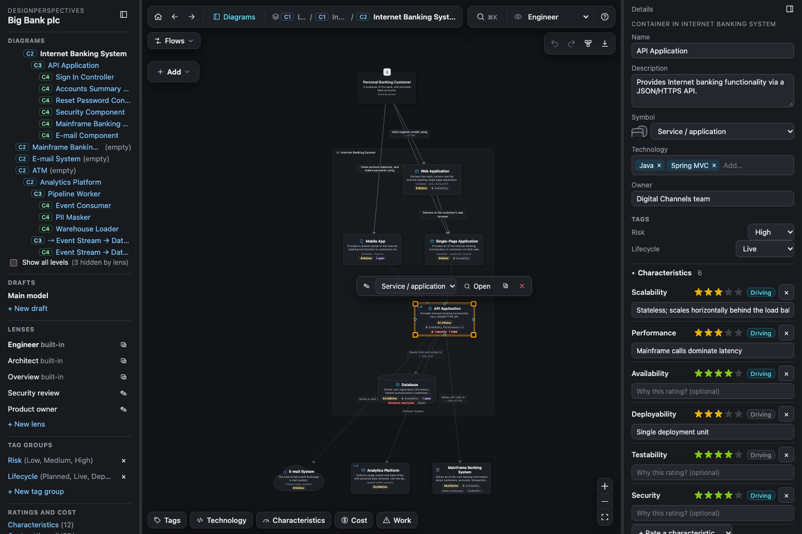
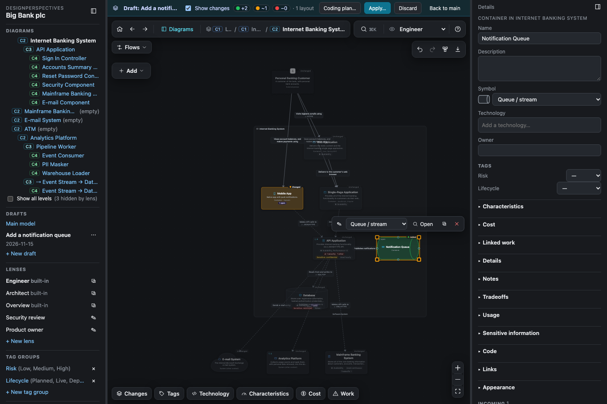

# designPerspectives

An open-source (MIT), model-based architecture tool using the [C4 model](https://c4model.com).
You describe your system once, as a model: people, software systems, containers, components and
the connections between them. Every diagram is a view of that model, so a change made once shows
everywhere.

- **Start from an empty canvas** and build the model by adding and connecting boxes.
- **Plan a change in a draft**: edit a copy of the model, see what was added, changed and removed,
  then apply it to the main model.
- **Lenses** show the same model differently for different audiences.
- **Comments, ideas and questions** on any box, line or diagram, with replies and a resolved state; every role can write them, a viewer too.
- The model is two JSON files in your repository (`architecture/`), written for clean `git diff`.
  It runs on your machine; nothing is sent anywhere.





Version **1.0.0**. Changes per version are in [CHANGELOG.md](CHANGELOG.md); how to contribute is in
[CONTRIBUTING.md](CONTRIBUTING.md); how to report a security problem is in [SECURITY.md](SECURITY.md).

## Run it

Requires Node.js 20.11 or later. The browser UI ships inside the package; nothing else is needed.

```bash
npm install -g github:AbhishekR3/designPerspectives
# or, from a clone:  npm ci && npm link

mkdir my-architecture && cd my-architecture
dp serve            # creates architecture/ with an empty model if none exists, opens the browser
dp serve --demo     # same, but a new folder gets the sample model, its sample code and a made-up git history;
                    # also runs the demo bank web app on 127.0.0.1:4200
```

New here? [docs/demo-tour.md](docs/demo-tour.md) walks through the demo, a made-up bank modelled as it
runs in production (payments, fraud checks, notifications, monitoring), in about 30 minutes.

Other commands:

```bash
dp init             # create an empty model without starting the server (dp init --demo for the sample model)
dp serve PATH       # serve a model in another folder (PATH/architecture/)
dp serve --code-root SRC   # folder holding the source code components point to (default: the project folder)
dp serve --read-only       # viewer role: nothing can be changed
dp serve --port 9000 --no-open
dp serve --allow-host NAME   # also answer to this host name (tunnel or proxy in front)
dp serve --allow-ui-host NAME   # let the live UI inspector open an app on this host
dp serve --traces FOLDER     # OpenTelemetry trace files (OTLP JSON) to read (default: PATH/traces)
dp check            # check the model, its drafts and its code mapping; exit code 1 on problems
dp check --strict   # also fail on warnings (mapped code paths that do not exist); `dp validate` = `dp check`
dp diff --base main          # what changed in the model since a git branch/tag/commit, as Markdown
dp diff --base v1 --head v2 --format json --out diff.json
dp diff --base origin/main --exit-code   # exit code 1 when the model changed
dp plan <draft>                    # coding plan for a draft, as Markdown
dp plan <draft> --check            # check the plan against the working copy; exit code 1 while steps are open
dp plan <draft> --against <branch> # check the plan against a git branch, tag or commit
dp users init                     # sign-in: create architect, engineer and viewer (passwords printed once)
dp users add NAME --role ROLE     # add a user; also: dp users passwd NAME, dp users remove NAME, dp users list
dp --version
```

The server listens on `127.0.0.1:8765` only. It answers only requests addressed to localhost and refuses changes sent from other websites. Hidden files and folders (names starting with a dot) in the code folder cannot be opened. Stop it with Ctrl+C.

Model files written by the earlier Python version (0.2) open unchanged.

## Sign-in and roles (optional)

Sign-in is off by default. A project turns it on by having a users file at `.dp/users.json`, which `dp users init` creates. The app then asks for a name and password, and the role decides what each person can change. The server checks every change, so the browser cannot bypass the rules.

```bash
dp users init                       # create architect, engineer and viewer with random passwords (printed once)
dp users add NAME --role engineer   # add a user; --password-stdin reads the password from standard input
dp users passwd NAME                # set a new password
dp users remove NAME
dp users list
dp serve --users FILE               # use a users file in another location
```

| Role | Can do |
|---|---|
| Architect | Everything: the main model, drafts, applying a draft, real code files |
| Engineer | Reads everything; creates drafts and edits any draft; cannot change the main model, write code files or apply a draft; can discard only drafts they started |
| Viewer | Reads everything; changes nothing |

Git versions are read-only for everyone. Sessions end after 12 hours without activity and are lost when the server restarts. Five failed sign-ins lock a name for 30 seconds.

What it is not:

- Not real-time. Two people editing the same thing: the last write wins, and the other sees it when the window regains focus.
- Not data hiding. Lenses choose what is shown first; a viewer can still read costs and notes through the API.
- Not safe on a network without HTTPS. Passwords travel in clear text, so put a TLS proxy in front of the server.

The users file holds password hashes and must not be committed. `.dp/` is added to `.gitignore`.

## Files

| File | What it holds |
|---|---|
| `architecture/workspace.json` | A [Structurizr](https://github.com/structurizr/structurizr) workspace: elements, relationships, views, positions, flows. Readable IDs (`api-application`), stable formatting for `git diff`. |
| `architecture/comments.json` | Comments, ideas and questions about elements, relationships and diagrams, with replies and resolved state. Created with the first comment. |
| `architecture/designperspectives.json` | Tag groups, lenses, the list of characteristics and cost settings (data Structurizr has no place for). |
| `architecture/drafts/<id>/` | A draft (planned change): its own `workspace.json` and `designperspectives.json`, `draft.json` (title, description, date, and optional `branch` and `link`) and `base/` (the main model when the draft was made, used when applying it). `code.json` and `code/` hold planned code edits, kept out of your code folder until apply. |

designPerspectives data stored inside the workspace as Structurizr element properties:
`dp.owner`, `dp.links`, `dp.tag.<Group>` (e.g. `dp.tag.Risk = High`), `dp.archType` (symbol),
`dp.notes`, `dp.tradeoffs`, `dp.usage`, `dp.sensitive`, `dp.code.paths`, `dp.characteristics`, `dp.cost`,
`dp.work`, and on relationships `dp.kind`, `dp.stages` (the steps inside a pipeline or protocol, each with
optional sample data), `dp.example` and `dp.format` (a sample of the data the relationship carries),
`dp.endpoints` (HTTP calls it carries, for the live UI inspector) and `dp.work`; elements can have `dp.ui.url`
(where their UI runs).

The sidecar also holds per-object `styles` (colours, line style, text size) and per-diagram
`layouts` (box sizes, line anchors/bends/label positions; box positions for connector and code
diagrams).

## What you can do

- Model people, software systems, containers, components and relationships.
- Landscape, context, container and component diagrams; double-click to go down a level,
  breadcrumb to go back. Connections between elements inside boxes show at higher levels as
  dashed *derived* lines.
- Add, move, connect, edit and delete on the canvas; auto-layout; positions saved per diagram.
- Object panel: name, description, technology, owner, links, tags, incoming/outgoing connections.
- Tag groups (e.g. Risk: High/Medium/Low) as overlays with a legend; every coloured box also
  carries a text badge.
- Flows: ordered steps over relationships with a step-through player.
- Lenses: the built-in **Engineer** lens plus your own (visible levels, default overlay,
  hidden tag groups, what each box shows).
- Export a diagram as SVG or PNG.

Stage A2 additions:

- **No overlap**: auto-layout is layered (ELK) with room for labels; new boxes are placed in the
  nearest free spot; a box dropped onto another moves to the nearest free spot.
- **Levels in the sidebar**: C1 (landscape, context), C2 (containers), C3 (components, connector
  detail), C4 (code), each indented under its parent. The breadcrumb shows the same tags.
- **Connectors have an inside**: double-click a line to open its connector detail: the stages of a
  pipeline or protocol (e.g. consume, mask, load), each optionally linked to the component that
  implements it. A line drawn between higher-level boxes opens where its relationship is drawn.
- **Sample data on pipelines**: click a line to see a sample of what it carries; for a pipeline, the
  sample entering it and the sample leaving each stage, with the fields each stage adds, removes or
  changes marked, so a reader sees what the pipeline does to the data.
- **Live UI inspector**: give a UI element the address it runs at and click **Inspect live UI**. The
  app opens inside dp; click in it and the side panel lists the HTTP calls each click made, the
  relationships they match (endpoints such as `POST /api/payments` on relationships), the data sent
  and returned next to the documented example, what those calls lead to in the model, and the flows
  involved. A call the model does not know can be added as an endpoint in one click. Works in a
  browser on the machine running `dp serve`; apps on other hosts need `--allow-ui-host <name>`.
- **Traces**: dp reads OpenTelemetry trace files (OTLP JSON, as the Collector's file exporter writes
  them). The inspector tags each call with a trace ID, finds its trace, and shows the path the request
  really took through the model, element by element, marking steps and services the model does not
  have. Spans are matched to elements by the file they ran in (code mapping) or by service name.
- **Backtrack**: from any pipeline stage or flow step, go back through the earlier steps: each
  step's sample data, one field's value through every step (where it appeared and changed), the
  code behind each step with its functions, and the git commits that changed that code or that part
  of the model. Steps changed in the last 14 days (or not yet committed) are marked, and the
  functions a recent change touched are highlighted.
- **Code level**: map a component or connector to files or folders; the C4 code diagram shows the
  files as boxes and the imports between them (Python and JS/TS scanned). Double-click a file to
  edit it in the browser; it saves to the file on disk (only inside the code folder).
- **Technology as tags** (suggestions from the model), **symbols** per architecture type (database,
  queue, pipeline, web, mobile, cache, storage, cloud, document, service), **notes**, **tradeoffs**,
  **usage** (who, how often), and **sensitive** labels (public to restricted) on objects; lenses
  choose which of these sections and badges show.
- **Direct editing on the canvas**: resize boxes, connect from any side, drag line ends to any
  point on a box, bend lines, straight/curved/right-angle lines, slide a line's label, colours,
  line style/width, text size, arrows, duplicate, undo/redo (Ctrl/Cmd+Z), copy/paste (Ctrl/Cmd+C/V/D), arrow-key nudge, Back/Forward between diagrams, a Download menu (PNG/SVG), details tables on objects, example data per flow step, drag the sidebar edges.
- `dp serve --read-only` gives a viewer role: nothing can be changed.

Stage A3 additions:

- **Canvas-first layout**: dark canvas with floating controls. Top left: home, back/forward,
  Diagrams (shows/hides the diagram list), breadcrumb; below it the **Flows** menu and the flow
  step card (Introduction, Step n of N, Conclusion; Restart/Back/Next; message direction, from/to).
  Top right: search (Ctrl/Cmd+K), lens switcher, help, and the add/undo/redo/auto-layout/download
  tools. Boxes are dark cards with an icon, name, description and type.
- **Overlay dock** (bottom left): Tags, Technology, Characteristics and Cost. Pick one to colour the
  boxes; each value shows how many boxes have it. Click a value to **Focus** on those boxes (the rest
  dim) or **Hide** them. Overlays stay on while a flow plays.
- **Architecture characteristics** ("-ilities"): rate an object 1–5 on scalability, deployability,
  testability and others (the 1–5 star scale Richards & Ford use for architecture styles), mark
  the *driving* ones, and note why. The list is editable.
- **Cost**: monthly cost lines per object; systems and containers show the total of everything
  inside them. Cost bands (Free to Very high) and the currency are editable.
- A lens's default overlay can now also be a characteristic, cost or technology.

0.2.0 additions:

- **Add palette** (left of the canvas): Container, Service / API, Web app, Mobile app, Database,
  Cache, Queue / stream, Pipeline / job, File storage, Cloud service, Document, and, where they fit,
  Component, Software system, External system, Person, Stage. Drag one onto the diagram to place it
  there, or click it to add it in the nearest free spot; its name is ready to type on the canvas.
- **Connect to empty space**: drag from a box's dot to an empty part of the diagram to add a new
  box there, already connected.
- **Edit on the canvas**: select a box, then click its name (or press F2) to rename it. The bar above
  a selected box changes its symbol, opens what is inside, duplicates or deletes it.
- **Line labels slide along their line** only; they can no longer be pulled off it.
- **Line shapes**: straight, curved through a bend point, smooth S-curve, right angles, rounded right
  angles. **Line patterns**: solid, dashed, dotted, dash-dot, long dash. **Arrowheads**: filled,
  open, diamond, open diamond, circle, bar.
- **Linked work**: link boxes and lines to security issues, pull requests, issues, backlog items and
  required updates (title, link, status, severity). Boxes show open items; the **Work** overlay
  colours boxes by their most severe open item.
- `dp --version`, `GET /api/health`, a recovery screen if the page hits an error, code-file saves
  that keep permissions and never leave half-written files.

Stage C1 additions (planned change):

- **Drafts**: start a draft from the sidebar (Drafts → + New draft). It is a copy of the model you
  edit like the main one (with its own undo history); the main model is not touched.
- **Changes overlay**: in a draft, boxes and lines are coloured added / changed / changed inside /
  removed against the main model as it was when the draft was made. Removed objects stay on the
  diagram as faded, read-only ghosts. The panel lists every change; a changed object shows its fields
  before and after.
- **Apply or discard**: Apply merges the draft into the main model as one undoable step. Changes made
  to the main model since the draft was made are kept; if both changed the same object, Apply is
  refused and lists the conflicts. Discard deletes the draft.
- **Compare with git** (C2): when the project is in a git repository, pick a branch, tag or commit
  under Drafts → Git and press **Compare** to see what changed since then, with the same overlay;
  **Open** shows that version read-only. Needs the `git` command.
- **In CI** (C3): `dp check` fails the build on model problems; `dp diff --base <ref>` writes a
  Markdown summary for a pull request comment. Sample workflows are in
  [docs/examples/ci/](docs/examples/ci/).

Stage C4 additions (planned code changes). See [docs/planned-change.md](docs/planned-change.md):

- **Code edits in a draft**: open a mapped file from a code diagram and edit it, add a planned file,
  or plan a deletion. Saves go to the draft (`code/`), not to your code folder, and the code diagram
  shows them as changed or added files. Saves are refused when comparing with a git version.
- **Coding plan**: Drafts strip → **Coding plan…** lists the work the draft implies (build, remove,
  change, connect, disconnect, flow, file). Paths and imports are checked automatically. Set the branch
  the code will be written on, check against the code folder or a branch, or copy the plan as Markdown.
  On the command line: `dp plan <draft>`.
- **Apply with code**: the apply dialog can also write the planned code edits ("Also write the planned
  code edits"). A file changed, removed or created in the code folder since it was planned is reported
  as a conflict.
- **`dp diff` covers code**: changed code files behind mapped objects are listed and count toward
  `--exit-code`. `--no-code` leaves them out.
- **Right-click menus**: on a box (open, rename, symbol, external, cut/copy/paste/duplicate, copy and
  paste style, reset size, delete), on a line (open the connector, edit the label, line shape, arrows,
  reset the line, copy and paste style, delete) and on empty canvas (add any palette item at that
  spot, paste there, undo/redo, auto-layout, fit and zoom, go up a level, download). Items that do
  not apply (read-only server, flows, objects from a compared version) are left out. Arrow keys,
  Enter and Escape work in the menu.

Stage P2 additions:

- **Start empty**: `dp serve` and `dp init` make an empty model; `dp serve --demo` loads the sample
  model with its sample code. An empty landscape shows a "Start your architecture" card with three steps.
- **Lenses**: the built-in **Architect** lens (all levels and sections) and **Overview** (landscape and
  context only, fewer sections). The default is Architect until the model has a container, then
  Engineer. Your pick is remembered per project folder.
- **Move**: a container can move to another software system, and a component to another container.
  A move is refused when the name is already taken there.
- **Readable IDs**: the first rename of a new box also renames its ID, so `new-system` becomes `loans`.
- **Add and connect**: a person or software system added on a context, container or component diagram
  comes with its line. Dragging a line onto empty canvas offers the kinds the diagram can add.
- **Several boxes**: Shift+click or Shift+drag to select them. Move, nudge or delete them together, with
  one undo step.
- **Sidebar**: every software system is listed. A system with no containers is marked "(empty)".

Stage P3 additions:

- **Drafts with a title**: a new draft has a title and an optional description. Drafts show their author
  (from `git config user.name` for now) and date. Rename, edit the description or discard from the row menu.
- **How far main moved**: a draft shows "main +N", the number of objects main changed since the draft started.
- **Planned files from the element panel**: "+ New planned file" creates the file and maps its path in one step.
- **Newer versions picked up**: when the window regains focus, the UI reloads if the model changed, for
  example after a git checkout, in another tab or from the CLI.
- **Safer version switching**: a draft or git ref that cannot load keeps the previous version on screen,
  with the error shown. A main model that cannot load has a Retry button.
- **Right-click menu**: scrolling inside it no longer closes it; Shift+F10 or the menu key opens it.

Plan and limits: [docs/planned-change.md](docs/planned-change.md).

## Develop

Everything is TypeScript: the server, the CLI and the browser UI share one set of API types
(`src/shared/types.ts`), so a change to a response shape is checked on both sides by the compiler.

```bash
npm ci                          # server, CLI and test tools (also builds dist/)
npm test                        # unit and API tests (vitest): model, validation, diagrams, flows, connectors, code, API, CLI
npm run typecheck
npm run dp -- serve             # run the CLI from source (tsx), e.g. `npm run dp -- validate`

cd ui && npm ci && npm run dev  # UI dev server on :5173, proxies /api to dp serve on :8765
npm run build                   # (in ui/) writes the UI into static/

npx playwright install chromium # or set DP_E2E_CHROME to a Chrome/Chromium binary
npm run test:e2e                # browser tests (need the built UI)
npm run make-demo               # regenerate the bundled demo model (demo/)
```

Layout:

| Path | What it holds |
|---|---|
| `src/shared/types.ts` | API types and constants used by both the server and the UI |
| `src/core/` | `workspace.ts` file format, `sidecar.ts`, `ops.ts` edits and rules, `diagrams.ts` what each level shows, `connectors.ts`, `code.ts`, `flows.ts`, `validate.ts`, `store.ts` files and undo |
| `src/server/app.ts` | HTTP API ([Hono](https://hono.dev)) and the static UI |
| `src/cli.ts` | the `dp` command |
| `ui/` | React UI with xyflow and elkjs; builds into `static/` |
| `demo/` | the bundled demo model and its sample code |
| `tests/`, `e2e/` | vitest and Playwright tests |

See `NOTICE` for the demo model's source.
