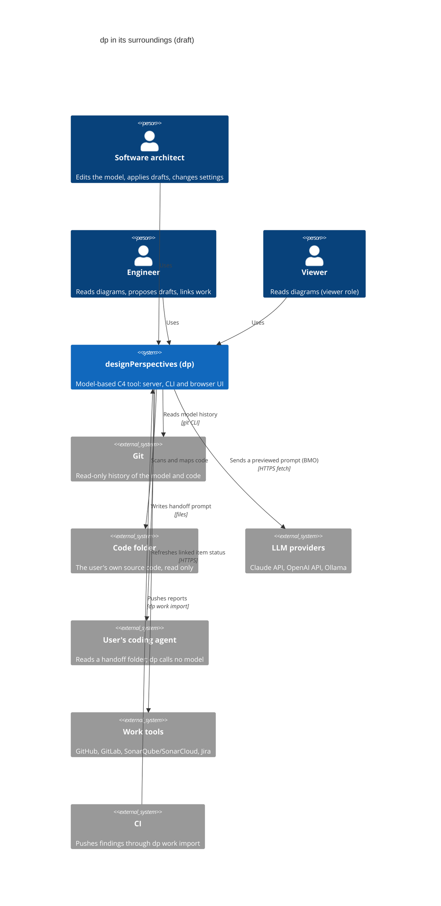
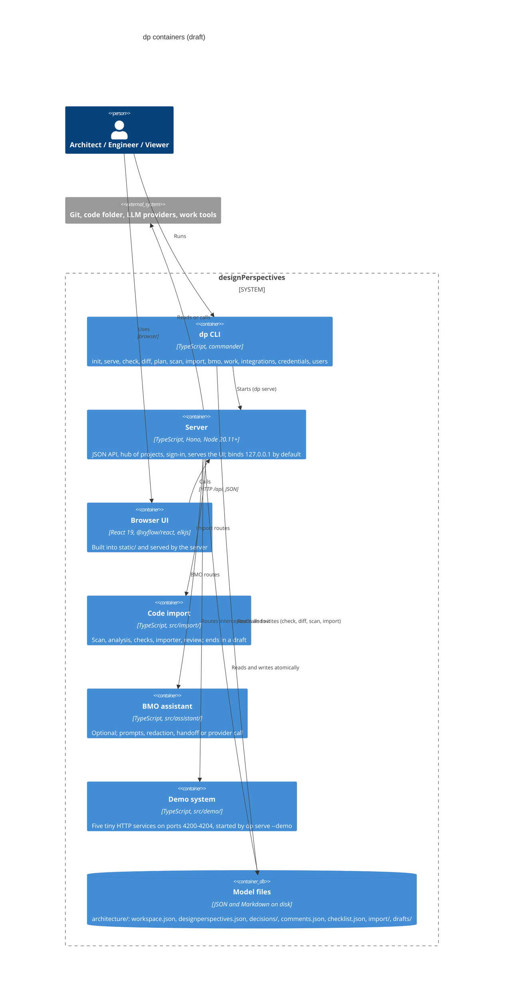
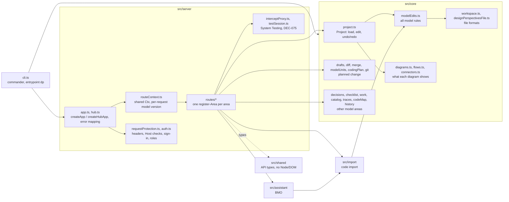
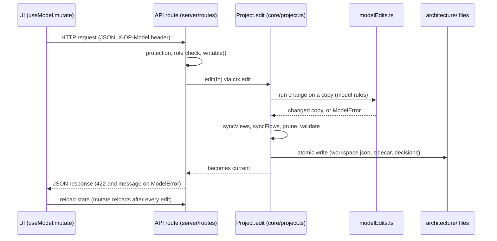

# designPerspectives architecture overview (draft)

> **Draft, written from .claude/CLAUDE.md and the source tree on 2026-11-20. Not generated from a dp model. Check against the code.**
>
> A real dp model of this repository does not exist yet. This page is a hand-written sketch for new contributors, for the owner to correct. Facts come from `.claude/CLAUDE.md`, the folder listing and the top comments of `src/cli.ts`, `src/server/app.ts`, `src/server/hub.ts` and `src/core/project.ts`. Anything not confirmed is marked "(unconfirmed)".
>
> **Checked 2026-11-20 against the source for six items that were unconfirmed** (where `users.json` and `credentials.json` live, the order of steps in `Project.edit`, how the CLI reaches the model, the work tool variants, two UI files, the `--hub` flag). Each is now stated as fact with its file. What is still unconfirmed is listed in section 6. The release checklist ([release-1.0.0-checklist.md](release-1.0.0-checklist.md), section 8) requires this page to be brought up to date again before 1.0.0, because the planned waves add folders, routes and containers.
>
> Diagram syntax: levels 1 and 2 use Mermaid's C4 syntax (`C4Context`, `C4Container`), which is experimental and may render differently between Mermaid versions. Level 3 uses a plain `flowchart LR`, because it needs more boxes than the C4 syntax lays out well.

dp is an MIT-licensed, model-based C4 architecture tool. One model (a Structurizr workspace on disk) feeds every diagram, and lenses present the same model differently per audience. Everything is TypeScript.

## 1. Context

Who uses dp and which outside things it touches. Every outside link is optional: dp runs with only a model folder.

Notes:
- Git is used only to read (`src/core/git.ts`, via the git CLI, DEC-018). The CI pipeline of dp itself is GitLab (DEC-089); the CI box above is any CI that runs `dp work import` or `dp check`.
- LLM calls happen only through BMO, which is off by default. The preview shows the exact prompt and its hash; a run is refused unless the hash matches.
- Work tools: adapters `github`, `gitlab`, `sonar`, `jira` in `src/core/workTools/`. Hosted and self-hosted variants both work through a connection with a base URL (`.dp/integrations.json`, `src/core/integrations.ts`): `github.com`, `gitlab.com` and `sonarcloud.io` are built in; GitHub Enterprise uses `<base>/api/v3`, self-hosted GitLab `<base>/api/v4`, SonarQube `<base>/api`, Jira `<base>/rest/api/2` and has no built-in host (`apiRoot` in each adapter). Whether each variant works against a real server has never been run (manual test plan U4).

## 2. Containers

The deployable and storable parts. The server and the CLI share one TypeScript code base in `src/`; the UI is a separate package in `ui/`.

Technologies from the sources: TypeScript throughout, Hono (server), commander (CLI), React 19 + @xyflow/react + elkjs (UI, Vite build to `static/`), Vitest (unit, API and CLI tests, `tests/unit/`), Playwright (browser tests, `tests/browser/`), ESLint and Prettier (config in `config/`), GitLab CI.

Other container-level facts:
- `static/` (built UI) is committed and shipped in the npm package; `dist/` (compiled server and CLI) is not committed.
- `.dp/` holds machine-local settings outside the model, git-ignored: `bmo.json`, `integrations.json`, `testing.json`, `users.json` (`<project>/.dp/users.json`, `src/core/users.ts`) and `credentials.json` (`<hub or project>/.dp/credentials.json`, mode 0600, `src/core/credentials.ts`).
- A hub (`dp serve --hub DIR`) serves several project folders from one server, with a shared catalog and one sign-in (DEC-054).
- Only `dp serve` builds the server app (`buildApp` or, with `--hub`, `createHubApp`, `src/cli.ts`). The other commands import `core/`, `import/` and `assistant/` directly and read or write the files themselves; none of them calls the server over HTTP.

## 3. Components of the backend

Folders under `src/`. Arrows mean "uses". The server never edits the model directly; it calls `core`.

One sentence each, from CLAUDE.md:
- **core/workspace.ts, designPerspectivesFile.ts**: read, check and write the Structurizr file format with stable key order, and the sidecar (tag groups, lenses, characteristics, cost, styles, layouts).
- **core/modelEdits.ts**: all edits go through here; it is the single home of model rules, and errors are `ModelError` (HTTP 422).
- **core/project.ts**: `Project` loads the files, reloads when they change on disk, runs `edit()` on a copy, syncs views and flows, validates and writes atomically, with undo/redo.
- **core/diagrams.ts**: computes what each diagram shows from the model; higher levels show derived edges.
- **core/drafts.ts, diff.ts, merge.ts, modelUnits.ts, codingPlan.ts, git.ts**: planned change; a draft is a copy of the model under `architecture/drafts/<id>/`, compared with `ChangeSet` and applied by three-way merge.
- **core/decisions.ts, checklist.ts, work.ts, catalog.ts, traces.ts, codeMap.ts, history.ts**: decision records, the checklist, linked work, the shared catalog, OpenTelemetry traces, the code level and git history with model diffs.
- **server/app.ts**: builds the shared context, installs middleware, mounts route modules in a fixed order and maps errors to responses.
- **server/hub.ts**: a hub of projects; builds each project's app lazily and passes `/api/*` to the project named by `X-DP-Project`.
- **server/routeContext.ts, requestProtection.ts, auth.ts**: the shared `Ctx`, the request protection (security headers, Host and cross-site checks, body limit, JSON only, viewer role) and sign-in, sessions and roles.
- **server/routes/**: thin routes, one `register<Area>` each (`readModel`, `drafts`, `model`, `sidecar`, `code`, `decisions`, `traces`, `testing`, `comments`, `checklist`, `hub`, `import`, `bmo`, `work`, `ui`).
- **server/interceptProxy.ts, testSession.ts**: System Testing; an intercept point is a listener on 127.0.0.1 that forwards HTTP/1.1 calls to a target, with one session per project.
- **import/**: brings a codebase into the model one C4 level at a time; scan, intake, analysis, checks, importer, review; review data stays in `architecture/import/`, never in the model.
- **assistant/**: the optional BMO assistant; the server builds every prompt and chooses every file; backends are handoff (writes a file, calls no model) and provider (Claude API, OpenAI API, Ollama with plain `fetch`).
- **shared/types.ts**: the API contract, re-exported by `ui/src/types.ts`; also `workLinks.ts`, `decisionAlerts.ts`, `secretFields.ts`.

## 4. How a change flows

A UI edit, as far as `CLAUDE.md` and the top comments describe it. Names of individual route functions are left out.

Points from the sources: an edit is refused if it adds a validation error; errors already in a file opened from elsewhere do not block unrelated edits; one request at a time per project, so no lock is needed; each draft is its own `Project` with its own undo history. In `Project.edit` (`src/core/project.ts`) the order is: reload if the files changed on disk, clone the workspace, sidecar and decisions, run the change, then `syncViews`, `syncFlows`, `prune`, sort the decisions, check `addedErrors` against the errors the files already had (a `ModelError` if any are new), push the undo snapshot (when recorded), and write.

## 5. Key rules

- All model edits go through `src/core/modelEdits.ts`; server routes stay thin.
- `src/shared/types.ts` is the API contract and must stay free of Node and DOM imports. `ui/src/types.ts` re-exports it.
- The built UI is committed in `static/` with fixed file names (`index.html`, `assets/app.js`, `app.css`, `diagram-layout.js`). After UI changes, rebuild and commit `static/`; CI fails if the build changes it.
- Data on disk: `architecture/workspace.json` (Structurizr workspace, stable key order, readable slug IDs, unknown fields kept) and `designperspectives.json` (the sidecar). Anything else per object goes in `dp.*` properties inside the workspace. Exceptions: `comments.json`, `checklist.json`, decisions as Markdown files, and `import/` review data.
- Requests choose the model version with the `X-DP-Model` header (`main`, `draft:<id>`, `ref:<git ref>`) and the comparison with `X-DP-Compare`.
- Code import and BMO output end as proposals: a draft, never a direct change to the main model.
- Everything is TypeScript; no other language.
- After changing model, ops or demo code, run `npm run make-demo` and commit `demo/`; after adding tests run `npm run test:list` and commit `tests/TESTS.csv`.
- Branch from `main`; do not commit directly to `main`.

## 6. Not shown and unconfirmed

Not shown:
- The UI's internal structure (`canvas/`, `hooks/`, `panels/`, `pages/`, `drafts/`, `inspect/`, `testing/`, `common/`, `styles/`), described in `.claude/CLAUDE.md` but not drawn here.
- Other folders: `config/` (tool settings), `docs/`, `demo/` (sample model, hub, traces, `web-app/`), `scripts/` (`make-demo.ts`, `make-demo-hub.ts`, `list-tests.ts`, `ci-local.ts`, `install-hooks.ts`, `write-folder.ts`), `tests/`.
- Per-route paths, the System Testing flow in detail, sign-in internals, `src/core/users.ts` and credentials encryption (`DP_SECRET_KEY`).

Unconfirmed:
- `src/server/routes/hub.ts` is described in CLAUDE.md as serving the hub-level routes; how a single project answers them "as a hub of one" is taken from CLAUDE.md, not read in code.
- Whether the arrows in section 3 match the real import graph (drawn from CLAUDE.md descriptions, not from reading imports).
- `ui/src/diagramCost.ts` and `ui/src/lineColours.ts` are not described in CLAUDE.md. From their header comments: `diagramCost.ts` works out the cost line of a diagram (the scope's own total, plus a second row for costly boxes outside it); `lineColours.ts` works out a diagram's own colours from the kind or the ID, stored nowhere, with hand-set styles and overlays winning. Neither is drawn here.
- Whether the UI folders and files added since 2026-11-20 are all listed (a tree comparison was made only for the two files above).

## 7. Questions for the owner

1. Should this overview become a real dp model of this repository (and then replace this page, or be generated into it)?
2. Where would that model live? `.gitignore` ignores `/architecture/` at the repo root (it is the output of a local `dp serve --demo`) and `/local/`. A committed model would need another folder (for example under `docs/`) or a change to that ignore rule, which also affects what a local `dp serve` in the repo root writes.
3. Should the UI get its own component diagram, or stay out of this overview?
4. Is the "CI" actor in the context diagram worth keeping, or should it be limited to dp's own GitLab pipeline?
5. Mermaid's C4 syntax is experimental. Is a flowchart-only version preferred for stability?
