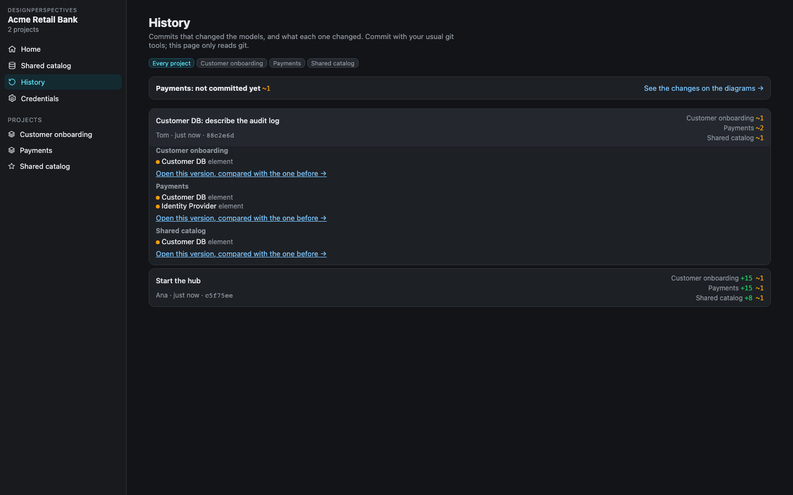
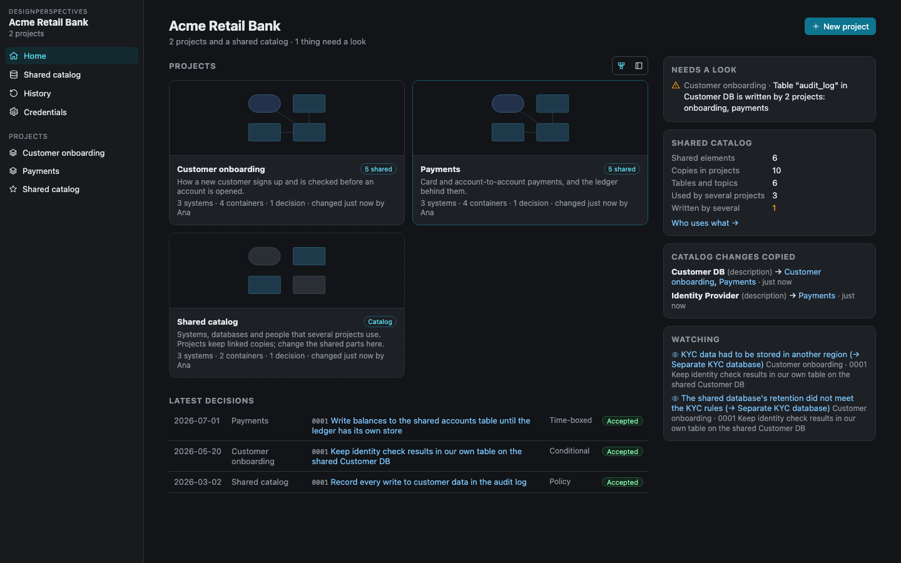
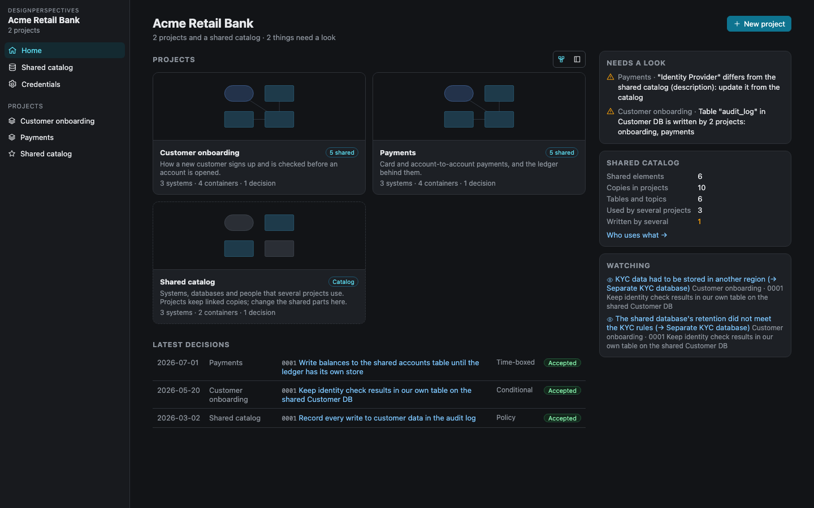
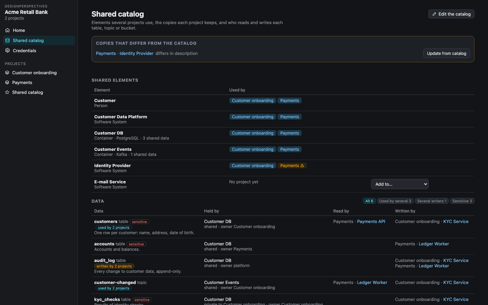
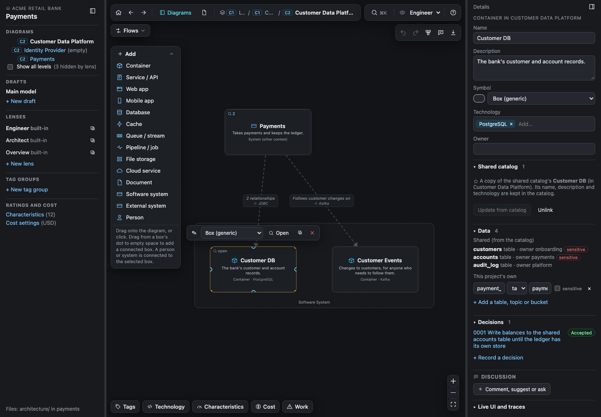
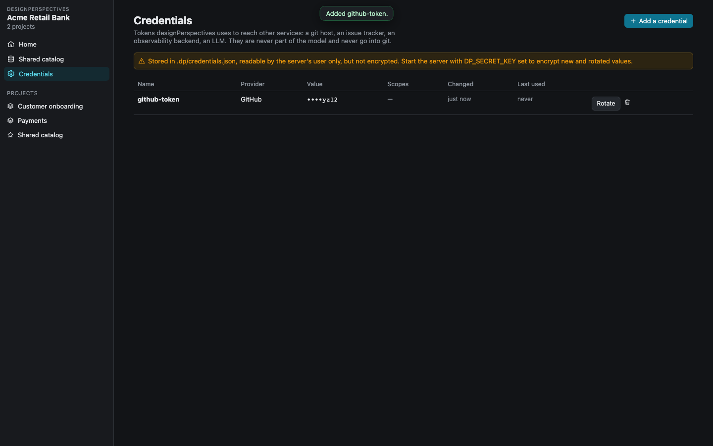
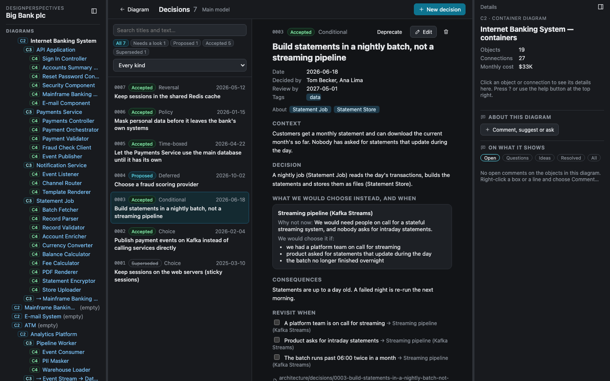
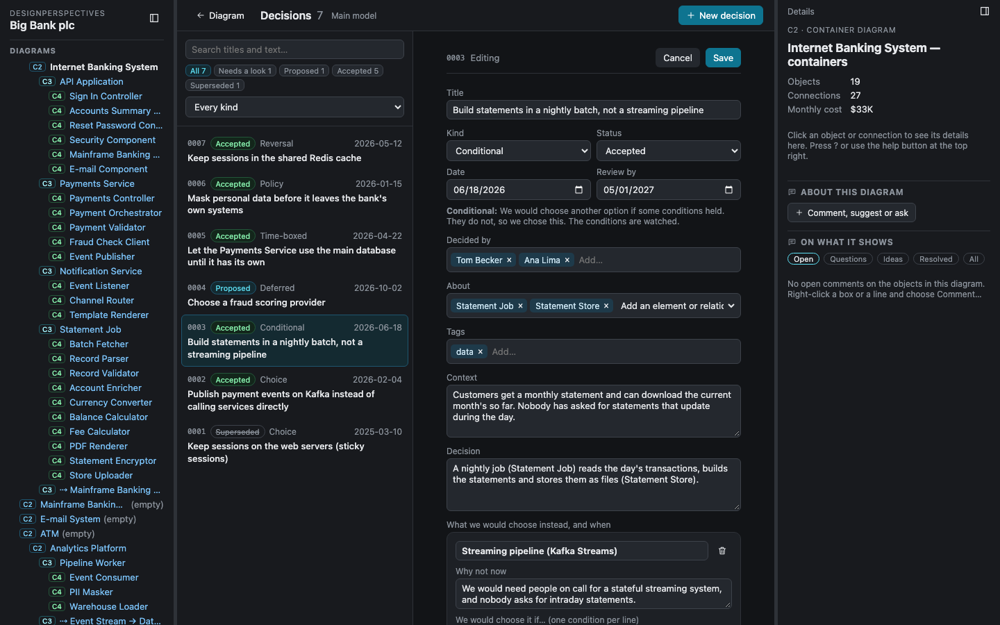

# Stage reviews

One section per stage or release, newest first: what was built, how it was checked, and the limits. Where a review asked questions, they are kept with the owner's feedback below them.
Owner questions from these reviews were answered on 2026-11-16 and are recorded in [decisions.md](decisions.md) under DEC-063.
File paths inside older sections are the paths at the time; see DEC-062 for the current layout.

## Contents

- [Release 0.4.0: one branch, answers applied, files regrouped, security fixes](#release-040-one-branch-answers-applied-files-regrouped-security-fixes)
- [Orthogonal line routing (stage 1 and routing around boxes)](#orthogonal-line-routing-stage-1-and-routing-around-boxes)
- [Stage H6 — roles per project, catalog copies that follow, history, GitHub status](#stage-h6--roles-per-project-catalog-copies-that-follow-history-github-status)
- [Stages H2–H5 — home page, hub, shared catalog and data, credentials](#stages-h2h5--home-page-hub-shared-catalog-and-data-credentials)
- [Stage H1 — decision records](#stage-h1--decision-records)
- [Sample data, the live UI inspector, traces and backtracking](#sample-data-the-live-ui-inspector-traces-and-backtracking)
- [Stage P6 — open-source readiness and release 1.0.0](#stage-p6--open-source-readiness-and-release-100)
- [Stage P5 — layout, overflow and polish](#stage-p5--layout-overflow-and-polish)
- [Stage P4 — optional sign-in with three roles](#stage-p4--optional-sign-in-with-three-roles)
- [Stage P3 — plan changes with drafts](#stage-p3--plan-changes-with-drafts)
- [Stage P2 — diagram from scratch](#stage-p2--diagram-from-scratch)
- [Stage R — refactor and dialogs](#stage-r--refactor-and-dialogs)
- [Stage P1 — security and core fixes](#stage-p1--security-and-core-fixes)
- [Stage C4 — planned code changes and the coding plan](#stage-c4--planned-code-changes-and-the-coding-plan)
- [Stage C — planned change (drafts, git compare, `dp check` / `dp diff`)](#stage-c--planned-change-drafts-git-compare-dp-check--dp-diff)
- [Rewrite in TypeScript (0.3.0)](#rewrite-in-typescript-030)
- [Release 0.2.0 review: editing on the canvas, linked work, production hardening](#release-020-review-editing-on-the-canvas-linked-work-production-hardening)
- [Stage A3 review: canvas-first layout, characteristics and cost](#stage-a3-review-canvas-first-layout-characteristics-and-cost)
- [Stage A2 review: feature round of 14 November](#stage-a2-review-feature-round-of-14-november)
- [Stage A review — Model and diagrams (Proof of Concept)](#stage-a-review--model-and-diagrams-proof-of-concept)

## Release 0.4.0: one branch, answers applied, files regrouped, security fixes

Date: 2026-11-16. Branch: `release/0.4`, which merges the two lines of work (hub, home, catalog, decision records and line routing) with the release work. Decisions: [DEC-062](decisions.md#dec-062--files-are-grouped-by-area-with-plain-names) (layout) and [DEC-063](decisions.md#dec-063--owner-answers-to-the-open-review-questions-release-040) (owner answers).

### What was built

| # | Item | Where |
|---|---|---|
| 0.4 | **One branch.** The hub, home, catalog and decision work and the line routing work are merged on `release/0.4`. The version is 0.4.0; the earlier number 1.0.0 was never tagged or published. | `CHANGELOG.md` |
| 0.4 | **Files regrouped (DEC-062).** Plain names in `src/core/`, one route module per area in `src/server/routes/`, the demo code in `src/demo/`, and UI folders `canvas/`, `panels/`, `pages/`, `drafts/`, `inspect/`, `hooks/` and `common/`. No behaviour change. | `src/`, `ui/src/` |
| 0.4 | **Owner answers applied (DEC-063).** Network bind needs sign-in, `--read-only` or `--insecure`; hidden code paths refused; engineers change only the drafts they started; Ctrl/Cmd+click selects; draft compare "Since it started" or "Against main now"; a sample draft in the demo; the apply dialog starts unticked when the draft has a branch; install from GitHub only; CI runs `dp check --strict` on the demo; the test runner and Prettier are upgraded and enforced. | `src/cli.ts`, `src/server/auth.ts`, `ui/src/drafts/`, `ui/src/canvas/Canvas.tsx`, `src/demo/`, `.github/workflows/ci.yml` |
| 0.4 | **Security fixes from the review.** Hub project folders added in the browser must be inside the hub and not hidden, and `hub.json` entries are checked on load; project IDs cannot be built-in object keys; GitHub links are checked before the stored token is used; `comments.json` is capped at 10 MB. | `src/server/hub.ts`, `src/core/users.ts`, `src/core/comments.ts`, `src/core/workStatus.ts` |
| 0.4 | **Search dialog.** Ctrl/Cmd+K is a modal dialog with a focus trap. | `ui/src/common/SearchBox.tsx` |
| 0.4 | **Hardening.** A timing-dependent drafts browser test was fixed. The install was tested from a packed tarball: 1.0 MB, 171 files; `dp init --demo`, `dp check` and `dp serve` all worked. | `e2e/`, `package.json` |

### How it was checked

Figures from the release run; they were not re-run for this docs pass.

- Typecheck, lint and Prettier pass.
- 424 unit and API tests and 147 browser tests pass.
- `npm audit` reports 0 vulnerabilities.
- `npm run make-demo` leaves `demo/` unchanged.
- The UI build is reproducible, so the committed `static/` matches a fresh build.
- Two Opus security reviews. Their findings are the fixes listed above.

### Limits

- Not run: Windows; Structurizr's own tools reading the files; CI on GitHub (the owner's steps); install from the GitHub URL.
- A hand-written `hub.json` is trusted. Its entries may still point outside the hub folder (DEC-054, DEC-063).
- A catalog architect changes names and descriptions in linked copies of projects where they have a lower role or none, because copies follow the catalog (DEC-057). Accepted for now (DEC-063).
- Drafts with no author (made before sign-in was turned on) are architect-only once sign-in is on.
- Two engineers cannot share one draft.

### Questions for the owner

None open. The next round is Stage B (codebase to model with an import file and drafts) and BMO (with a handoff backend first, then the Claude API, the OpenAI API and Ollama), planned for 0.5.0 (`docs/backlog.md`).

### Owner feedback

<!-- Please add feedback here. -->

## Orthogonal line routing (stage 1 and routing around boxes)

Date: 2026-11-15. Branch: `feat/orthogonal-routing`. Baseline: `feat/decision-records` (9e602dd), because `main` is behind the stacked branches. Decision: [DEC-052](decisions.md#dec-052--lines-use-right-angles-go-around-boxes-and-spread-out-on-each-side-of-a-box).

### What was built

| # | Item | Where |
|---|---|---|
| R1 | **Right-angle lines.** A line with no saved shape is drawn with rounded right angles. The menu and panel label is "Automatic (rounded right angles)". | `ui/src/routing.ts`, `ui/src/Canvas.tsx` |
| R1 | **Sides and spread ends.** `planPorts` picks a side for each end and spreads all line ends on one side along it, ordered by where the other end is. It avoids boxes when it chooses sides. It works on all lines of a diagram at once. | `ui/src/routing.ts` |
| R2 | **Routing around boxes.** `orthoRoute` is a right-angle path search with a cost per turn. Lines go around other boxes, with 15px clearance (5px when the gap is tight). If no way exists, the line keeps its old path. | `ui/src/routing.ts` |
| R2 | **Side switching.** When a box blocks the preferred sides, another pair of sides is chosen. | `ui/src/routing.ts` |
| R2 | **Label placement.** `defaultLabelT` and `placeLabels` put labels where they do not overlap other labels or boxes. `ui/src/labelSize.ts` estimates label sizes from the text. | `ui/src/routing.ts`, `ui/src/labelSize.ts` |
| R2 | **One pass per render.** `Canvas.tsx` routes all automatic lines in one pass on every render, including during drags. `C4Edge` only draws. | `ui/src/Canvas.tsx`, `ui/src/canvasParts.tsx` |
| R2 | **Bend points.** A dragged bend point is now a point the line passes through. | `ui/src/routing.ts` |
| R | Saved shapes, dragged ends, dragged bend points and dragged label positions still win. Nothing new is stored in the model. Routes are not saved, so model files and git diffs do not change. | |
| R | Tests: 29 unit tests, including a seeded random test over 200 diagrams, a determinism test and a check of the demo containers diagram geometry. Browser spec for routing. | `tests/routing.test.ts`, `e2e/routing.spec.ts` |

### How it works (one paragraph)

`ui/src/routing.ts` is a pure module with no imports. It takes the boxes and lines of one diagram and returns the route of each automatic line. `planPorts` first chooses a side and a slot on that side for each line end, so that line ends on one side do not meet at one point. `orthoRoute` then searches for a right-angle path between the two ends. The search adds a cost for each turn and treats other boxes as obstacles with clearance. `placeLabels` puts each label on a free spot near the middle of the line. `Canvas.tsx` calls these once per render for all automatic lines. Saved shapes and dragged parts win over the computed route, as before.

### How it was checked

- Unit tests: 29 in `tests/routing.test.ts`, including the seeded random test over 200 diagrams, determinism, and the demo containers diagram geometry.
- Full vitest: 312 tests pass.
- Browser tests: 124 pass. New tests in `e2e/routing.spec.ts` check that:
  - all segments are right angles;
  - line ends on the same box are at least 15px apart;
  - side-by-side labels do not overlap;
  - no line crosses a box other than its own two.
- `npm run typecheck`, `npm run lint` and the UI build pass.
- `npm run make-demo` leaves `demo/` unchanged.
- Measured on the demo containers diagram (19 boxes, 27 lines):
  - overlapping label pairs: 14 before, 0 after;
  - lines crossing boxes: 26 before, 0 after;
  - one full routing pass: about 1.7 ms median.

### Limits

- Lines can still sit on top of each other in a shared gap.
- Labels can still sit on neighbouring lines.
- Straight, curved and smooth lines are not routed around boxes or used in label placement.
- Side switching is skipped for lines with a hand-set end or bend point. Their path is still routed around boxes.
- Label size is an estimate. Fonts on another machine can differ slightly. The browser test allows up to 2 overlapping labels for this reason.
- A diagonal pair of boxes prefers an L shape. In crowded rows this can look busier than a Z shape.
- Existing diagrams change look on next open.
- A bend point saved earlier from a curved line can add turns, because it now sets a point the line passes through.
- Moving a box can move the ends of other lines on the same side.

### Questions for the owner

1. Should "Automatic" keep rounded corners, or should it use sharp right angles?
   - Answer [Owner]: Automatic = rounded corners.
2. Should a per-diagram default line shape be added to the sidecar?
   - Answer [Owner]: per-diagram default added (DEC-061, `layouts[<diagram>].lineShape`).
3. What should the next routing stage cover? The options are: separating lines in a shared gap, label-versus-line avoidance, ELK label sizes, and optional hops. Which comes first?
   - Answer [main session, not the owner]: stage-2 order chosen by the main session (lanes and label-vs-line first, in DEC-061). ELK label sizes, straight/curved/smooth routing and optional hops remain in the backlog.

### Follow-up (DEC-061)

Date: 2026-11-15. Decision: [DEC-061](decisions.md#dec-061--default-line-shape-per-diagram-lanes-and-make-room--spread-out).

#### What was built

| # | Item | Where |
|---|---|---|
| F1 | **Default line shape per diagram.** Stored as `layouts[<diagram>].lineShape` in the sidecar; absent means rounded right angles. Set from the diagram details panel ("Line shape"). "Automatic" names the diagram default. A change is a layout change in drafts and `dp diff`. | `src/core/sidecar.ts`, `src/server/routes/sidecar.ts`, `src/core/diagrams.ts`, `src/shared/types.ts`, `ui/src/lineShapes.ts`, `ui/src/App.tsx` |
| F2 | **Lanes and label avoidance.** Lines on the same coordinate through a gap are spread 10px apart (8px or 6px when tight), ordered so they do not cross at the ends. Near-straight lines (ends under 12px apart) are aligned. Labels avoid other lines (weight 8). | `ui/src/routing.ts` (`separateRoutes` and the `planPorts` jog pass) |
| F3 | **Make room and Spread out.** Toolbar and empty-canvas menu actions. Each is one undo step. | `ui/src/spread.ts`, `ui/src/Canvas.tsx` (`spread()`), `ui/src/menus.ts`, `ui/src/icons.tsx` |

#### How it was checked

- Unit tests: vitest 350 pass, including `tests/routing.test.ts` (42), `tests/line-shape.test.ts` (8) and `tests/spread.test.ts` (17).
- Browser tests: 132 pass, including routing (5), line-shape (2) and spread (4).
- `npm run typecheck`, `npm run lint` and the UI build pass. `npm run make-demo` leaves `demo/` unchanged.
- Demo containers diagram:
  - lines sharing a gap (overlaps): 6 before, 1 after;
  - labels crossed by another line: 19 before, 11 after;
  - line crossings: 21 before, 23 after;
  - one full routing pass: about 2.6 ms (1.7 ms in stage 1);
  - Make room moved 14 of 19 boxes.
- Spread out on 50 boxes: about 0.8 ms.

#### Limits

- Some labels now sit up to about 400px along their line from its middle.
- Labels crossed by a line are reduced, not removed (19 → 11, not 0).
- Total line crossings rose slightly (21 → 23), because separating lines on top of each other sometimes needs a crossing.
- Make room uses the routes and labels of the current drawing, so a second press right after can still find a little to do in rare cases.
- Boxes with exactly the same centre cannot be separated.

#### Questions for the owner

1. Should the explicit "Rounded right angles (default)" choice clear the `lineShape` key instead of storing `"rounded"`?
2. Should Make room / Spread out apply only to the selected boxes when several are selected?

### Review round (Opus) and fixes

Date: 2026-11-15. An Opus reviewer read the committed diff 9e602dd..cb2f833 and checked the findings with probe scripts. Nine findings, all fixed:

1. Every drag frame re-ran the whole routing pass. It took 2.6 s per frame on 100 boxes and 200 lines. Now only the lines touching the dragged box are re-routed (5–35 ms per frame), and a full pass runs on release. The router itself is faster: windowed obstacle search, binary-search blocking, A* search and local crossing counts. One full pass went from 2550 to 127 ms (scattered, 100 boxes and 200 lines) and from 134 to 21 ms (grid, same size). Demo containers take about 1.7 ms. Routes are identical to before on about 5,800 fuzz routes.
2. End grips of right-angle lines were drawn away from the real line ends. They now sit at the line ends.
3. Make room ignored boxes hidden by a filter and moved compare-mode ghost boxes. Fixed with the `fixed` option in `spreadLayout`.
4. Make room counted no lines or labels on non-right-angle diagrams. Fixed.
5. A doc comment in `separateRoutes` overstated the behaviour. Corrected; the code keeps the trade-off in DEC-061.
6. Several self-loops on one box always crossed. They now nest.
7. Jog straightening could fold a line back through its own box. It is refused now.
8. Boxes with centres within 8px were never separated. Fixed.
9. Touching boxes gave a route that looped inside the target. It is now a zero-length line.

Also from the review:

- Unknown `lineShape` values are kept on disk (see DEC-061).
- New tests fuzz the full Canvas routing pipeline with spacing 40, 5 and 0, with anchors and bend points.

Owner answers:

- Clearing the key: the main session chose to clear the key. The owner said "do whatever you think is best".
- Selected boxes: both the whole diagram and the selection [Owner].

Checks: typecheck and lint clean; vitest 388 passed (26 files); UI build; e2e 134 passed; `npm run make-demo` leaves demo/ unchanged.

### Owner feedback

Answered on 2026-11-16: see DEC-063 in [decisions.md](decisions.md).

## Stage H6 — roles per project, catalog copies that follow, history, GitHub status

Date: 2026-11-15. Branch: `feat/hub-roles-sync-history` (on `feat/home-hub`). Decisions: DEC-057, DEC-058, DEC-059.

This stage answers the owner's feedback on the H2–H5 questions:

| Question | Answer | What was built |
|---|---|---|
| 1. Roles per project in a hub? | Yes. | Roles per project (DEC-057). |
| 2. Update every copy from the catalog? | Yes, as soon as the change is saved to the catalog; plus "a Git for this project to understand changes", read-only. | Automatic copies (DEC-057); History page (DEC-058). |
| 3. Require `DP_SECRET_KEY`? | No, not for now. | No change. |
| 4. Which integration first? | "Keep it simple, go with whatever you think." | GitHub status for linked work (DEC-059). |
| 5. Tables as components? | No. | No change. |

### What was built

| # | Item | Where |
|---|---|---|
| H6-1 | **Roles per project.** `projects: {id: role}` in the users file. A project's app gives the request the user's role there. The role is read live, so there is no sign-out on change. `dp users role NAME ROLE [--project ID]`, and `dp users list` shows the project roles. `GET /api/hub` gives your role per project, shown on cards and in the rail. | `src/core/users.ts`, `Auth.projectRole` in `src/server/auth.ts`, `buildApp`, `src/cli.ts` |
| H6-2 | **Copies follow the catalog.** `Hub.syncCatalog` runs before each project request, after each catalog request, and on hub, home and usage. It is keyed by the catalog and project revisions, writes only when something differs, and is not an undo step. A copy whose new name clashes stays as drift. Off on a read-only server. | `src/server/hub.ts`, `syncCopies` in `src/core/catalog.ts` |
| H6-3 | **"Catalog changes copied"** on the home page: element, fields, and the projects with links to each copy. | `HomeSummary.catalogUpdates`, `HomePage.tsx` |
| H6-4 | **History.** Commits touching the model folders, per project or across the hub, each compared with its parent model: counts and up to 12 objects. It also shows what is not committed yet against HEAD, and links to each version compared with the one before. Cached per commit. | `src/core/history.ts`, `GET /api/history`, `ui/src/home/HistoryPage.tsx` |
| H6-5 | **GitHub status for linked work.** "Refresh status from GitHub" under Linked work. It reads issue and pull request states from api.github.com with the first `github` credential (or none, for public repositories). One undo step; it reports links it could not read and never returns the token. | `src/core/workStatus.ts`, `POST /api/work/refresh`, `ui/src/panels/WorkRefresh.tsx`, `CredentialStore.byProvider` |





### How it was checked

- **vitest**: 305 tests (up from 298), all pass.
  - `tests/hub.test.ts` (12):
    - the demo's drifted copy is brought up to date and listed
    - a catalog edit reaches both projects; undo of a project's own edit keeps the copy in step
    - a name clash stays as drift
    - a read-only hub writes nothing
    - roles per project: engineer here, architect there; a viewer who is an engineer in one project; changed live; bad roles refused; the last architect protected
  - `tests/history-work.test.ts` (5):
    - single-project history with model changes per commit and the uncommitted changes
    - hub history across projects and filtered to one
    - no git
    - GitHub refresh with a stubbed fetch: statuses changed, failures reported, the token sent but never returned, one undo step, the no-credential path, roles
- **Browser tests**: `e2e/hub.spec.ts` now has 6, adding "a catalog change reaches every project" and "history". The full browser run is in the commit's checks.
- Typecheck, lint and Prettier are clean on touched files. `npm run make-demo` is stable. `static/` was rebuilt.

### Limits

- **Writes during reads.** A project's files can change during a request that only reads: the first one after a catalog change. Git shows that change as uncommitted, and History lists it.
- **List of copies is not kept.** The "Catalog changes copied" list is in memory only (git history has the changes).
- **No "no access" role**: every signed-in user sees every project of the hub.
- **History load time.** History's first load runs one model diff per commit; the default is 20 commits, 100 at most.
- **GitHub only.** The status refresh covers github.com only, not GitHub Enterprise or other trackers, and only when asked.

### Questions for the owner

1. Should a role be able to hide a project entirely from someone (a "no access" role)?
2. Should catalog copies also be committed for you, or is "shown as uncommitted, then you commit" right (dp keeps git read-only today)?
3. Should the GitHub refresh also run on a schedule while the server is up, or stay a button?

### Owner feedback

- 2026-11-15, on the questions above:
  1. "Yes, a role should have no access to an entire project too." Built as role `none` per project (DEC-060): the project is hidden and every request to it is refused, on read-only servers too. Tested in `tests/hub.test.ts` ("no access…").
  2. "Do what you think is best." dp does not commit the catalog copies; they show as uncommitted and are committed with the team's own tools (recorded in DEC-057).
  3. "GitHub refresh is on demand only." Already so; recorded in DEC-059.

## Stages H2–H5 — home page, hub, shared catalog and data, credentials

Date: 2026-11-15. Branch: `feat/home-hub` (on `feat/decision-records`, H1). Decisions: DEC-053, DEC-054, DEC-055, DEC-056.

These stages finish the owner-approved plan "home page, multiple projects, shared catalog, decision records, credentials". The owner said "draw.io" where the plan had "flow.io". Its start screen (create from a blank diagram or a template, open a recent one) shaped "New project" with a choice of start.

### What was built

| # | Item | Where |
|---|---|---|
| H2-1 | **Home page summary**: a card per project with counts, drafts, problems, last commit and a landscape thumbnail drawn from stored positions. Also "Needs a look", "Watching" (triggers and dates), and the latest decisions. Cached by model revision. | `src/core/home.ts`, `src/shared/decisionFlags.ts`, `GET /api/home` |
| H2-2 | **Hub-level routes for one project.** `GET /api/hub` and the routes above answer for a single project too, as a hub of one. | `src/server/routes/hub.ts`, `buildApp` in `app.ts` |
| H2-3 | **Home page UI**: a left rail (Home, Shared catalog or Data, Credentials, projects); project cards or a list; every item links to its diagram, decision, draft or element. | `ui/src/Root.tsx`, `ui/src/home/Shell.tsx`, `HomePage.tsx`, `styles/home.css` |
| H2-4 | **One-time reveal.** A home-page link to an element (`reveal=`) opens its diagram with the element selected. The sidebar's top line links home. | `App.tsx`, `Sidebar.tsx`, `useNavigation.ts` |
| H3-1 | **Hub server**: `hub.json` (checked: IDs, duplicates, folders that hold the hub or another project). Each project's app is built on first use. Requests are passed on by `X-DP-Project`. There is one shared sign-in, and the file is re-read when it changes. | `src/server/hub.ts` |
| H3-2 | **New project** from the home page (architects): a blank model or the demo. | `POST /api/hub/projects`, `NewProjectDialog` |
| H3-3 | **CLI**: `dp init --hub [--demo]`, `dp serve --hub`, `dp check --hub`. | `src/cli.ts` |
| H3-4 | **Demo hub**: a catalog and two projects (onboarding, payments) sharing a Customer DB. It has shared tables, a private table each, `audit_log` written by both, and one copy that drifted from the catalog. Generated by `make-demo`. | `scripts/demo-hub.ts`, `demo/hub/` |
| H4-1 | **Linked copies** (`dp.catalog`): shared fields are refused in projects. Add from the catalog, Link, Update from catalog and Unlink are explicit edits. A duplicate is not linked. | `ops.ts`, `src/server/routes/catalog.ts` |
| H4-2 | **Data** (`dp.data`: tables, topics, buckets, …) and **data access** (`dp.data.access`: read or write per relationship). | `ops.ts`, `shared/types.ts`, `diff.ts` |
| H4-3 | **Usage across projects**: who uses each shared element; drifted and missing copies; readers and writers of each asset; flags for "used by several projects" and "written by several projects"; unknown data. | `src/core/catalog.ts`, `GET /api/catalog/usage` |
| H4-4 | **Catalog page** (Data in a single project) with Update and Add to… actions. **Panels**: Shared catalog, Data, and Data access sections, the last also on derived lines. | `ui/src/home/CatalogPage.tsx`, `ui/src/panels/DataSections.tsx`, `ui/src/useCatalog.ts` |
| H5-1 | **Credentials store**: `.dp/credentials.json` (0600, gitignored). Values are encrypted with AES-256-GCM when `DP_SECRET_KEY` is set (scrypt key per value, name and provider bound in); otherwise they are stored as plain text and the page says so. Locked with the wrong key. Values are write-only; the masked hint shows the last 4 characters. | `src/core/credentials.ts` |
| H5-2 | **Routes, CLI and page**: the `admin` action (architects; refused on a read-only server); `dp credentials list/add/rotate/remove` (values from stdin); the Credentials page. | `routes/credentials.ts`, `auth.ts`, `cli.ts`, `ui/src/home/CredentialsPage.tsx` |









### How it works (one paragraph)

`dp serve DIR --hub` reads `hub.json` and serves each listed project folder through its own, unchanged project app, chosen by a request header. The browser shows a home page above the projects: what each one holds, what needs a look and what is being watched. Shared things live once in the catalog project. Each project keeps a linked copy of what it uses, and lists which tables those copies hold and which of its relationships read or write them. The catalog page then answers "who uses this table, and who writes it" across projects. Credentials for future integrations are stored next to the hub, outside git. Their values are never shown again, and they are encrypted when a key is given.

### How it was checked

- **vitest**: 298 tests, up from 283.
  - `tests/hub.test.ts` (10): single-mode home and data use; header routing and isolation; home attention; usage flags; linked-copy rules and catalog actions; one sign-in across projects; admin-only project creation; `hub.json` and folder checks; `dp init --hub`; `dp check --hub`; a broken project shown on its card.
  - `tests/credentials.test.ts` (5):
    - a planted secret appears in no response
    - the file is mode 0600 and in `.gitignore`
    - code routes cannot read it
    - encryption round trip, the wrong key shows "locked", and a value moved to another entry does not open
    - roles and a read-only server; hub storage; the CLI
- **Browser tests**: 125 pass, including 4 new in `e2e/hub.spec.ts`:
  - the home page, a drifted copy fixed from its element panel, and back home
  - a new project from a template
  - the catalog page's filters and "Add to…"
  - data access set on a (derived) line
  - credentials whose value never shows on the page
- **A bug the full run found**: the home page's `.card` class also matched the canvas boxes (`card` is a box class) and broke three existing tests. It was renamed to `p-card`.
- **Other checks**: typecheck, lint and the UI typecheck are clean. `npm run make-demo` is stable. Screenshots were checked at 1440 × 900. Runs were on macOS only.

### Changes from the plan

- **Per-project apps.** The plan proposed a "getter view" over one shared context so route modules would not change. They capture `ctx` fields when they register, so each project gets its own app instead. Route modules are still unchanged.
- **One commit for four stages.** H2–H5 share files (`routes/hub.ts`, `app.ts`, `hub.ts`, `types.ts`, `api.ts`, the shell), so they are one commit with one review instead of four.
- **No `--credentials FILE` option.** The file is always `.dp/credentials.json` in the served folder.
- **No catalog marker on boxes.** Linked copies are not marked on the canvas yet (a box badge would be the next step).

### Limits

- **Roles** are global in a hub.
- **Memory**: every loaded project stays in memory.
- **First load**: `dp check` runs per project on the first home load after a change, which is slow for large hubs.
- **Thumbnails** use stored positions only; a never-laid-out landscape shows a grid.
- **Data access** is per relationship. A service that reaches a database without a modelled relationship is not counted.
- **Catalog changes** show as drift in every copy until each project chooses "Update from catalog". This is deliberate; nothing is rewritten across projects.
- **Credentials** are plain text on disk (mode 0600) without `DP_SECRET_KEY`. There is no "test connection", and nothing uses them yet.
- **Concurrent edits.** Another session was editing `docs/backlog.md` and `docs/decisions.md` in this working tree (DEC-051). These commits include only this work's lines; `backlog.md` is not touched.

### Questions for the owner

1. Should roles be per project in a hub (for example, an engineer on payments but a viewer on onboarding)?
2. Should "Update from catalog" also be offered as "update every copy" from the catalog page, as one draft per project?
3. Should `DP_SECRET_KEY` be required before any credential is stored, rather than optional with a warning?
4. Which integration should use the credentials first (GitHub issue and pull request status on linked work, or trace backends)?
5. Should tables also be drawable as components on demand (for a data-centric view), or stay a list?

### Owner feedback

Answered on 2026-11-16: see DEC-063 in [decisions.md](decisions.md).

## Stage H1 — decision records

Date: 2026-11-15. Branch: `feat/decision-records`. Baseline: `feat/diagram-comments` (commit 53909cb). Decisions: DEC-050.

This is the first stage of the owner-approved plan "home page, multiple projects, shared catalog, decision records, credentials". The plan's later stages are listed at the end, under "What comes next".

### What was built

| # | Item | Where |
|---|---|---|
| H1-1 | **Decision record files**: `architecture/decisions/NNNN-slug.md`. A small fixed front matter, `# Title`, then fixed sections. Unknown sections and keys are kept. An unreadable file is reported and never rewritten. Parse → write is byte for byte. | `src/core/decisions.ts` |
| H1-2 | **Six kinds**, each with its own fields and hints: choice, conditional, deferred (`decide-by`), time-boxed (`expires`), policy (`applies-to`) and reversal (`supersedes`). Five statuses. Accepting a reversal marks the decisions it replaces as superseded, both ways. | `src/shared/types.ts`, `src/core/decisions.ts` |
| H1-3 | **Decisions are part of the model.** `Project.edit(fn(ws, sc, decisions))` covers them, with undo and redo. They are noticed when changed on disk. Drafts copy them, with `base/`. They are `dec:<file>` units for the diff and the three-way merge, and they are read from git versions. | `store.ts`, `units.ts`, `diff.ts`, `drafts.ts`, `git.ts`, `validate.ts` |
| H1-4 | **Renumbering on apply.** A number used in both main and the draft is renumbered on the draft's side, and its links follow. | `renumberAdded` in `decisions.ts` |
| H1-5 | **Checks and reports.** Model errors: an unreadable file, two files with one number, a link to a missing decision, a bad date. `dp check` warns about decisions on removed objects. `dp diff` has a Decisions table. | `validate.ts`, `report.ts` |
| H1-6 | **API**: `GET /api/decisions[/:id[/markdown]]`, `POST /api/decisions`, `PUT` and `DELETE /api/decisions/:id`, `PATCH /api/decisions/:id/status`. The routes are version-aware and use the `edit` action in `ROUTE_RULES`. `AppState.decisions` lists summaries. | `src/server/routes/decisions.ts`, `auth.ts`, `context.ts` |
| H1-7 | **Decisions page** over the diagram, opened from **Decisions** in the navigation bar. It has filters (status, kind, "needs a look", search), each decision's record, and a form editor. | `ui/src/DecisionsPage.tsx`, `ui/src/DecisionEditor.tsx`, `ui/src/styles/pages.css` |
| H1-8 | **The conditional decision** (the owner's example). Each alternative has "Why not now" and "We would choose it if…". **Watch the alternatives' conditions** turns those conditions into revisit triggers. A met trigger flags the decision as needing a look, on the page and as a count on the navigation button. | `DecisionEditor.tsx`, `DecisionsPage.tsx` |
| H1-9 | **Element and relationship panels**: a Decisions section listing the decisions about the object, with **Record a decision**. "About" chips on a record jump to the object on its diagram. | `ui/src/panels/DecisionSection.tsx` |
| H1-10 | **Change list**: a "Decisions" group in a draft's changes and in the apply preview. Clicking one opens the decision. | `ChangesPanel.tsx` |
| H1-11 | **URL.** The page lives in the URL as `p=decisions[/<id>]` on the diagram hash. Back closes it, the model version is kept, and a link to a decision in a draft works. | `usePage` in `ui/src/useNavigation.ts` |
| H1-12 | **Secret warning.** The editor warns when text looks like a password or key, because decision records go into git. | `DecisionEditor.tsx` |
| H1-13 | **Demo**: seven decisions, one of each kind. They include a superseded/reversal pair and a time-boxed "shared database" decision that leads into the catalog stage. They are generated by `npm run make-demo` and copied by `dp init --demo`. | `scripts/make-demo.ts`, `demo/decisions/`, `store.ts` |





### How it works (one paragraph)

A decision is a Markdown file next to the model. The server reads every file in `decisions/` with the workspace and sidecar, and treats them as one more part of the model. So a decision written in a draft appears in that draft's change list, is applied with the rest of the draft, and can be undone. The browser shows the shown version's decisions on a page that covers the diagram. The page has its own address, so Back and links work. The record shows what was chosen, the alternatives with why not now and when they would win, and the triggers to watch. The editor saves the whole record at once.

### How it was checked

- **vitest**: 283 tests, up from 270. The 13 new tests in `tests/decisions.test.ts` cover:
  - a byte-for-byte round trip of a full file, with unknown sections and keys
  - block lists and quoted values
  - unreadable files: reported, kept, and refused for edits
  - units
  - renumbering
  - create, edit, undo and redo, and delete through the API
  - bad input
  - supersede in both directions
  - files changed on disk
  - roles: an engineer only in a draft; a viewer never
  - drafts: copy, compare, and apply with renumbering
  - `dp check` warnings
  - reading decisions at a git ref and comparing with it
- **Browser tests**: 121 pass, including 2 new in `e2e/decisions.spec.ts`.
  - The first writes a conditional decision with an alternative and conditions, copies the conditions into triggers, sees the secret warning, saves, accepts, marks a trigger met and sees the flag. It then jumps to the element and opens the decision from the element's panel.
  - The second edits a decision in a draft, sees it in the draft's changes and opens it from there; main is unchanged.
- `npm run typecheck`, `npm run lint` and the UI typecheck are clean. Prettier was applied to the touched files.
- `npm run make-demo` gives the committed `demo/`. `static/` is rebuilt.
- Screenshots were checked at 1440 × 900.
- Runs were on macOS only.

### Limits

- **Front matter grammar.** It is fixed. Hand-written YAML features beyond it (nested maps, multi-line strings) make the file a load error, not silent loss. YAML comments are dropped when a decision is rewritten here.
- **Section headings in text.** A `## ` line typed inside a section is saved as `###`, so it is not read back as a new section.
- **Section order.** Unknown sections move after the known ones the first time a decision is edited here.
- **Renumbering** changes the draft decision's number and file name on apply. Links to the old number made outside the model go stale.
- **Trigger checkbox.** It ticks when the save comes back, not instantly.
- **No Markdown rendering** in the record: text is shown as written, with line breaks kept.
- **Formatting.** Prettier also re-wrapped a few lines that the earlier comments commit had left unformatted, in `App.tsx`, `ElementPanel.tsx`, `context.ts` and `api.ts`.
- **Concurrent edits.** Another session was editing `docs/backlog.md` and `docs/decisions.md` in the same working tree during this stage; it added DEC-051 (Stage B import). This stage uses DEC-050 only, and its commit holds only this stage's changes in those files.

### Questions for the owner

1. Should engineers be able to file a **proposed** decision on main without a draft? Today they can only write one inside a draft, as with every model edit.
2. Is the fixed front matter grammar acceptable, or should full YAML be read (with a dependency)?
3. Should accepted decisions be locked against edits, so that a change means a new decision that supersedes the old one? Many ADR practices work this way. Today they stay editable.

### What comes next (the approved plan)

- **H2 — Home page in single mode.** A `GET /api/home` summary with:
  - a project card: counts, drafts and how far behind they are, check problems, last commit, and a thumbnail drawn from stored positions
  - "Needs attention" items: check errors, drafts behind, proposed decisions, reviews due, expired time-boxed decisions, triggers met
  - a "Watching" list
  - a decisions timeline
- **H3 — Hub server.** `dp serve --hub DIR` with `hub.json` listing project folders. Requests pick a project with an `X-DP-Project` header, one sign-in covers every project, and the home page shows a grid of projects.
- **H4 — Shared catalog.** Shared elements live once in `<hub>/catalog/`, and projects keep linked copies (`dp.catalog`).
  - Data assets: `dp.data` on a container (tables, topics, buckets) and `dp.data.access` (read or write) on relationships.
  - A "where used" view flags tables shared by several projects and tables with more than one writer.
  - The demo gets a two-project hub sharing a Customer DB.
- **H5 — Integration credentials.** Stored in `.dp/credentials.json` (mode 0600, gitignored), optionally encrypted with `DP_SECRET_KEY`. Values are write-only through the API, and only architects can manage them.

### Owner feedback

Answered on 2026-11-16: see DEC-063 in [decisions.md](decisions.md).

## Sample data, the live UI inspector, traces and backtracking

Date: 2026-11-15. Branch: `demo-prod-model` (uncommitted, on top of the demo work in progress). Baseline: commit 89fc176. Decisions: DEC-043 to DEC-048. Two rounds: round 1 (sample data, the inspector) comes first; round 2 (owner feedback, traces, backtracking, demo) is at the end.

### What was built

| # | Item | Where |
|---|---|---|
| L1 | **Sample data on relationships and stages.** `dp.example` and `dp.format` on a relationship, `example` and `format` on each stage in `dp.stages` (the data leaving that stage). Blank lines at the ends are dropped. At most 8,000 characters. Drafts list them as "Example data" and "Data format". | `src/core/ops.ts`, `src/core/diff.ts`, `src/shared/types.ts` |
| L2 | **Data through a connector.** Clicking a line (relationship panel) or opening the connector shows the samples in order: what enters, what leaves each stage, where it ends. JSON is pretty-printed. When two neighbouring samples are JSON objects, fields the stage added, removed or changed are marked, with a one-line summary. A relationship without samples shows the examples of flow steps that use it. The stage panel shows its own sample against the one before it. | `ui/src/SamplePayload.tsx`, `ui/src/panels/ConnectorPanel.tsx`, `EdgePanel.tsx`, `StagePanel.tsx`, `ExampleFields.tsx` |
| L3 | **Live UI address and endpoints.** `dp.ui.url` on elements (http/https, no user name or password) and `dp.endpoints` on relationships (`GET /api/accounts/:id`, `*` for any method, a final `*` for the rest of a path, or a full URL). Edited in the element and relationship panels. | `src/core/ops.ts`, `ui/src/panels/ElementPanel.tsx`, `EdgePanel.tsx` |
| L4 | **UI proxy.** One listener on 127.0.0.1 per app origin. It forwards to that origin only, removes framing headers, adds the inspector script to HTML pages, and passes WebSocket upgrades through. It removes dp's session cookie from forwarded requests and rewrites redirects and cookies so they work on the proxy. | `src/server/uiProxy.ts`, `src/server/inspectScript.ts` |
| L5 | **Matching and the walk.** `POST /api/inspect` matches calls to relationships from the UI element (or its children) and walks on through outgoing relationships, each element once, up to three steps. It also returns the flows involved and a suggested endpoint for unmatched calls (ID-like segments become `:id`). `POST /api/ui-proxy` starts or reuses the proxy for an element. Both are `open` in the route rules. | `src/core/inspect.ts`, `src/server/routes/inspect.ts`, `src/server/auth.ts` |
| L6 | **Inspector screen.** The app on the left, clicks and their calls on the right. Each call shows the matched relationship, what was sent and returned, the documented example, "save as the example", and what follows in the model, with each relationship's samples on demand. Elements reached show as chips (click: show in the diagram), and the flows involved as links. Calls not caused by a click are listed apart. | `ui/src/LiveUiInspector.tsx`, `ui/src/styles/dialogs.css`, `ui/src/App.tsx` |
| L7 | **CLI and security headers.** `dp serve --allow-ui-host <name>` (repeatable). dp's own CSP allows frames from `http://127.0.0.1:*`. | `src/cli.ts`, `src/server/protect.ts` |
| L8 | **Demo.** The usage-event pipeline has a sample entering it and one per stage (Mask PII drops `email` and `user_id`, adds `user_ref`, masks `account`). The web app's four API relationships list their endpoints. The payment call has a documented example. | `scripts/make-demo.ts`, `demo/` |

### How it works (one paragraph)

Samples are plain fields in the model, so they are versioned, diffed and merged like everything else. The inspector observes calls in the browser and asks the server what they mean. The meaning comes from endpoints written on relationships, so the model stays the only source of what calls exist. Everything after the first relationship is read from the model, not observed.

### How it was checked

- vitest: 231 → 245 tests. New: sample fields round-trip, size cap, stage edits keep samples, drafts list the fields (`tests/features.test.ts`). Endpoint cleaning and matching, ID suggestion, live UI address rules, the walk (order, depth limit, each element once), the routes, and the proxy against a stand-in app (`tests/inspect.test.ts`). The proxy tests cover header removal, script insertion, cookie rewrite, dp's session cookie removal, Origin rewrite, redirects, the Host check, refused remote targets, and an app that is down. The route-rules test covers the two new routes.
- Browser tests: 2 new. Clicking the demo pipeline shows the samples and the marks (`e2e/features.spec.ts`). Clicking in a stand-in app framed through the proxy shows the call, the masked password, the match, the chain and the touched elements, and adding an endpoint for an unknown call makes it match (`e2e/inspector.spec.ts`).
- Typecheck, lint and the UI build are clean. Screenshots of both screens were checked by eye at 1280 and 1440 px.
- One existing browser test (`drafts-ui.spec.ts`, "a draft with only a planned code edit…") fails in most full runs here: 113 of 114 pass. Repeated on its own under load it fails about 1 time in 24, and it fails the same way on a clean checkout of commit 89fc176 (5 of 48), so it is an existing race in the apply dialog, not caused by this work.

### Limits

- Samples are written by people; nothing checks them against real data. Field marks compare top-level JSON fields only.
- The inspector sees fetch and XMLHttpRequest only (plus forms that navigate). It does not see WebSocket messages, server-sent events, `sendBeacon` or worker calls.
- A call belongs to a click if it starts within two seconds of it. Polling in that window is counted; a slow chain started later is not.
- Secrets are masked by field name only. IBANs are masked too, which hides them in observed data even when they are test data.
- The proxy is on 127.0.0.1: the inspector works only in a browser on the machine running `dp serve`. Not tried with a real dev server (Vite, webpack, Next.js) and its hot-reload socket, with HTTPS targets, or with an app that uses a service worker.
- The walk after the matched relationship shows every way on in the model, up to three steps. It is wider than what one request does; flows are the precise path.
- The inspected app runs without its framing and content-security headers inside dp.

### Questions for the owner

1. Should IBANs (and similar personal data) stay masked in observed data, or only secrets such as passwords and tokens?
2. Is two seconds the right window for linking calls to a click? Should it be a setting?
3. Should the inspector also read OpenTelemetry trace files, so the chain after the API is observed rather than read from the model?
4. Should the demo ship a small sample web app, so the inspector can be tried with `dp serve --demo` alone?

### Owner feedback (round 1)

- Q1: keep masking personal data → DEC-045.
- Q2: two seconds is right → unchanged.
- Q3: read trace files → built (round 2).
- Q4: a demo app, and a demo for backtracking → built (round 2).
- New: backtrack from a step of a ten-step process to where its data came from, how it changed, the functions and processes around it, and what changed recently → built (round 2).

### Round 2: what was built

| # | Item | Where |
|---|---|---|
| T1 | **Trace files.** OTLP JSON (lines or whole files) from `traces/` or `dp serve --traces <folder>`, re-read on change. Spans matched to elements by `dp.element`, code file, parent span, or service name (`dp.otel.service`, ID or name); `peer.service` for what a client span calls. Hops matched to relationships; missing ones and unknown services reported. Span attributes masked. | `src/core/traces.ts`, `src/server/routes/inspect.ts`, `src/shared/mask.ts` |
| T2 | **Traces in the inspector.** The script tags the app's own calls with `traceparent`; each call shows "Observed in traces" (the hops, drift, a span waterfall), retried while the exporter catches up. "Recent traces" lists the newest. Element panel: "Service name in trace files". | `src/server/inspectScript.ts`, `ui/src/ObservedTrace.tsx`, `ui/src/LiveUiInspector.tsx`, `ui/src/panels/ElementPanel.tsx` |
| B1 | **Backtrack.** `GET /api/backtrack` from a connector stage or flow step: each step's data, element, files, functions, commits, uncommitted edits and model changes; recent steps marked. | `src/core/backtrack.ts`, `src/core/functions.ts`, `src/core/git.ts` (log, diff, status), `src/server/routes/backtrack.ts` |
| B2 | **Backtrack screen.** Steps from the chosen one back to the first, a "changed in the last N days" box, the step's data against the step before, one field followed through every step, code with changed functions marked (a file opens in the editor), commits and model history. Opened from `↶ backtrack` on pipeline stages, the stage panel, and the flow step card. | `ui/src/Backtrack.tsx`, `ui/src/SamplePayload.tsx`, panels, `ui/src/FlowPanel.tsx` |
| D1 | **Demo pipeline.** Statement Job container with ten components (one TypeScript file each) behind a ten-stage connector, with samples at every stage and a high-severity known issue. | `scripts/make-demo.ts`, `demo/sample_code/statements/` |
| D2 | **Demo history.** `demo/history.json` replayed as four dated commits into a new demo folder (skipped inside a repository). | `src/core/demoHistory.ts`, `src/cli.ts` |
| D3 | **Demo web app** on 127.0.0.1:4200 with `dp serve --demo`, writing traces; the demo model's Single-Page Application points at it. | `src/server/demoApp.ts`, `demo/web-app/` |

### Round 2: how it was checked

- vitest: 245 → 258 tests. `tests/backtrack.test.ts`: function finder; demo history dates, authors and a clean tree; skipped inside a repository; backtrack steps, recent flags, changed functions, model changes, uncommitted edits; without git; flow steps; bad input. `tests/traces.test.ts`: parsing lines, whole files and base64 ids; matching by file, main file, parent, peer and `dp.otel.service`; masking; drift; the store re-reading files; `--traces`; the demo app's API and the traces it writes, including a held payment and a failed one.
- Browser tests: 2 new. Backtrack from stage 8 of the demo (suspects, field history, changed functions, model change, the file editor on top, Escape order). The demo app in the inspector (observed hops, drift for the exchange-rates call, recent traces). 115 of 116 browser tests pass; the one failure is the drafts-dialog race described above, which also fails on a clean checkout.
- `dp serve --demo` run by hand: history written, demo app on 4200, traces read. Screenshots of the backtrack screen and of the inspector with a trace checked by eye at 1440 px.
- Typecheck, lint and the UI build are clean; `npm run make-demo` regenerates the same files.

### Round 2: limits

- Fields are followed by name only; a renamed or computed field breaks the chain (related names are listed).
- Function ranges are approximate; Python and TypeScript/JavaScript only.
- Model history reads the last 15 commits of the model file and assumes linear history.
- Trace files only (no live collector); other exporters' formats (Jaeger, Zipkin) are not read. Cross-origin calls from the app are not tagged with a trace ID.
- The demo folder becomes a git repository with made-up commits; the demo app needs port 4200 free.
- Not tried with a real OpenTelemetry Collector output file, only with files in its documented format.

### Round 2: questions for the owner

1. Should backtracking also use traces (what a real run of each step did), once pipelines emit spans?
2. Is "same field name" enough for following data, or should a stage be able to say which input field each output field comes from (explicit lineage in the model)?
3. Should the demo's made-up git history be opt-out (`--no-history`), or is "skipped inside an existing repository" enough?
4. Should dp read traces from a running collector (OTLP over HTTP) in a later stage?

### Owner feedback (round 2)

Answered on 2026-11-16: see DEC-063 in [decisions.md](decisions.md).

## Stage P6 — open-source readiness and release 1.0.0

Date: 2026-11-15. Branch: `prod-p6-release`. Baseline: Stage P5 (commit 1f36a45). Decisions: none new.

### What was built

| # | Item | Where |
|---|---|---|
| P6-1 | **Project files**: `CONTRIBUTING.md`, `CODE_OF_CONDUCT.md`, and `SECURITY.md` (how to report a problem, and the threat model). | `CONTRIBUTING.md`, `CODE_OF_CONDUCT.md`, `SECURITY.md` |
| P6-2 | **Issue templates** for bug, feature and config, and a **pull request template**. | `.github/ISSUE_TEMPLATE/`, `.github/PULL_REQUEST_TEMPLATE.md` |
| P6-3 | **README front page** rewritten: what it is, two screenshots, a three-command quick start from an empty folder, then the features. The screenshots are made from the demo model. | `README.md`, `docs/images/canvas.png`, `docs/images/draft-changes.png` |
| P6-4 | **Version 1.0.0**. The CHANGELOG `Unreleased` section becomes `1.0.0 — 2026-11-15`. | `package.json`, `CHANGELOG.md` |
| P6-5 | **Repo check**: the reference books and the research notes that name other tools are ignored by git, not tracked. The npm package ships only `dist`, `static`, `demo`, `README`, `LICENSE` and `NOTICE`. | `package.json` |

### How it works (one paragraph)

Version 1.0.0 is the first release for people outside the team. The project files, the issue and pull request templates, and the new README tell a new reader what the tool is, how to start it, and how to report a problem or send a change. The npm package holds only what a user runs. The reference books and the notes that name other tools stay out of git. Nothing has been pushed or published yet.

### How it was checked

- Since 0.3.0, the whole programme (stages C4, P1, R, P2, P3, P4, P5, P6) has taken vitest from 137 to 229 tests, and browser tests from 32 to 112.
- Lint was added and is clean. Typecheck is clean.
- Each stage has a review file in `docs/reviews/`.
- The same commands were run locally on macOS only. CI was not run on GitHub for these branches. Linux and Node 20 were not exercised.

### Limits

- `npm audit` is clean for the shipped dependencies. It still reports advisories in the test toolchain (development only, not shipped); fixing them needs a major upgrade of the test runner.
- Nothing is pushed or published. The branches are local and stacked: `stage-c4-code-changes` → `prod-p1-security-and-core-fixes` → `prod-r-refactor` → `prod-p2-from-scratch` → `prod-p3-drafts` → `prod-p4-login` → `prod-p5-layout-polish` → `prod-p6-release`. Pull requests, the npm publish and the git tag are the owner's steps.
- CI was not run on GitHub. Linux and Node 20 were not exercised.
- The sample CI jobs in `docs/examples/ci/` have not been run.
- Prettier is configured but not applied.
- Real-time collaboration is deferred by the owner.

### Questions for the owner

1. Should the work be merged as eight stacked pull requests, or as one?
2. Should 1.0.0 go to npm now, or first as a release candidate?
3. Should Prettier be applied before the release?

### Owner feedback

Answered on 2026-11-16: see DEC-063 in [decisions.md](decisions.md).

## Stage P5 — layout, overflow and polish

Date: 2026-11-15. Branch: `prod-p5-layout-polish`. Baseline: Stage P4 (commit ba70bb7). Decisions: [DEC-042](decisions.md).

### What was built

| # | Item | Where (main files) |
|---|---|---|
| P5-1 | **Top area in two rows**: breadcrumb crumbs truncate (middle first), search collapses to an icon, lens label truncates. Nothing overlaps down to a 420 px canvas column. Before, the search and lens bar covered the breadcrumb at 1280 px and most of the top-left bar at 1024 px. | `ui/src/App.tsx`, `ui/src/SearchBox.tsx`, `ui/src/styles/layout.css` |
| P5-2 | **Draft strip and role banner** are one row that wraps. Apply, Discard and Back to main always stay visible. Before, the change counts stacked and the strip scrolled sideways. | `ui/src/ChangesPanel.tsx`, `ui/src/App.tsx`, `ui/src/styles/layout.css` |
| P5-3 | **Add palette** collapses to a button (remembered; starts collapsed on a narrow canvas) and scrolls inside itself. Palette and dock share one column, so they cannot cover each other. | `ui/src/Palette.tsx`, `ui/src/Dock.tsx`, `ui/src/usePanels.ts`, `ui/src/styles/canvas.css` |
| P5-4 | **Fit to view** fits the diagram into the area not covered by bars, palette, dock and zoom buttons. The diagram re-fits when the canvas size changes, until the user pans or zooms. | `ui/src/Canvas.tsx`, `ui/src/insets.ts` |
| P5-5 | **Quick bar** above a selected box stays inside the canvas. | `ui/src/canvasParts.tsx`, `ui/src/Canvas.tsx` |
| P5-6 | **Side panels**: resizing cannot shrink the canvas below 420 px. The right panel collapses to a slim rail (starts collapsed under 1100 px). | `ui/src/usePanels.ts`, `ui/src/App.tsx`, `ui/src/styles/panels.css` |
| P5-7 | **Long names and tokens**: 120-character names and 80-character unbroken tokens wrap or truncate in boxes, boundary labels, edge labels, panels, change lists, the breadcrumb, menus, toasts, dialogs and the sidebar tree. No horizontal scrollbars in the panels. | `ui/src/styles/base.css`, `ui/src/styles/dialogs.css`, `ui/src/styles/panels.css`, `ui/src/editors.tsx`, `ui/src/fields.tsx` |
| P5-8 | **Dialogs** fit the window, with scrolling content and visible buttons. | `ui/src/styles/dialogs.css`, `ui/src/notify.tsx` |
| P5-9 | **Feedback**: loading bar on diagram and version switches; busy state on Apply, Create, Save and Move; one focus ring; labels on every icon-only button; help card lists all shortcuts; reduced-motion support; an empty flow no longer gets a step. | `ui/src/HelpCard.tsx`, `ui/src/useFlowPlayer.ts`, `ui/src/styles/tokens.css`, `ui/src/styles/base.css` |
| P5-10 | **Layout tests**: 24 geometry-based browser tests at 1024×640, 1280×760 and 1440×900. | `e2e/layout.spec.ts`, `e2e/roles.spec.ts` |

### How it works (one paragraph)

The top area is two rows that wrap instead of one bar that scrolls. Bars, the Add palette, the dock and the zoom buttons read measured insets, and fit-to-view uses only the space they leave free. The right panel and the palette can be collapsed, and both remember the choice. A side panel cannot shrink the canvas below 420 px. Long text wraps or truncates everywhere it appears. The design choice is in [DEC-042](decisions.md).

### How it was checked

- 112 browser tests pass (88 before). 24 of them are in the new layout spec, which checks geometry at three window sizes.
- 229 vitest tests pass.
- Lint and typecheck are clean.
- Screenshots at 1024, 1280 and 1440 px wide were reviewed by eye.
- Two defects were found in that review and fixed, each with a check: the dock panel was squeezed when the palette was open on a short window; the collapsed palette showed as an empty box.
- Labels, focus and keyboard reach were checked by hand and by tests only in part.

### Limits

- Below 760 px wide is out of scope. The app shows the canvas with both panels collapsed.
- The diagram does not re-fit when only a dock panel opens.
- A toast can cover the second row of the top area on a narrow canvas.
- Dark theme only.
- No automated accessibility audit was run.

### Questions for the owner

1. Should the Add palette start collapsed at 1280 px? It does now.
2. Is a light theme wanted?

### Owner feedback

Answered on 2026-11-16: see DEC-063 in [decisions.md](decisions.md).

## Stage P4 — optional sign-in with three roles

Date: 2026-11-15. Branch: `prod-p4-login`. Baseline: Stage P3 (commit cd79387). Decisions: [DEC-041](decisions.md). Amends [DEC-001](decisions.md) and [DEC-006](decisions.md); DEC-008 is unchanged.

### What was built

| # | Item | Where |
|---|---|---|
| P4-1 | **Users file**: `.dp/users.json` with scrypt hashes, owner-only permissions, `.dp/` added to `.gitignore`. Off when the file is absent. A malformed file stops `dp serve`. | `src/core/users.ts`, `src/server/context.ts` |
| P4-2 | **`dp users`**: `init` (three users, random passwords printed once), `add --role`, `passwd`, `remove`, `list`; `--password-stdin`; `dp serve --users <file>`. | `src/cli.ts`, `src/core/users.ts` |
| P4-3 | **Sessions**: HttpOnly, SameSite=Strict cookie named per port; in-memory session, 12 hours idle; a restart signs everyone out. Five failed sign-ins lock a name for 30 seconds. | `src/server/auth.ts` |
| P4-4 | **Role rules on the server**: a rule for every changing route. A route with no rule is Architect-only, and a test fails for a new route with no rule. | `src/server/auth.ts`, `tests/auth.test.ts` |
| P4-5 | **Drafts record the signed-in user** as author. | `src/core/drafts.ts`, `ui/src/ChangesPanel.tsx` |
| P4-6 | **Sign-in page and user chip**: role and Sign out. | `ui/src/SignIn.tsx`, `ui/src/UserChip.tsx`, `ui/src/App.tsx` |
| P4-7 | **Role-based UI**: default lens by role (Architect, Engineer, Overview for viewers), remembered per user and project; anyone may still switch lens. Engineer on main sees "Start a draft". Viewer sees "View only". Controls a role cannot use are hidden. | `ui/src/useLens.ts`, `ui/src/Sidebar.tsx`, `ui/src/Dock.tsx`, `ui/src/menus.ts` |
| P4-8 | **Read-only side panels**: a real read-only mode, which was missing even for git versions. | `ui/src/panels/*.tsx`, `ui/src/fields.tsx`, `ui/src/FlowPanel.tsx` |
| P4-9 | **No dragging in read-only views**: boxes cannot be moved or resized when read-only. | `ui/src/Canvas.tsx` |
| P4-10 | **Session expiry**: an expired session returns to the sign-in page, then to the same diagram. | `ui/src/api.ts`, `ui/src/App.tsx` |
| P4-11 | **Hardening after code review**: nine weaknesses found and fixed, each with a test (see below). | `src/core/users.ts`, `src/server/auth.ts`, `src/server/context.ts` |

### How it works (one paragraph)

Sign-in is off unless `.dp/users.json` exists, so existing projects see no change. With the file, every request is checked against a role table on the server. The table has a rule for each changing route; a route with no rule is Architect-only. Engineers can create and edit drafts but cannot change the main model, write code files or apply a draft. They can discard only the drafts they started. Viewers change nothing. Lenses pick the default view and never hide data. The browser reads the role from the session and hides controls the role cannot use, but the server is the real check. Passwords are stored as scrypt hashes. Sessions are kept in memory.

### Hardening found in review

The code review of the sign-in code found nine weaknesses. All are fixed, each with a test, before the commit:

1. The lockout could be bypassed with parallel requests.
2. Repeated attempts could keep a user locked out.
3. Failures on other names could reset a lockout.
4. A users file made invalid while the server ran left sign-in off.
5. A half-saved users file signed everyone out for good.
6. One user signing in repeatedly could evict other users' sessions.
7. Unknown API paths returned 403 instead of 404.
8. The check that the users file is outside the code folder could be bypassed with a symlink.
9. Oversized hash parameters could exhaust memory.

### How it was checked

- Lint and typecheck are clean.
- 229 vitest tests pass (194 before). They include the full role table for the three roles on main and in a draft.
- 88 browser tests pass (78 before), run twice. They cover the sign-in flow, a viewer tour that sends no changing request, the engineer and architect flows, session expiry and the per-user lens.
- The demo model is unchanged by `npm run make-demo`.
- The UI build is committed.

### Limits

- Not real-time. If two users edit the same thing, the last write wins. The other user sees it when their window regains focus (DEC-039).
- Undo history is per model version, not per user. An architect's undo can undo another architect's edit.
- Sessions are lost on restart.
- Passwords travel in clear text unless the server is behind HTTPS. On a network, use a TLS proxy.
- Lenses do not hide data. A viewer can read costs and notes through the API.
- `dp users` commands must not run in parallel.
- Roles are fixed. There are no custom roles.

### Questions for the owner

1. Should engineers be limited to editing only their own drafts?
2. Should a viewer's lens hide sensitive sections on the server? This would change DEC-008.
3. Is a 12-hour idle session right?

### Owner feedback

Answered on 2026-11-16: see DEC-063 in [decisions.md](decisions.md).

## Stage P3 — plan changes with drafts

Date: 2026-11-15. Branch: `prod-p3-drafts`. Baseline: Stage P2 (commit da7d97b). Decisions: [DEC-039](decisions.md), [DEC-040](decisions.md).

### What was built

| # | Item | Where |
|---|---|---|
| P3-1 | **Model sync**: a draft or git version that cannot load leaves the previous version, overlay and URL on screen, with the error named. A bad version in the URL on first load falls back to main with a notice. A main model that cannot load shows Retry. | `ui/src/App.tsx`, `ui/src/api.ts`, `src/core/git.ts`, `src/server/routes/drafts.ts` |
| P3-2 | **Newest response only**: request tickets drop superseded responses, so a box does not jump back after quick edits or drags. | `ui/src/App.tsx`, `ui/src/api.ts` |
| P3-3 | **Save then refresh**: an edit that saved but whose reload failed says "Saved, but the view could not be refreshed", with Retry. Follow-up actions still run. | `ui/src/actions.ts`, `ui/src/App.tsx` |
| P3-4 | **Back and Forward**: across a version switch they land on the right diagram and add no stray history entries. | `ui/src/App.tsx` |
| P3-5 | **Focus check**: the state response carries `version`. On window focus the UI reloads only if the model changed. No timer. It waits while the user types or a dialog is open. | `src/shared/types.ts`, `ui/src/App.tsx` |
| P3-6 | **New draft dialog**: title and description. A duplicate title is refused in the dialog. | `ui/src/ChangesPanel.tsx`, `src/core/drafts.ts` |
| P3-7 | **Author**: drafts record an optional `author` (from the client, else `git config user.name`). Shown in the list and in the `dp plan` Markdown header. | `src/core/drafts.ts`, `src/core/plan.ts`, `ui/src/ChangesPanel.tsx` |
| P3-8 | **Drafts list menu and rows**: rows show author and date. Menu: Rename, Edit description, Discard. | `ui/src/ChangesPanel.tsx` |
| P3-9 | **"main +N" badge**: how many objects main changed since the draft started. Cached by main's revision. | `src/core/drafts.ts`, `src/server/routes/drafts.ts`, `ui/src/ChangesPanel.tsx` |
| P3-10 | **Apply dialog**: code-only drafts are no longer "changes nothing". Stale conflicts clear when the code option is toggled. The undo text is truthful. Success toasts for apply and discard. | `ui/src/ChangesPanel.tsx`, `ui/src/actions.ts` |
| P3-11 | **Coding plan dialog**: "Checking…" while loading, a failed check is shown in the dialog, the branch is saved once, Copy Markdown confirms. | `ui/src/ChangesPanel.tsx` |
| P3-12 | **File editor**: Ctrl/Cmd+S saves only when Save is enabled. Tab does not edit a read-only file. Loading… state. Long paths wrap. | `ui/src/CodeParts.tsx`, `ui/src/useShortcuts.ts` |
| P3-13 | **New planned file from the element panel**: one request creates the file and maps the path, both or neither (`POST /api/code/file` with `mapTo`). | `src/server/routes/code.ts`, `src/core/ops.ts`, `ui/src/panels/ElementPanel.tsx`, `ui/src/panels/CodeDiagramPanel.tsx` |
| P3-14 | **Right-click menu**: scrolling inside it no longer closes it. Shift+F10 or the menu key opens it for the selection. | `ui/src/ContextMenu.tsx`, `ui/src/menus.ts` |
| P3-15 | **Ghost file boxes**: a removed file box no longer shows an editable file panel. | `ui/src/panels/CodeDiagramPanel.tsx` |

### How it works (one paragraph)

Each request gets a ticket, and the UI applies only the response to the newest ticket, so an older response that arrives late is dropped. A version switch that fails restores the last good version, overlay and URL, and the error is shown. The state response carries a `version`; on window focus the UI compares it and reloads only when it changed, so changes from git, another tab or the CLI appear without a timer. A draft's author is a plain label stored in `draft.json`. The "main +N" count is a diff of the draft's base against main, cached by main's revision, so it is computed once per main change. The new file action is one server call, so the file and its mapping are both made or neither is.

### How it was checked

- `npm run lint` and the typecheck are clean.
- 194 vitest tests pass (190 before).
- 78 browser tests pass (62 before), run twice. Seven model-sync tests were each confirmed to fail on the old code. Nine drafts-ui tests drive drafts only through the UI: create, rename, edit, changes overlay, main +N, apply, undo, discard, conflict, code-only draft, file editor, plan dialog. The new specs are in `e2e/drafts-ui.spec.ts`.
- The demo model is unchanged by `npm run make-demo`.
- The UI build is committed. The old hashed bundles are removed.

### Limits

- There is no rebase of a draft onto a newer main. The "main +N" badge only reports the gap (DEC-040).
- Conflicts are reported, not resolved.
- Undo of an apply restores the model only. Written code files and the draft are not restored.
- The author comes from `git config user.name` until login exists (next stage). It is a label, not an identity check.
- A Retry button exists only for refresh failures, not for every error.
- The author is not shown inside the coding plan dialog.
- A change made elsewhere shows only when the window regains focus (DEC-039).

### Questions for the owner

1. Should a draft with "main +N" offer "update from main" (rebase) next?
2. Is `git config user.name` acceptable as the default author when there is no login?

### Owner feedback

Answered on 2026-11-16: see DEC-063 in [decisions.md](decisions.md).

## Stage P2 — diagram from scratch

Date: 2026-11-15. Branch: `prod-p2-from-scratch`. Baseline: Stage R (commit 16bd203). Decisions: [DEC-035](decisions.md), [DEC-036](decisions.md), [DEC-037](decisions.md), [DEC-038](decisions.md).

### What was built

| # | Item | Where |
|---|---|---|
| P2-1 | **Blank by default**: `dp serve` and `dp init` create an empty model. `--demo` gives the sample model with its sample code. `--empty` is still accepted. This reverses the earlier default. | `src/cli.ts`, `src/core/store.ts`, `tests/from-scratch.test.ts`, `e2e/from-scratch.spec.ts` |
| P2-2 | **Built-in lenses**: Architect (all levels, all sections) and Overview (landscape and context; no cost, notes, trade-offs, sensitive or code sections; technology hidden), next to Engineer. The state response has `defaultLens`. The chosen lens is remembered per project. | `src/core/sidecar.ts`, `src/server/routes/model.ts`, `ui/src/useLens.ts` |
| P2-3 | **First-run card**: an empty landscape shows "Start your architecture" with three steps. Other empty diagrams show a hint for their level. | `ui/src/EmptyState.tsx` |
| P2-4 | **Move**: a container moves to another software system, a component to another container. Keeps the ID, children and relationships. Works in drafts and in the compare overlay. | `src/core/ops.ts`, `src/server/routes/model.ts`, `src/core/merge.ts`, `src/core/diff.ts`, `ui/src/MoveDialog.tsx`, `tests/ops.test.ts`, `tests/drafts.test.ts` |
| P2-5 | **Readable IDs**: the first rename of a box added in this session also renames its ID and every reference. Opt-in with `reslug` on the rename request. | `src/core/ops.ts`, `ui/src/actions.ts`, `tests/ops.test.ts` |
| P2-6 | **Add and connect**: a person or software system added on a context, container or component diagram is created with its line, in one undo step. A line dragged onto empty canvas opens a menu of kinds. | `src/core/diagrams.ts`, `ui/src/connectRequired.ts`, `ui/src/Palette.tsx`, `ui/src/menus.ts`, `tests/diagrams.test.ts` |
| P2-7 | **Multi-select**: Shift+click and Shift+drag select several boxes. Drag and arrow keys move them together. Delete asks once and is one undo step (`POST /api/elements/delete`). | `ui/src/useSelection.ts`, `ui/src/panels/MultiPanel.tsx`, `ui/src/useShortcuts.ts`, `e2e/move-multi.spec.ts` |
| P2-8 | **Sidebar**: every software system is listed. A system with no containers is one entry marked "(empty)". Boxes that can be opened show a muted open mark on hover. | `ui/src/Sidebar.tsx` |
| P2-9 | **Canvas fixes**: Cut is removed. A double click on a palette item adds one box. The Delete key respects read-only and compare-only views. One rename request per Enter. Shortcuts do not fire while typing. `?` toggles help. The toolbar hides Undo, Redo and Auto-layout in read-only views. | `ui/src/useShortcuts.ts`, `ui/src/useClipboard.ts`, `ui/src/Canvas.tsx`, `ui/src/canvasParts.tsx`, `e2e/canvas-fixes.spec.ts` |

### How it works (one paragraph)

A new project has an empty model, and `--demo` copies the sample in. The lens default is computed by the server from the model (Architect with no containers, else Engineer). The browser keeps the lens a person picks, keyed by the project folder, and saves the resolved default on first load. A move is a server operation in `ops.ts` that checks the name and the parent rule before it changes the model. In a draft, the move is stored as one change to the element (Parent before → after), and the three-way merge treats any change on both sides to the same element as a conflict. Multi-select is a set of IDs in the UI. Moving, nudging and deleting act on the whole set, and the server deletes the set in one request, so the undo stack gets one step. Add-and-connect is one request that creates the box and its line, so it is one undo step.

### How it was checked

- `npm run lint` and the typecheck are clean.
- 190 vitest tests pass (160 before), including new tests for the from-scratch flow, move, re-slug, add-and-connect and the drafts merge of a move.
- 62 browser tests pass (40 before), run twice. New specs: a from-scratch run on an empty project (add, rename, connect, drill in, add a container, reload), move, multi-select and canvas fixes.
- The demo model is unchanged by `npm run make-demo`.
- The UI build is committed.
- Behaviour changes: the default for `dp serve` and `dp init` (DEC-036), the default lens (DEC-038), and the sidebar listing of empty systems. Everything else is an addition or a fix.

### Limits

- Only containers and components can move. People and software systems cannot (DEC-037).
- The fresh-ID mark lives only in the open page. After a reload, the first rename no longer renames the ID.
- Multi-select uses Shift only, for both click and drag. It does not select lines.
- A plain API client can still create a person that no lower diagram shows, because it has no line.
- At 1280 px width the first-run card sits close to the Add palette. This is for the layout stage.
- Two edits to the same element on both sides of a draft conflict, even when they do not overlap.

### Questions for the owner

1. Is blank-by-default right for `dp serve`, or should the first run ask "empty or sample"?
2. Should Ctrl/Cmd+click also add to the selection?
3. Should an empty system's context diagram be listed in the sidebar? (It is not listed now. It is reached from the system's panel, the breadcrumb and double-click.)

### Owner feedback

Answered on 2026-11-16: see DEC-063 in [decisions.md](decisions.md).

## Stage R — refactor and dialogs

Date: 2026-11-14. Branch: `prod-r-refactor`. Baseline: Stage P1 (commit 789869c). Decisions: [DEC-033](decisions.md), [DEC-034](decisions.md).

### What was built

| # | Item | Where |
|---|---|---|
| R1 | **UI shell split**: `App.tsx` went from 1231 to 434 lines. Logic moved to hooks and modules with no behaviour change. | `ui/src/App.tsx`, `ui/src/useModel.ts`, `ui/src/useNavigation.ts`, `ui/src/useShortcuts.ts`, `ui/src/useClipboard.ts`, `ui/src/useLens.ts`, `ui/src/useSelection.ts`, `ui/src/usePanels.ts`, `ui/src/useFlowPlayer.ts`, `ui/src/menus.ts`, `ui/src/actions.ts`, `ui/src/storage.ts`, `ui/src/SearchBox.tsx` |
| R2 | **Server split**: `src/server/app.ts` went from 910 to 58 lines. Request context, request protection and the routes are in their own modules. Route order is unchanged. One `atomicWrite` replaces two identical copies. | `src/server/app.ts`, `src/server/context.ts`, `src/server/protect.ts`, `src/server/routes/`, `src/core/fsutil.ts` |
| R3 | **Object panel and stylesheet split**: `ObjectPanel.tsx` (1003 lines) became a folder of panels and editors. `styles.css` (1859 lines) became files by area. Every z-index is a `--z-*` variable with its old value. | `ui/src/panels/`, `ui/src/styles/` |
| R4 | **In-app dialogs and toasts**: the browser's prompt and confirm boxes are replaced in 19 places. Failures that used to be silent are now shown. | `ui/src/dialogs.tsx`, `ui/src/notify.tsx` |
| R5 | **ESLint in CI**: recommended rules for JavaScript and TypeScript, plus the two hook rules. Prettier is configured but not applied. | `eslint.config.js`, `.prettierrc.json`, `.prettierignore`, `.github/workflows/ci.yml`, `package.json` |
| R6 | **Test teardown fix**: the browser-test server closes open connections before it stops. Before, a test sometimes hung for 60 s at teardown. | `e2e/fixtures.ts` |

### How it works (one paragraph)

Shared UI state lives in hooks. `App.tsx` only combines them. `useModel.ts` holds server state, refresh, mutate and version switching; `useNavigation.ts` holds the current diagram, history and URL hash. Each keyboard listener keeps its own target check, so the four listeners were not merged. The server builds its app from a request context (`context.ts`), a protection middleware (`protect.ts`) and route modules under `routes/`, in the same order as before. Dialogs come from `dialogs.tsx`: `confirmDialog` and `promptDialog` return a promise, take focus, and return focus when closed. While a dialog is open, keyboard shortcuts do nothing. `notify.tsx` holds one error slot and shows success toasts.

### How it was checked

- `npm run lint` is clean. Typecheck passes for the server and the UI.
- 160 unit and API tests pass with no test edits.
- 40 browser tests pass (32 before, plus 8 new dialog tests), three runs in a row.
- The UI build is committed. `npm run make-demo` leaves `demo/` unchanged.
- 13 screenshots were compared with the previous build: landscape, help, element panel, menus, dock, flow, code diagram, file editor, draft changes and the apply dialog. They are identical apart from one line that shows the temporary folder name.
- Behaviour change: only R4. The other items have no behaviour change. Twelve existing quirks were found and kept on purpose. They will be fixed in later stages, with tests. Examples: Cut deletes the element, so Paste does nothing; the Delete key ignores read-only mode; an edit is reported as failed when the edit worked but the reload after it failed.

### Limits

- The four keyboard listeners are separate, not one.
- `mutate` was not restructured.
- SearchBox is not a modal dialog. It has no focus trap.
- Prettier is not applied, so 58 of 113 source files would be re-wrapped.
- The hook-dependency disables are only correct while callers keep passing state setters and refs.
- The 12 quirks above remain until the later stages fix them.

### Questions for the owner

1. Should Prettier be applied in one separate commit (58 files re-wrapped) and enforced in CI, or left as it is?
2. Are the new dialog button labels and wording right?

### Owner feedback

Answered on 2026-11-16: see DEC-063 in [decisions.md](decisions.md).

## Stage P1 — security and core fixes

Date: 2026-11-14. Branch: `prod-p1-security-and-core-fixes`. Baseline: Stage C4 (commit c6db32f). Decisions: [DEC-030](decisions.md), [DEC-031](decisions.md), [DEC-032](decisions.md).

### What was built

| # | Item | Where |
|---|---|---|
| P1 | **Host check**: when bound to loopback, the Host header must be `localhost`, `127.0.0.1` or `[::1]`. `dp serve --allow-host <name>` adds names. A non-loopback `--host` turns the check off and prints a warning. | `src/server/app.ts`, `src/cli.ts` |
| P1 | **Change protection on `/api/*`**: changes are refused (403) when Origin is not the server's own or Sec-Fetch-Site is cross-site. A body must be JSON (415 otherwise) and at most 5 MB (413 otherwise). | `src/server/app.ts` |
| P1 | **Response headers**: Content-Security-Policy (own origin, inline styles allowed), X-Frame-Options DENY, nosniff, no-referrer. | `src/server/app.ts` |
| P1 | **Error handling**: unexpected errors return "Internal error. See the server log."; the detail goes to the log. A malformed `%` in a static path returns 400. | `src/server/app.ts` |
| P1 | **Hidden paths**: names starting with a dot are never read, written, listed or planned, in the code folder, in drafts or in git versions. Symlinks to them are refused. Code writes are capped at 1 MB. | `src/core/codefs.ts`, `src/core/code.ts`, `src/core/drafts.ts`, `src/core/plan.ts` |
| P1 | **All-or-nothing apply with code**: code files are written first with a backup of each, then the model, then the draft is deleted. A failed write or model step restores everything and keeps the draft. | `src/core/drafts.ts` |
| P1 | **Duplicates**: a model that already has duplicates accepts edits that do not add one. `addedErrors` compares counts; validation messages carry a count from three up. | `src/core/validate.ts`, `src/core/ops.ts` |
| P1 | **Copying an element** no longer copies code paths or work items. | `src/core/ops.ts` |
| P1 | **Pruning**: styles and layout entries for `file:` keys are removed when no object maps that path. | `src/core/store.ts` |
| P1 | **Parent/child relationships**: validation reports a relationship between an element and its own parent or child. | `src/core/validate.ts` |
| P1 | Tests: `tests/security.test.ts` (14 tests), two apply-rollback tests, and updates to existing unit tests. | `tests/security.test.ts`, `tests/*.test.ts` |

### How it works (one paragraph)

Every request passes through one middleware in `src/server/app.ts`. When the server is bound to loopback, the Host header must name a loopback address or a name added with `--allow-host`. Requests that change `/api/*` must come from the server's own origin, must not be cross-site, and must carry a JSON body within 5 MB. Every response gets the same security headers. Hidden paths are blocked in one place, the code reader and writer in `src/core/codefs.ts`, so the code diagram, drafts, the coding plan and git versions all share the rule. Apply in `src/core/drafts.ts` keeps a backup of each code file, writes the code, writes the model, and deletes the draft last; any failure before the draft is deleted restores the backups.

### How it was checked

- Tests: 160 vitest tests pass (138 before), including the 14 new security tests and the two apply-rollback tests.
- 32 browser tests pass.
- `npm run typecheck` is clean.
- `npm run make-demo` leaves `demo/` unchanged. There is no UI change, so `static/` is unchanged.
- A code review pass found three problems, fixed before commit: the duplicate wording refused edits that reduced duplicates; non-normalised mapped paths (`./src/api`) lost their code-diagram layout; there was no way to allow extra host names (added as `--allow-host`).

### Limits

- No login. A non-loopback bind is only protected by the warning.
- The Host check and the origin check do not stop a local program or a user on the same machine.
- Hidden paths are blocked by name only. Secrets with ordinary names (for example `config/secrets.yaml`) are not covered.
- A component cannot be mapped to a dot folder such as `.github/workflows`.
- Apply restore is best effort: content and permissions come back, modification times do not, and a failed restore is logged. A crash between the steps is not covered. Deleting the draft is not rolled back.
- Duplicates can be repaired only one at a time.
- Self-relationships are not flagged, because imported workspaces may contain them.
- No kind or nesting check. The file format already makes that impossible.
- Scripts that call the API must send `Content-Type: application/json`.
- The UI cannot be embedded in a frame, including editor preview panes.

### Questions for the owner

1. Should framing be allowed for editor preview panes? That would mean relaxing `X-Frame-Options` and the CSP for those hosts only.
2. Should mapping a component to a dot folder be refused at edit time, instead of silently finding no files?
3. Should a non-loopback `--host` require a login before it starts, rather than only printing a warning?

### Owner feedback

Answered on 2026-11-16: see DEC-063 in [decisions.md](decisions.md).

## Stage C4 — planned code changes and the coding plan

Date: 2026-11-14. Branch: `stage-c4-code-changes`. Baseline: Stage C3 (commit 1e6638a). Guide: [planned-change.md](planned-change.md).

### What was built

| # | Item | Where |
|---|---|---|
| C4 | **Code edits in a draft**: saving a mapped file while in a draft stores it in the draft (`code.json` with the sha1 of the original as base, and `code/<path>`). The code folder is not changed until apply. Planned new files, planned deletions and revert. Routes: `GET/PUT/POST/DELETE /api/code/file`, `POST /api/code/revert`. Saves are refused (403) in a git version. | `src/core/codefs.ts`, `src/core/code.ts`, `src/server/app.ts` |
| C4 | **One code reader** for three sources: the code folder, the code folder plus a draft's planned edits, and the code at a git commit. | `src/core/codefs.ts` |
| C4 | **Coding plan**: the draft's changes as steps (build, remove, change, connect, disconnect, flow, file), checked automatically where possible. UI dialog on the draft strip: set the branch, check against the code folder or a branch, copy Markdown. | `src/core/plan.ts`, `ui/src/ChangesPanel.tsx` |
| C4 | **`dp plan <draft> [PATH]`**, with `--check` (exit 1 while steps are open), `--against <ref>` (exit 2 when there is no code to check against), `--format md\|json`, `--out <file>`, `--code-root`. | `src/cli.ts`, `src/core/plan.ts` |
| C4 | **Apply with code**: "Also write the planned code edits" in the apply dialog. Conflicts are reported when a file changed, was removed or was created in the code folder since it was planned. | `src/core/drafts.ts`, `ui/src/ChangesPanel.tsx` |
| C4 | **`draft.json`** gains optional `branch` and `link`. | `src/core/drafts.ts` |
| C4 | **`dp diff`** gains `--no-code` and `--code-root`. Changed code files behind mapped objects are listed and count toward `--exit-code`. | `src/core/report.ts`, `src/cli.ts` |
| C4 | **Right-click menus** on boxes, lines and the canvas, with copy and paste style and keyboard navigation. | `ui/src/ContextMenu.tsx` |
| C4 | Tests: 5 unit/API tests, one browser spec for the coding plan and planned code, one browser spec for the context menu. | `tests/planned-code.test.ts`, `e2e/planned-code.spec.ts`, `e2e/context-menu.spec.ts` |

### How it works (one paragraph)

Reads of code go through one reader (`src/core/codefs.ts`) that takes one of three sources: the code folder, the code folder with a draft's planned edits on top, or the code at a git commit. A draft keeps its planned edits in `code.json` (a manifest that records the sha1 of each original file) and in `code/`, so nothing touches the code folder until apply. Git versions are read-only, so saves there are refused. The coding plan (`src/core/plan.ts`) turns the draft's model and code changes into steps and checks each one against the chosen source: paths exist or are gone, imports are present or absent, and planned files are written. Apply writes the model first and then the code files, so the same check that drives the plan also finds conflicts with files changed since planning.

### How it was checked

- Tests: 138 vitest tests pass; 32 browser tests pass.
- `npm run typecheck` (server and UI) and the UI build.

### Limits

- The check sees files and imports only. HTTP, queue and dependency-injection calls are not imports, so they are checked by hand.
- Planned edits are compared with the code folder as it is now, not as it was when the draft started.
- Undoing an apply restores neither the code files it wrote nor the deleted draft.
- Apply writes the model first and then the code. A failed file write leaves the model applied and the draft in place. To be fixed in the next stage.
- Planned code edits are not part of the draft's undo history.
- A step for a changed technology is always checked by hand.

### Questions for the owner

1. Should "Also write the planned code edits" default to off when the draft has a branch?
2. When a file write fails during apply, should the model change be rolled back (the next stage's fix), or is a clear message with the draft kept enough?
3. Should planned code edits get their own undo history, or is it enough that they are saved on every edit?

### Owner feedback

Answered on 2026-11-16: see DEC-063 in [decisions.md](decisions.md).

## Stage C — planned change (drafts, git compare, `dp check` / `dp diff`)

Date: 2026-11-14. Baseline: 0.3.0 (`main`, commit 01d917f). Branches: `stage-c1-drafts` → `stage-c2-git-compare` → `stage-c3-cli` (each builds on the one before).

Owner decisions for this stage (2026-11-14): applying a draft is an object-level **three-way merge** that refuses on conflicts; drafts live in **`architecture/drafts/<id>/` and are committed**; scope is **C1 + C2 + C3** as three pull requests with this one review.

### What was built

| # | Item | Where |
|---|---|---|
| C1 | **Drafts**: Drafts → + New draft copies the model to `architecture/drafts/<id>/` (plus `base/`, the main model at that moment). The draft is edited like the main model, with its own undo history. | `src/core/drafts.ts`, `ui/src/ChangesPanel.tsx` |
| C1 | **Changes overlay**: boxes and lines coloured Added / Changed / Changed inside / Removed. Removed objects stay as faded, struck-through, read-only **ghosts** at their old place. Clicking a changed object shows each field before → after; the panel lists all changes (click → open where it is drawn). Focus/Hide filters work on it like other overlays. | `src/core/compare.ts`, `src/core/diff.ts`, `ui/src/overlays.ts`, `ui/src/Dock.tsx` |
| C1 | **Apply / Discard**: Apply shows what the main model will get, then merges as **one undo step** and deletes the draft. Changes made to main since the draft started are kept; an object changed on both sides (or a merge that breaks a model rule, e.g. two containers named the same) is listed as a conflict and nothing is applied. | `src/core/merge.ts`, `src/core/units.ts` |
| C2 | **Compare with git**: Drafts → Git: pick a branch, tag or commit (or type one) → **Compare** (same overlay, working model vs that version) or **Open** (that version, read-only). Two refs can be compared through the API (`X-DP-Model: ref:A`, `X-DP-Compare: ref:B`). | `src/core/git.ts` |
| C3 | **`dp check`** (`dp validate` still works): model rules for the main model and every draft; warnings for mapped code paths that do not exist; `--strict` fails on warnings; exit 0 / 1 / 2 (no model). | `src/core/report.ts`, `src/cli.ts` |
| C3 | **`dp diff --base <ref> [--head <ref>] [--format md\|json] [--out f] [--exit-code]`**: Markdown summary for a pull request comment (counts, tables of elements, relationships, flows, settings, collapsed before/after). | same |
| C3 | Sample CI jobs: GitHub Actions (check + comment via `gh`) and GitLab CI (check + note via the REST API). | `docs/examples/ci/` |

Screenshots: [draft with the Changes overlay and a changed object selected](reviews/stage-c/draft-changes.png), [apply dialog](reviews/stage-c/apply-dialog.png).

### How it works (one paragraph)

A model version is flattened into **units**, one per object (element, relationship, view, stored position, tag group, lens, style, layout entry; `src/core/units.ts`). Diff, merge and the overlay all compare units by key; IDs do not change on rename and elements cannot change parent, so matching by ID is exact. View element lists are left out of units because `syncViews`/`syncFlows` rebuild them from the model. Every API request names the version it works on and the one it is compared with in two headers (`X-DP-Model`, `X-DP-Compare`), so the server keeps no "current draft" and two tabs can show different versions. Decisions: DEC-016 (drafts and merge), DEC-017 (headers), DEC-018 (git CLI).

### How it was checked

- **Round trip**: flattening and rebuilding the demo model gives the same two files byte for byte; also for a hand-made workspace with fields we do not model (deployment nodes, configuration, custom views, unknown properties). This is the guard against apply rewriting files that only one side changed.
- **Tests**: 130 vitest tests pass (102 before this stage): units, diff, merge (fast-forward, disjoint edits, same-object conflict, same change on both sides, delete vs change, child of a removed element, positions never conflict), draft API (create, edit leaves main untouched, compare diagram with ghosts and "changed inside", diagram that only exists in the base, apply + undo, 409 conflicts, model-rule conflict, rename, discard, bad IDs incl. `../..`, read-only server), git (temporary repositories: ref listing, read-only versions, compare working tree vs ref and ref vs ref, a commit without the model, refs like `--help` and `a:b` refused), CLI (`check` warnings/strict/drafts/exit 2, `diff` Markdown/JSON/`--head`/`--exit-code`/bad refs).
- **Browser tests**: 25 pass (22 before + drafts ×2 + git compare), run 3 times each in parallel (75 runs), no failures.
- `npm run typecheck` (server and UI), the UI build is reproducible (same hashed files on rebuild), `npm run make-demo` leaves `demo/` unchanged, the compiled CLI (`dist/`) runs `check` and `diff`.
- **Bug found and fixed while testing**: the first version of the draft banner floated over the top of the canvas and covered boxes (found because a browser test could not click a box under it). It is now a strip above the canvas that takes its own space; the model picker moved from the crowded top bar into a Drafts section in the sidebar.

### Limits

- Conflicts are reported, not resolved: to apply, change one side so the objects agree (or discard and redo). There is no "rebase draft onto main" yet.
- Undoing an apply restores the main model but not the deleted draft (git history still has it, if committed).
- New objects from a draft are inserted after the object that preceded them in the draft, so sibling order can differ slightly from the draft's.
- Layout (positions, sizes, line shapes) never conflicts: the draft's layout wins. Styles do conflict.
- C2 compares the **stored model** at a ref, not a code scan (Stage B is not built). It needs the `git` command; without it the Git row is hidden.
- A repository created after the server started is picked up on the next request; one that disappears needs a restart.
- `dp check` cannot report "unmapped code" (code no object points to) until Stage B; it warns about mapped paths that are missing instead.
- **Not run**: the GitLab CI sample (no GitLab instance). The GitHub Actions sample was not run in a real repository either; it uses `gh pr comment --edit-last` with a fallback to a new comment [Training: `--edit-last` exists in recent `gh` versions]. Both install `dp` from GitHub, which was not tested before merge (backlog §5).
- Changed from the plan: the GitLab sample posts the note with `curl` and GitLab's merge-request notes API instead of installing `glab`, to avoid an unverified download URL.

### Questions for the owner

1. Should a draft also be comparable with the **current** main model (what applying would change now), not only with its base? The apply dialog already shows this; a toggle on the strip would be small.
2. Keep "layout never conflicts, draft wins", or should layout conflicts be reported too?
3. Ship a sample draft in the demo model so the feature is visible on first run?
4. For C2, is comparing stored models enough for now, or should C2 wait for Stage B scans to compare code with the model?
5. Should `dp check --strict` run in this repository's own CI (on `demo/`)?

### Owner feedback

Answered on 2026-11-16: see DEC-063 in [decisions.md](decisions.md).

## Rewrite in TypeScript (0.3.0)

Date: 2026-11-14. Baseline: Release 0.2.0 (`stage-a3-ui`, commit 6907105), Python 3.11+ / FastAPI backend, React UI.

### Decision

The owner asked for the project to be recreated in whichever language suits it best, at feature parity.
Chosen: **one TypeScript stack** — Node.js server ([Hono](https://hono.dev)), `dp` CLI ([commander](https://github.com/tj/commander.js)),
the existing React UI, and one shared API-types file (`src/shared/types.ts`).

| | TypeScript everywhere (chosen) | Keep Python + TypeScript UI | Rust (Tauri) + TypeScript UI |
|---|---|---|---|
| Languages in the repo | 1 | 2 | 2 |
| API contract | one file, checked by `tsc` on both sides | `ui/src/types.ts` copied by hand from Python responses | hand-copied or generated |
| Model rules usable in the browser later (offline, desktop) | yes, same code | no | via WASM |
| Code-level import scanning | Python imports need a hand-written scanner (no `ast`) | Python `ast` available | hand-written |
| Install | `npm install -g` (Node 20.11+) | `pipx install` (Python 3.11+) | native binary |
| Cost of the change | full backend rewrite | none | full rewrite, slower iteration |

The reasoning above is the author's assessment (not measured): the deciding factors were removing the hand-copied
API types and keeping the model rules reusable on the client.

### Module map

| Python (0.2) | TypeScript (0.3) |
|---|---|
| `workspace.py` (pydantic models) | `src/core/workspace.ts` (plain JSON + `toWorkspace` checks + ordered `dumpWorkspace`) |
| `sidecar.py` | `src/core/sidecar.ts` |
| `ops.py` | `src/core/ops.ts` (`prune` moved to `diagrams.ts`) |
| `diagrams.py`, `connectors.py`, `flows.py`, `validate.py` | same names under `src/core/` |
| `code.py` | `src/core/code.ts` (Python imports: tokenizer instead of `ast`) |
| `store.py` | `src/core/store.ts` |
| `server.py` (FastAPI) | `src/server/app.ts` (Hono) |
| `cli.py` (Typer) | `src/cli.ts` (commander) |
| `scripts/make_demo.py` | `scripts/make-demo.ts` |
| `src/designperspectives/demo/`, `static/` | `demo/`, `static/` |
| `tests/*.py` (pytest), `e2e/*.py` (pytest-playwright) | `tests/*.test.ts` (vitest), `e2e/*.spec.ts` (Playwright Test) |

### Parity evidence

1. **Ported tests.** Every pytest test was ported with the same assertions (one exception below), plus new ones:
   100 vitest tests pass (was 84 pytest tests); 22 browser tests pass (same 22 as before), 3 repeated runs in parallel, no failures.
2. **Side-by-side run.** The Python 0.2 server and the new server were started on two copies of the same demo
   project and given the same 39 requests (creates, renames, conflicting names, stages, styles, positions, layouts,
   tag-group renames, lenses, flows, characteristic renames, cost settings, duplicate, deletes, undo/redo, and requests
   that must fail), then every diagram was fetched. Every status code and response body matched, including the 422
   messages. Differences found, all expected: the project path in `/api/state`; stage and file boxes now include empty
   `cost`/`characteristics`/`work`/`costTotal`/`costRollup` fields; the saved files differ only in number formatting
   (`40` instead of `40.0`).
3. **Demo model.** `npm run make-demo` regenerates `demo/workspace.json` and `demo/designperspectives.json`
   byte-identical to the Python output apart from the same number formatting.
4. **UI bundle.** Moving the API types to `src/shared/types.ts` produced the same hashed bundle as before (type-only change).

The one test changed in meaning: `test_cli_validate` called the installed `dp`; it now runs the CLI from source and
also checks the exit code for a missing model (2).

### Behaviour changes

- Python import scanning uses a tokenizer (skips comments and string literals, handles parentheses, `;`, `\` line
  continuations and relative imports). Unlike `ast`, a file with a syntax error still shows its imports.
- Numbers are written as JavaScript writes them (`40`, `3`), so a project saved by 0.2 gets a one-time diff in
  `dp.cost` values, cost band limits and style widths the next time those objects are saved.
- Requests with a missing or malformed body return 422 `{"detail": "<message>"}`; FastAPI returned its own list format.
- `/api/docs` (FastAPI's generated page) is gone.

### Bugs found while testing, fixed

- **Row editors could drop typed input** (`ui/src/ObjectPanel.tsx`): the refresh after one row's save replaced the rows
  while the next field was being typed in, so the next save was skipped. Rows are no longer replaced while a text
  field or dropdown inside them has focus. Found because the faster server made the browser test fail intermittently.
- **Code-file conflict check** (`src/core/code.ts`): the file's modification time is the version token, compared with
  1 ms tolerance; two saves within 1 ms shared a token, so a stale editor could overwrite newer content. Each save now
  moves the time on by at least 10 ms when needed.
- **Browser-test race** (`e2e/fixtures.ts`): `openDiagram` could switch diagrams before the app's own first navigation
  and be overridden under load. It now waits for the app to be ready.

### Not verified here

- Windows (no Windows machine; the CLI's browser opening and paths were written for it but not run).
- Installing straight from GitHub (`npm install -g github:AbhishekR3/designPerspectives`) before the branch is merged;
  installing the packed tarball (`npm pack`) was tested, and CI repeats that on every run.

## Release 0.2.0 review: editing on the canvas, linked work, production hardening

Date: 2026-11-14. Branch: `stage-a3-ui`. Includes Stage A3 (`stage-a3_review.md`).

Requests (owner, 2026-11-14):
1. "The text on an arrow should only be movable within that unidirectional movement."
2. "Give the ability to add new pipelines directly or new components or databases or whatever like that."
3. "Give a more drag and drop feature … where it's easier for the user to directly modify and view what they want to change."
4. "Allow the use of curved or straight lines or other types as well whatever is available in draw.io / lucidchart."
5. "Give it an ability to link its parts to security issues / PRs / other type of updates that is required or in backlog."
6. "Make whatever modification you think is helpful for this phase to be used as PROD then push to GitHub."

Markers: *(interpretation)* = my choice, not stated by the owner.

### What was built

| # | Request | What was built | Where |
|---|---|---|---|
| 1 | Label moves along its arrow only | Dragging a label moves it along the line, kept between 5% and 95% of its length. Sideways offsets saved by earlier versions are ignored and removed on the next drag | `canvasParts.tsx` |
| 2 | Add pipelines, databases, components directly | **Add palette** left of the canvas. On container diagrams: Container, Service / API, Web app, Mobile app, Database, Cache, Queue / stream, Pipeline / job, File storage, Cloud service, Document; the same symbols as components on component diagrams; Software system, External system, Person on landscape/context; Stage on connector diagrams. Names are numbered when taken ("Database 2") | `Palette.tsx`, `ops.create_element(unique_name=…)` |
| 3 | Drag and drop, edit directly | Drag a palette item onto the diagram (placed where dropped, moved to the nearest free spot if it would overlap); click to add in a free spot. Drag a line from a box's dot to empty space: a new box is added there, connected. New boxes open with their name ready to type **on the canvas**. Select a box, then click its name (or F2) to rename. **Quick bar** above a selected box: rename, symbol, open inside, duplicate, delete | `Canvas.tsx`, `canvasParts.tsx`, `App.tsx` |
| 4 | More line types | Shapes: straight, curved (through the bend point), **smooth S-curve**, right angles, **rounded right angles**. Patterns: solid, dashed, dotted, **dash-dot**, **long dash**. Arrowheads: **filled**, **open**, **diamond**, **open diamond**, **circle**, **bar**. Which of these to offer *(interpretation)*: the common shapes, patterns and line ends of diagram editors; not every draw.io option | `canvasParts.tsx`, `StylePanel.tsx`, `sidecar.py` |
| 5 | Link to security issues, PRs, backlog | **Linked work** on boxes and lines: type (security issue, pull request, issue / bug, backlog item, required update), title, link, status (open, in progress, blocked, done), severity (critical to low). Badges show open items (security issues in red). **Work** tab in the overlay dock colours boxes by their most severe open item, per type or all | `ops.clean_work`, `ObjectPanel.tsx`, `overlays.ts`, `Dock.tsx` |
| 6 | Production use | See next section | |

Double-click on a box still opens what is inside it. Rename is on a single click of a selected box's name, after a short pause, so a double-click is never taken for a rename *(interpretation, after an earlier version renamed on double-click and blocked opening)*.

### Production changes *(interpretation of "helpful for PROD")*

- Version **0.2.0**; `dp --version`; `CHANGELOG.md`.
- `GET /api/health` for process monitors: `{"ok", "version", "loadErrors"}`.
- The page is sent with `Cache-Control: no-cache`, so after an upgrade the browser never shows the old UI from its cache (this happened on the owner's machine with 0.1).
- Code files edited in the browser are written to a temporary file and swapped in, keeping permissions and line endings, so a crash cannot leave half a file. (Model files were already written this way.)
- A recovery screen replaces a blank page if the UI hits an unexpected error.
- The demo is generated by `scripts/make_demo.py` (CI checks it is up to date); the ratings, costs and work items are in the script and marked as made-up examples.

### Stored data (new in this round)

| Data | Stored as |
|---|---|
| Linked work | `dp.work` property on elements and relationships, JSON `[{"type","title","url","status","severity","note"}]` |
| Arrowhead | `arrowHead` in the sidecar `styles` entry of a relationship |
| Line shape | `routing` in the sidecar `layouts` entry: `straight`, `curved`, `smooth`, `orthogonal`, `rounded` |

### Verification

- `pytest`: 84 tests (new: typed element with numbered name, work items on elements and relationships, health, code-file save keeps permissions and line endings).
- `pytest e2e`: 22 browser tests (new `e2e/test_editing.py`: drag a database from the palette, click a palette item and use the quick bar, line to empty space adds a connected box, label stays on its line, every line shape and an arrowhead, link work and use the Work overlay).
- Existing tests changed: new boxes are renamed on the canvas (`inline-name`) instead of the panel; empty-canvas clicks moved to the right edge (the palette covers the left).

### Limits to know about

- Linked work is entered by hand; nothing is fetched from GitHub or an issue tracker yet.
- A connection made by dropping on empty space always adds the diagram's main kind (container, component or system) with no symbol; change it with the quick bar.
- Drag and drop from the palette needs a mouse or trackpad; on touch screens, tap the item instead.

### Questions for the owner

1. Should linked work sync from GitHub (issues, PRs, security alerts) for repositories you name? That needs a GitHub token and network access.
2. Should a pipeline also be addable as a **connector** (a line with stages) straight from the palette, by picking the two ends?

### Owner feedback

Answered on 2026-11-16: see DEC-063 in [decisions.md](decisions.md).

## Stage A3 review: canvas-first layout, characteristics and cost

Date: 2026-11-14. Branch: `stage-a3-ui`, based on `stage-a2-features`.

Request (owner, 2026-11-14), with eight reference screenshots of another architecture tool:
"Have a format closer to this when designing. Have a better UI design and ability to include
additional info as well such as cost or info about the -ilities such as scalability,
deployability, testability, and such."

Markers: **[Screenshot]** = seen in the owner's reference screenshots. **[FoSA]** = Richards & Ford,
*Fundamentals of Software Architecture*, 2nd ed. (project copy). *(interpretation)* = my choice,
not sourced.

### What changed

| # | Area | What was built | Source | Where |
|---|---|---|---|---|
| 1 | Theme | Dark canvas, dark panels, dotted background | [Screenshot] | `styles.css` |
| 2 | Top-left bar | Home, back, forward, **Diagrams** (shows/hides the diagram list), breadcrumb with C1-C4 tags | [Screenshot] | `App.tsx` |
| 3 | Flows | **Flows** menu; step card with View (Introduction / Step n of N / Conclusion), Restart, Back, Next, step title, Message/Response, "From To To" with icons, Play | [Screenshot] | `FlowCard.tsx` |
| 4 | Top-right bar | Search (Ctrl/Cmd+K, objects and diagrams), lens switcher, help; below it the add/undo/redo/auto-layout/download tools | Search, help: [Screenshot]. Lens switcher and tool placement *(interpretation)* | `App.tsx` |
| 5 | Boxes | Dark cards: icon + name, description, type label (e.g. "Container · Java, Spring MVC"); person badge above people; magnifier + count when a box has a diagram inside; stores keep their cylinder outline | [Screenshot] | `canvasParts.tsx`, `icons.tsx` |
| 6 | Overlay dock | Bottom left: **Tags**, **Technology**, **Characteristics**, **Cost**. Each shows its groups with counts and its values with counts; a value's menu offers **Focus** (others dim) and **Hide** (removed from the canvas). Active filters show as pills with Clear | Tags/Technology tabs, counts, Focus/Hide: [Screenshot]. Characteristics and Cost tabs *(interpretation of the request)* | `Dock.tsx`, `overlays.ts` |
| 7 | Overlay colour | Coloured box: tinted fill, coloured border, value chip on the top edge; boxes without a value are faded and say so ("No value", "Not rated", "No cost") | Tinted boxes: [Screenshot]. Text chip: kept from Stage A (colour is never the only signal) | `canvasParts.tsx` |
| 8 | Characteristics | Per object: rating 1-5, **Driving** flag, note. List of characteristics editable (rename keeps ratings; remove deletes them). Default list of 12 | 1-5 scale and its meaning: [FoSA] ("one-star ... isn't well supported ... five-star ... one of the strongest features", style chapters). Names: [FoSA] ch. 4 tables and style scorecards. Rating individual objects, "Driving" flag and the default list *(interpretation)* | `ObjectPanel.tsx`, `ops.py`, `sidecar.py` |
| 9 | Cost | Per object: monthly cost lines (item, amount, note). Systems and containers show their own cost plus everything inside. Currency and bands (Free / Low / Medium / High / Very high) editable. Dock shows the diagram total | Cost tag group with Very high…Free: [Screenshot]. Numeric lines, roll-up and default band limits (0 / 100 / 1,000 / 5,000 per month) *(interpretation)* | `ObjectPanel.tsx`, `ops.py`, `editors.tsx` |
| 10 | Lenses | Default overlay may be a tag group, a characteristic (`@char:Name`), `@cost` or `@tech`. New sections "Characteristics" and "Cost" | *(interpretation)* | `editors.tsx`, `validate.py` |
| 11 | Fix | Browser Back/Forward now clears the selection, so the panel no longer shows an object from the previous diagram | found while testing | `App.tsx` |

Default box height is 120 px (was 150) to suit the compact cards.

### Stored data

| Data | Stored as | File |
|---|---|---|
| Ratings | `dp.characteristics` element property, JSON `[{"name","rating","driving","note"}]` | `workspace.json` |
| Cost lines | `dp.cost` element property, JSON `[{"item","monthly","note"}]` | `workspace.json` |
| Characteristic list | `characteristics: [{"name","description"}]` | `designperspectives.json` |
| Currency, bands | `cost: {"currency","bands":[{"name","max","color"}]}` | `designperspectives.json` |

The list and cost settings are written only when they differ from the defaults, so projects that
do not use them get no new keys.

### Demo data

The Internet Banking demo now has ratings on 15 objects and cost lines on 10. **The values are
made up for the demo; they are not measurements or estimates of a real system.** The two demo
lenses show the new sections (Security review: Characteristics; Product owner: Cost). The demo's
ATM fill colour changed from light grey to a dark purple to suit the dark theme.

### Verification

- `pytest`: 79 tests (7 new in `tests/test_characteristics_cost.py`: validation, roll-up,
  rename/remove of characteristics, cost settings, defaults not written, lens default overlay).
- `pytest e2e`: 16 browser tests (5 new in `e2e/test_overlays.py`: tag overlay with Focus/Hide,
  rating then characteristic overlay, cost line then cost overlay, flow card Introduction →
  steps → Conclusion, search). Three existing tests clicked the canvas at (30, 30) to deselect;
  that spot is now under the floating bar, so they click the left edge at mid-height instead.
- Screenshots: `stage-a3/before.png` (Stage A2), `stage-a3/tag-overlay.png`,
  `stage-a3/characteristics.png`, `stage-a3/flow-cost.png`.
- Not verified: Structurizr's own tools with the new `dp.*` properties (Docker/Maven not
  available here, as in A2); CI on GitHub.

### Limits to know about

- There is no light theme now; PNG/SVG exports have the dark background.
- Lenses saved before this stage list their sections explicitly, so they do not show the new
  Characteristics and Cost sections until those are ticked in the lens editor. The built-in
  Engineer lens shows them.
- Cost totals add the roll-ups of the boxes shown. On the diagrams the app draws, no box is
  drawn inside another box, so nothing is counted twice *(checked against `diagrams.py`; the
  boundary is not a box)*.
- Technology icons are generic symbols; no product logos are bundled.
- Ratings live on objects only, not on relationships or whole flows.

### Questions for the owner

1. Should a characteristic rating also have a **target** (the rating the object should reach), so
   the overlay can show gaps?
2. Cost: is a monthly amount enough, or do you want one-off costs and a cost per environment?
3. Keep the dark theme only, or add a light/dark switch?
4. Should a separate "Status" tab exist, or is the Lifecycle tag group enough?

### Owner feedback

Answered on 2026-11-16: see DEC-063 in [decisions.md](decisions.md).

## Stage A2 review: feature round of 14 November

Scope: the 11 requested updates and the owner's answers to the review questions.
Facts about the code are from this repository; statements marked *(interpretation)* are judgement.

### Requested updates

| # | Request | What was built | Where |
|---|---|---|---|
| 1 | No overlap or crowding | ELK layered layout with larger spacing for line labels; new boxes go to the nearest free spot (ring search, 50 px clear gap); a dropped box that overlaps moves to the nearest free spot | `ui/src/layout.ts`, `Canvas.tsx` |
| 2 | Connectors link to the next level | Double-click a line: connector detail (stages, optional implementing component per stage, kind, code). Derived lines open where their relationship is drawn. Stage linked to a component opens that component's diagram | `connectors.py`, `diagrams.py` |
| 3 | Adjustable sidebars | Drag handles, widths remembered, double-click resets | `App.tsx` |
| 4 | C1-C4 next to diagrams, indented | Tree built from parent links; connector detail is shown as C3 *(interpretation of "component level")* | `diagrams.diagram_list` |
| 5 | Notes, tradeoffs, usage, sensitive | Panel sections, canvas badges, lens control of which sections show | `ops.py`, `ObjectPanel.tsx` |
| 6 | Technology as tags | List of tags; suggestions from the model plus a built-in list | `fields.tsx`, `ops.technology_catalog` |
| 7 | Move label along a line, resize, editor features | Label drag along the line and off it, resize handles, bend grip, line shapes, duplicate, undo/redo | `canvasParts.tsx`, `store.py` |
| 8 | Connect anywhere | Connection points on all four sides; line ends can be dragged to any point on a box border | `canvasParts.tsx` |
| 9 | Symbols | Plan v0.4 had none. Added 10 types (box, service, web, mobile, database, cache, queue, pipeline, storage, cloud, document) | `shapes.tsx` |
| 10 | Component to code | Plan v0.4 only had code-path mapping (B3). Now: C4 code diagram (files as boxes, scanned imports), file editor with safe save | `code.py` |
| 11 | Colours and styling | Fill, border, text, line style/width, font size, arrows per object | `StylePanel.tsx`, `sidecar.py` |

Answers applied: example tag groups (Risk, Lifecycle) and a showcase demo (two extra lenses, a
pipeline connector with stages, code mapped to components, sensitive/usage/tradeoff examples);
the built UI stays committed.

### Verification

- `pytest`: 72 tests. `pytest e2e`: 11 browser tests covering no-overlap, connect from any side,
  bending and resetting a line, resizing and styling a box, tags/notes/sensitive/symbol,
  connector detail to code to file edit, sidebar resizing and level indentation, undo/redo.
- Not verified: Structurizr compatibility of the new `dp.*` properties and the `dp.level` view
  property in Structurizr's own tools (Docker/Maven were not available here); CI has not run on GitHub.

### Limits to know about

- Positions placed automatically are no longer undo steps (fixed in round 3); a manual Auto-layout still is.
- Line routing is drawn by the app; Structurizr ignores the sidecar `layouts`.
- Import scanning handles Python and JS/TS relative imports only; other languages show files without lines.
- Connector stages are not model elements, so they do not appear in Structurizr views.

### Round 3 (follow-up request)

| # | Request | What was done | Where |
|---|---|---|---|
| 1 | Back/forward | Each new diagram is a browser history entry; Back/Forward buttons plus the browser's own | `App.tsx` |
| 2 | Extra info such as database connection or columns | New "Details" section: free tables (title, columns, rows) with templates Connection details / Columns / Blank; stored as `dp.details`. Warns not to store secrets | `ops.py`, `ObjectPanel.tsx` |
| 3 | Role-based access | Minimal viewer role only: `dp serve --read-only` refuses every change (HTTP 403) and the UI shows a banner. Per-role views and redaction are not built | `server.py`, `cli.py` |
| 4 | Editor shortcuts | Ctrl/Cmd+C, X, V, D, Z, Shift+Z/Y, 0 (fit), +/- (zoom); arrows nudge (Shift: larger), Esc deselect, F2 rename, Delete. Copy/paste copies one element, not its children or connections | `App.tsx`, `Canvas.tsx` |
| 5 | One download button | "Download" menu with PNG and SVG | `App.tsx` |
| 6 | Flow data | Each step has a format and example data (`dp.stepData` on the flow view); the flow panel shows the current step's example, format, technology, sensitive items and notes while stepping | `flows.py`, `FlowPanel.tsx` |

## Stage A review — Model and diagrams (Proof of Concept)

Date: 2026-11-14. Plan: `designPerspectives/poc-plan-v0.4.md` (project doc). Branch: `stage-a-poc`.

Source markers as in the plan: **[Verified]** = checked in this stage (method given), **[Not verified]** = could not be checked here, **[Decision]** = a choice I made that the plan did not settle.

### 1. What was built

| ID | Feature | Where |
|---|---|---|
| A0 | Python package `designperspectives` (command `dp`), React UI built into the package, pytest + Playwright, GitHub Actions (Linux + macOS, Python 3.11 and 3.13). Repo had only a README, so nothing needed clearing (D5). | `pyproject.toml`, `ui/`, `.github/workflows/ci.yml` |
| A1 | One model: person, software system, container, component, relationship (description + technology). Name/ID rules enforced on every edit. | `ops.py`, `validate.py` |
| A2 | Landscape, context, container, component diagrams; double-click to drill down; breadcrumb back. | `diagrams.py`, `App.tsx` |
| A3 | Add / move / connect / edit / delete; auto-layout (elkjs); positions saved per diagram. | `Canvas.tsx`, `layout.ts` |
| A4 | Object panel: name, type, description, technology, owner, main link + extra links, tags, incoming/outgoing connections (clickable). | `ObjectPanel.tsx` |
| A5 | Tag groups with coloured values; overlay colours boxes **and** adds a text badge; legend with counts. | `editors.tsx`, `canvasParts.tsx` |
| A6 | Flows as Structurizr dynamic views: ordered steps, step text, response steps, prev/next/play; overlays stay on while playing. | `flows.py`, `FlowPanel.tsx` |
| A7 | Lenses: built-in Engineer (container + component levels, technology shown) plus user lenses (levels, default overlay, hidden tag groups, show technology/descriptions). | `sidecar.py`, `editors.tsx` |
| A8 | Demo: Internet Banking System (with the "Sign in" flow); SVG/PNG export of the current diagram. | `scripts/make_demo.py`, `src/designperspectives/demo/` |

### 2. How to run

```bash
pipx install git+https://github.com/AbhishekR3/designPerspectives@stage-a-poc
mkdir try-dp && cd try-dp
dp serve          # creates architecture/ with the demo, opens http://127.0.0.1:8765/
```

Development setup is in `README.md`.

### 3. Owner's checklist — results from this session

Run on Linux (cloud workspace), Chrome headless. Not run on macOS.

| # | Step | Result | How checked |
|---|---|---|---|
| 1 | Install, `dp serve` opens the demo | Pass | Wheel built and installed into a fresh venv; `dp init` + `dp validate` OK. `dp serve` on an empty folder created the demo and served the UI. `pipx` itself was not tried. |
| 2 | New system with three containers and connections | Pass | Playwright smoke test (`e2e/test_smoke.py`) |
| 3 | Drill context → container → component and back | Pass | Playwright smoke test |
| 4 | Rename shows in every diagram | Pass | Playwright smoke test + `tests/test_api.py` |
| 5 | Panel lists incoming/outgoing connections | Pass | Scripted browser walkthrough + API test. A container also lists its components' connections, marked "via …" (changed after the first walkthrough showed API Application with 0/0). |
| 6 | Risk tag group, three tagged objects, overlay, legend | Pass | Scripted browser walkthrough + API test |
| 7 | Five-step flow played with Risk overlay on | Pass | Scripted browser walkthrough (flow created in the UI) + API test |
| 8 | Second lens; switching changes levels and default overlay | Pass | Scripted browser walkthrough + API test |
| 9 | Close and reopen; `git diff architecture/` readable | Pass (reopen); diff readability is your call | API test reopens the files with a new server. Files use 2-space JSON and slug IDs; please judge the diff yourself. |
| 10 | Open `workspace.json` in Structurizr local | **[Not verified]** | No Docker daemon in this workspace, and Maven Central is blocked by its network allowlist, so the Structurizr Java library could not be run either. See §5. |

Automated: 50 pytest tests (model I/O, validation, edits, diagrams, flows, API for steps 2–9) and 1 Playwright test (steps 1–4). CI has not run yet; it will run on the pull request.

### 4. Deviations and decisions

| # | What | Why / trade-off |
|---|---|---|
| 1 | **[Decision]** Diagram content is computed from the model (like `include *`): a container diagram always shows all containers of the system plus whatever they connect to. You cannot hide one element from one diagram. | Keeps "rename shows everywhere" and connection roll-up simple. Per-diagram hiding is a backlog candidate. |
| 2 | **[Decision]** Lower-level relationships appear on higher-level diagrams as dashed *derived* lines (e.g. API Application → Database comes from Security Component → Database). Derived lines are not written to the model. | Roll-up of lower-level relationships without duplicating relationships in the file. Consequence: in Structurizr, our views show only the explicit relationships. |
| 3 | **[Decision]** Positions are stored ×2 (UI box 225×150, Structurizr box 450×300). | So a layout made here should look the same in Structurizr. Unverified until step 10. |
| 4 | **[Decision]** Context/container views are created only for systems that have containers, or once a diagram is opened. | Avoids empty views for every existing system. Systems without containers can still be drilled into; the object panel has "Open context". |
| 5 | **[Decision]** The active lens is remembered per browser (localStorage), not written to the files. | Switching lenses does not create git changes. Lens *definitions* are in `designperspectives.json`. |
| 6 | **[Decision]** Flow scope (`elementId`) is inferred from the steps; the flow panel warns when a flow breaks Structurizr's dynamic-view rules. | Flows mixing components of two containers still work here but may not open in Structurizr. |
| 7 | **[Decision]** Engineer is read-only; "duplicate" makes an editable copy. | Keeps one known default. |
| 8 | **[Decision]** The built UI is committed under `src/designperspectives/static/`. | `pip install` from git works without Node. Cost: UI changes produce large diffs in that folder. Alternative: build in a release step only. |
| 9 | **[Decision]** Views already in a workspace made by Structurizr are kept unchanged; designPerspectives adds its own views (keys `landscape`, `containers-<id>`, …) and lays them out fresh. | No data loss on import; imported layouts are not reused. |
| 10 | Not built: undo, multi-select, per-relationship routing/vertices, clicking the system boundary. | Not in the plan's Stage A list. |

Known issues: edge labels can overlap on dense diagrams; the selected box's outline is included in exports; the JS bundle is ~1.9 MB (elkjs, ~1.5 MB of it, loads only when a layout is needed).

### 5. A0 verification results

Checked against the source of `github.com/structurizr/structurizr` (cloned 2026-11-14, latest commit dated 2026-11-07, version 6.2.4). Reading source only; nothing of Structurizr was executed (building the downloaded source was blocked in this workspace, and Maven Central is not reachable).

| Plan item (was [Training]) | Finding | Source |
|---|---|---|
| Field names | Confirmed: `people`, `softwareSystems`, `containers`, `components`, `relationships` (nested in the source element, with `sourceId`/`destinationId`), `technology`, `description`, `url`, `tags` (comma-separated string), `properties` (string map), `location` (`External`/`Internal`/`Unspecified`). | `structurizr-json/structurizr.yaml` |
| View format and positions | Confirmed: `systemLandscapeViews`, `systemContextViews` (`softwareSystemId`), `containerViews` (`softwareSystemId`), `componentViews` (`containerId`); each has `key`, `elements[{id,x,y}]`, `relationships[{id}]`. | same |
| ID rules | IDs are strings. The default ID generator's comment: "any non-numeric IDs are ignored". The loader only checks uniqueness. So readable slug IDs (`api-application`) are used — this is better than the plan expected (numeric IDs were listed as a drawback). | `structurizr-core/.../SequentialIntegerIdGeneratorStrategy.java`, `Model.java` |
| Loader rules | Unique view keys; unique names among people + software systems, among containers of a system, among components of a container; unique relationship description per source/destination pair; views must reference existing elements/relationships. All mirrored in `validate.py`. | `structurizr-client/src/test/java/com/structurizr/api/WorkspaceRulesValidationTests.java` |
| Dynamic view format | Confirmed: relationship entries with `id`, `order` ("1", "2", …), `description`, `response`; optional `elementId` scope. Scope limits which elements may be added (no scope: people + systems only; system scope: containers; container scope: components). | `structurizr.yaml`; `structurizr-core/.../view/DynamicView.java`; example `structurizr-export/src/test/resources/big-bank-plc.json` |
| DSL → JSON export | The application's `export` command lists `json` among its formats (`-w <workspace> -f json`). How it is invoked through the Docker image was not checked. | `structurizr-application/.../command/ExportCommand.java` |
| Our file opens in Structurizr local | **[Not verified]** — needs Docker on your machine (checklist step 10). | — |

Conclusion: the format fits; no reason to stop before A1.

### 6. Questions for you

1. Step 10: please run Structurizr local on the demo's `architecture/` folder and tell me whether the elements, relationships and layout appear. If the layout looks wrong, deviation 3 is the first suspect.
2. Deviation 1: is "every diagram shows everything at its level" acceptable for now, or do you want per-diagram hiding before Stage B?
3. Deviation 8: keep committing the built UI, or build it only for releases (then installing from git needs Node)?
4. The demo has no tag groups, so checklist step 6 starts from scratch. Should the demo ship with an example group?

### 7. Owner feedback

Answered on 2026-11-16: see DEC-063 in [decisions.md](decisions.md).
