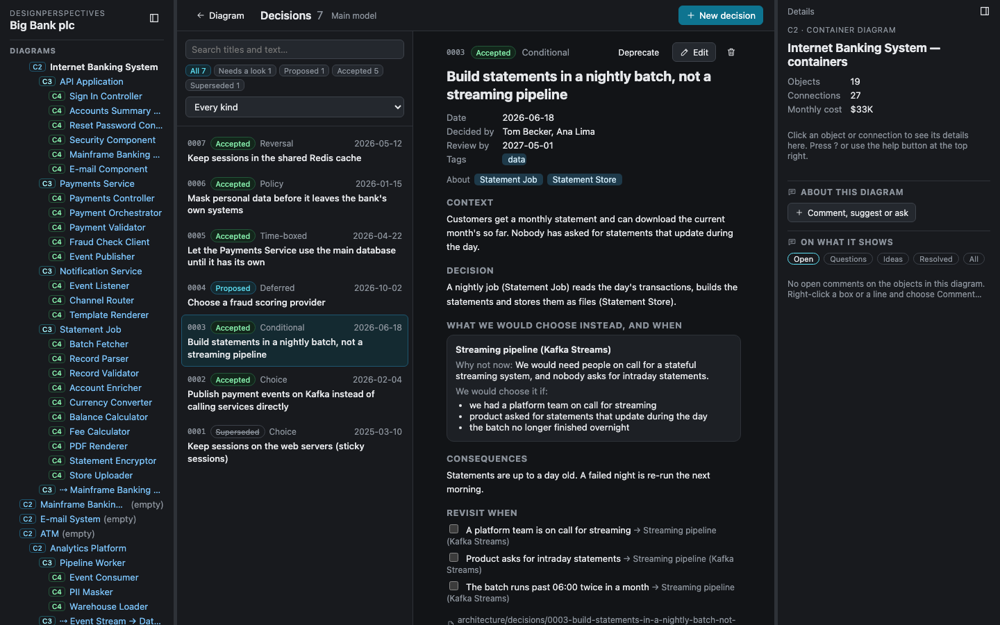
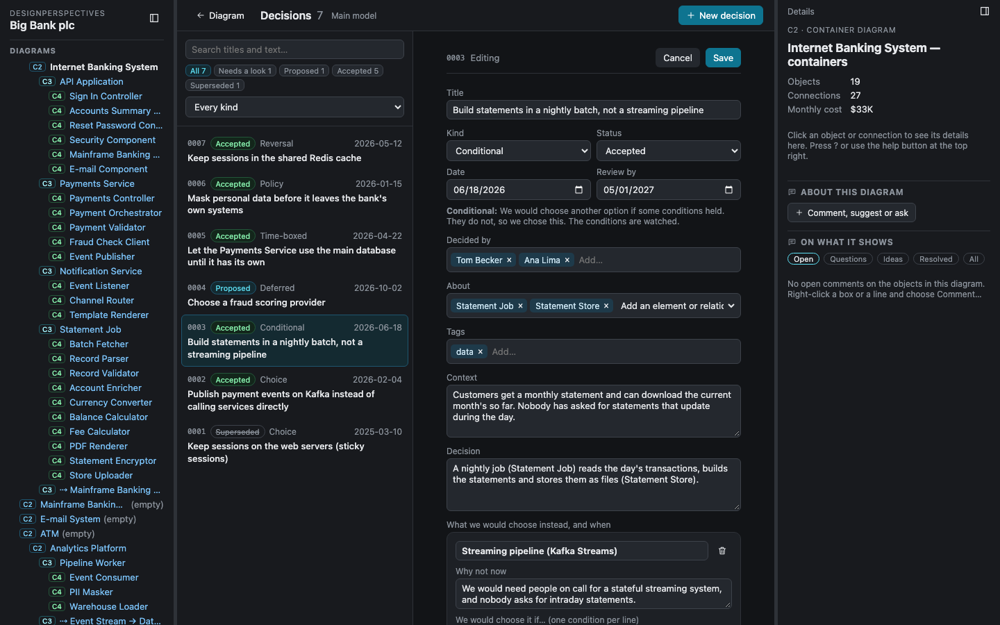

# Review: Stage H1 — decision records

Date: 2026-11-15. Branch: `feat/decision-records`. Baseline: `feat/diagram-comments` (commit 53909cb). Decisions: DEC-050.

This is the first stage of the owner-approved plan "home page, multiple projects, shared catalog, decision records, credentials". The plan's later stages are listed at the end, under "What comes next".

## What was built

| # | Item | Where |
|---|---|---|
| H1-1 | **Decision record files**: `architecture/decisions/NNNN-slug.md`. A small fixed front matter, `# Title`, then fixed sections. Unknown sections and keys are kept. An unreadable file is reported and never rewritten. Parse → write is byte for byte. | `src/core/decisions.ts` |
| H1-2 | **Six kinds**, each with its own fields and hints: choice, conditional, deferred (`decide-by`), time-boxed (`expires`), policy (`applies-to`) and reversal (`supersedes`). Five statuses. Accepting a reversal marks the decisions it replaces as superseded, both ways. | `src/shared/types.ts`, `src/core/decisions.ts` |
| H1-3 | **Decisions are part of the model.** `Project.edit(fn(ws, sc, decisions))` covers them, with undo and redo. They are noticed when changed on disk. Drafts copy them, with `base/`. They are `dec:<file>` units for the diff and the three-way merge, and they are read from git versions. | `store.ts`, `units.ts`, `diff.ts`, `drafts.ts`, `git.ts`, `validate.ts` |
| H1-4 | **Renumbering on apply.** A number used in both main and the draft is renumbered on the draft's side, and its links follow. | `renumberAdded` in `decisions.ts` |
| H1-5 | **Checks and reports.** Model errors: an unreadable file, two files with one number, a link to a missing decision, a bad date. `dp check` warns about decisions on removed objects. `dp diff` has a Decisions table. | `validate.ts`, `report.ts` |
| H1-6 | **API**: `GET /api/decisions[/:id[/markdown]]`, `POST /api/decisions`, `PUT` and `DELETE /api/decisions/:id`, `PATCH /api/decisions/:id/status`. The routes are version-aware and use the `edit` action in `ROUTE_RULES`. `AppState.decisions` lists summaries. | `src/server/routes/decisions.ts`, `auth.ts`, `context.ts` |
| H1-7 | **Decisions page** over the diagram, opened from **Decisions** in the navigation bar. It has filters (status, kind, "needs a look", search), each decision's record, and a form editor. | `ui/src/DecisionsPage.tsx`, `ui/src/DecisionEditor.tsx`, `ui/src/styles/pages.css` |
| H1-8 | **The conditional decision** (the owner's example). Each alternative has "Why not now" and "We would choose it if…". **Watch the alternatives' conditions** turns those conditions into revisit triggers. A met trigger flags the decision as needing a look, on the page and as a count on the navigation button. | `DecisionEditor.tsx`, `DecisionsPage.tsx` |
| H1-9 | **Element and relationship panels**: a Decisions section listing the decisions about the object, with **Record a decision**. "About" chips on a record jump to the object on its diagram. | `ui/src/panels/DecisionSection.tsx` |
| H1-10 | **Change list**: a "Decisions" group in a draft's changes and in the apply preview. Clicking one opens the decision. | `ChangesPanel.tsx` |
| H1-11 | **URL.** The page lives in the URL as `p=decisions[/<id>]` on the diagram hash. Back closes it, the model version is kept, and a link to a decision in a draft works. | `usePage` in `ui/src/useNavigation.ts` |
| H1-12 | **Secret warning.** The editor warns when text looks like a password or key, because decision records go into git. | `DecisionEditor.tsx` |
| H1-13 | **Demo**: seven decisions, one of each kind. They include a superseded/reversal pair and a time-boxed "shared database" decision that leads into the catalog stage. They are generated by `npm run make-demo` and copied by `dp init --demo`. | `scripts/make-demo.ts`, `demo/decisions/`, `store.ts` |

## How it works (one paragraph)

A decision is a Markdown file next to the model. The server reads every file in `decisions/` with the workspace and sidecar, and treats them as one more part of the model. So a decision written in a draft appears in that draft's change list, is applied with the rest of the draft, and can be undone. The browser shows the shown version's decisions on a page that covers the diagram. The page has its own address, so Back and links work. The record shows what was chosen, the alternatives with why not now and when they would win, and the triggers to watch. The editor saves the whole record at once.

## How it was checked

- **vitest**: 283 tests, up from 270. The 13 new tests in `tests/decisions.test.ts` cover:
  - a byte-for-byte round trip of a full file, with unknown sections and keys
  - block lists and quoted values
  - unreadable files: reported, kept, and refused for edits
  - units
  - renumbering
  - create, edit, undo and redo, and delete through the API
  - bad input
  - supersede in both directions
  - files changed on disk
  - roles: an engineer only in a draft; a viewer never
  - drafts: copy, compare, and apply with renumbering
  - `dp check` warnings
  - reading decisions at a git ref and comparing with it
- **Browser tests**: 121 pass, including 2 new in `e2e/decisions.spec.ts`.
  - The first writes a conditional decision with an alternative and conditions, copies the conditions into triggers, sees the secret warning, saves, accepts, marks a trigger met and sees the flag. It then jumps to the element and opens the decision from the element's panel.
  - The second edits a decision in a draft, sees it in the draft's changes and opens it from there; main is unchanged.
- `npm run typecheck`, `npm run lint` and the UI typecheck are clean. Prettier was applied to the touched files.
- `npm run make-demo` gives the committed `demo/`. `static/` is rebuilt.
- Screenshots were checked at 1440 × 900.
- Runs were on macOS only.

## Limits

- **Front matter grammar.** It is fixed. Hand-written YAML features beyond it (nested maps, multi-line strings) make the file a load error, not silent loss. YAML comments are dropped when a decision is rewritten here.
- **Section headings in text.** A `## ` line typed inside a section is saved as `###`, so it is not read back as a new section.
- **Section order.** Unknown sections move after the known ones the first time a decision is edited here.
- **Renumbering** changes the draft decision's number and file name on apply. Links to the old number made outside the model go stale.
- **Trigger checkbox.** It ticks when the save comes back, not instantly.
- **No Markdown rendering** in the record: text is shown as written, with line breaks kept.
- **Formatting.** Prettier also re-wrapped a few lines that the earlier comments commit had left unformatted, in `App.tsx`, `ElementPanel.tsx`, `context.ts` and `api.ts`.
- **Concurrent edits.** Another session was editing `docs/backlog.md` and `docs/decisions.md` in the same working tree during this stage; it added DEC-051 (Stage B import). This stage uses DEC-050 only, and its commit holds only this stage's changes in those files.

## Questions for the owner

1. Should engineers be able to file a **proposed** decision on main without a draft? Today they can only write one inside a draft, as with every model edit.
2. Is the fixed front matter grammar acceptable, or should full YAML be read (with a dependency)?
3. Should accepted decisions be locked against edits, so that a change means a new decision that supersedes the old one? Many ADR practices work this way. Today they stay editable.

## What comes next (the approved plan)

- **H2 — Home page in single mode.** A `GET /api/home` summary with:
  - a project card: counts, drafts and how far behind they are, check problems, last commit, and a thumbnail drawn from stored positions
  - "Needs attention" items: check errors, drafts behind, proposed decisions, reviews due, expired time-boxed decisions, triggers met
  - a "Watching" list
  - a decisions timeline
- **H3 — Hub server.** `dp serve --hub DIR` with `hub.json` listing project folders. Requests pick a project with an `X-DP-Project` header, one sign-in covers every project, and the home page shows a grid of projects.
- **H4 — Shared catalog.** Shared elements live once in `<hub>/catalog/`, and projects keep linked copies (`dp.catalog`).
  - Data assets: `dp.data` on a container (tables, topics, buckets) and `dp.data.access` (read or write) on relationships.
  - A "where used" view flags tables shared by several projects and tables with more than one writer.
  - The demo gets a two-project hub sharing a Customer DB.
- **H5 — Integration credentials.** Stored in `.dp/credentials.json` (mode 0600, gitignored), optionally encrypted with `DP_SECRET_KEY`. Values are write-only through the API, and only architects can manage them.

## Owner feedback

<!-- Please add feedback here. -->
