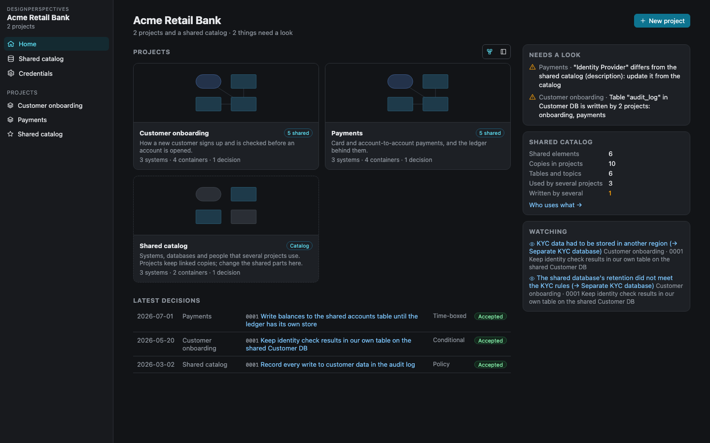
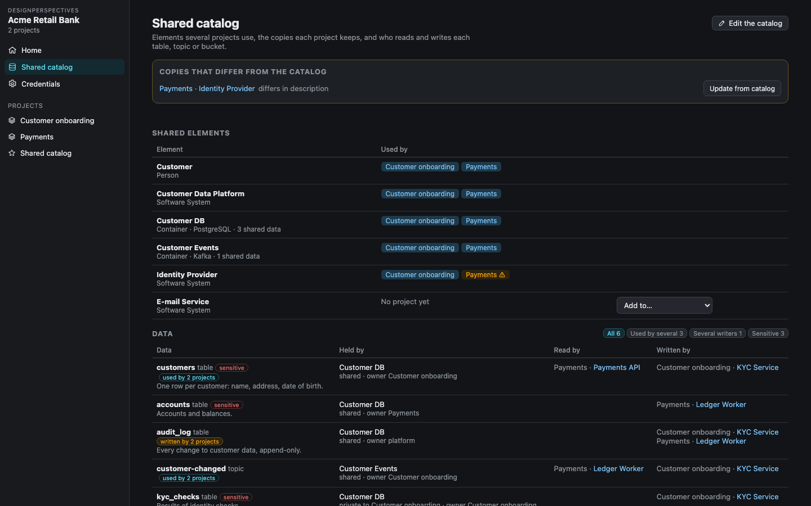
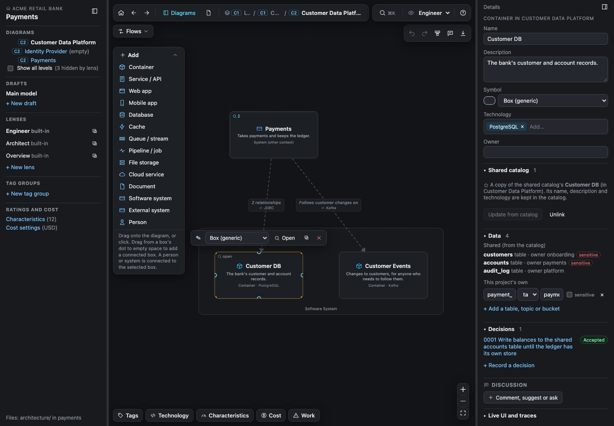
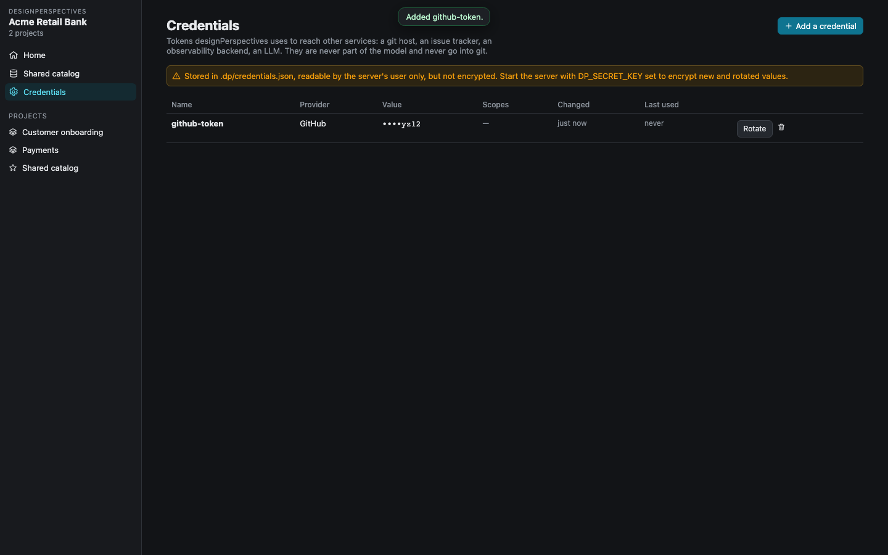

# Review: Stages H2–H5 — home page, hub, shared catalog and data, credentials

Date: 2026-11-15. Branch: `feat/home-hub` (on `feat/decision-records`, H1). Decisions: DEC-053, DEC-054, DEC-055, DEC-056.

These stages finish the owner-approved plan "home page, multiple projects, shared catalog, decision records, credentials". The owner said "draw.io" where the plan had "flow.io". Its start screen (create from a blank diagram or a template, open a recent one) shaped "New project" with a choice of start.

## What was built

| # | Item | Where |
|---|---|---|
| H2-1 | **Home page summary**: a card per project with counts, drafts, problems, last commit and a landscape thumbnail drawn from stored positions. Also "Needs a look", "Watching" (triggers and dates), and the latest decisions. Cached by model revision. | `src/core/home.ts`, `src/shared/decisionFlags.ts`, `GET /api/home` |
| H2-2 | **Hub-level routes for one project.** `GET /api/hub` and the routes above answer for a single project too, as a hub of one. | `src/server/routes/hub.ts`, `buildApp` in `app.ts` |
| H2-3 | **Home page UI**: a left rail (Home, Shared catalog or Data, Credentials, projects); project cards or a list; every item links to its diagram, decision, draft or element. | `ui/src/Root.tsx`, `ui/src/home/Shell.tsx`, `HomePage.tsx`, `styles/home.css` |
| H2-4 | **One-time reveal.** A home-page link to an element (`reveal=`) opens its diagram with the element selected. The sidebar's top line links home. | `App.tsx`, `Sidebar.tsx`, `useNavigation.ts` |
| H3-1 | **Hub server**: `hub.json` (checked: IDs, duplicates, folders that hold the hub or another project). Each project's app is built on first use. Requests are passed on by `X-DP-Project`. There is one shared sign-in, and the file is re-read when it changes. | `src/server/hub.ts` |
| H3-2 | **New project** from the home page (architects): a blank model or the demo. | `POST /api/hub/projects`, `NewProjectDialog` |
| H3-3 | **CLI**: `dp init --hub [--demo]`, `dp serve --hub`, `dp check --hub`. | `src/cli.ts` |
| H3-4 | **Demo hub**: a catalog and two projects (onboarding, payments) sharing a Customer DB. It has shared tables, a private table each, `audit_log` written by both, and one copy that drifted from the catalog. Generated by `make-demo`. | `scripts/demo-hub.ts`, `demo/hub/` |
| H4-1 | **Linked copies** (`dp.catalog`): shared fields are refused in projects. Add from the catalog, Link, Update from catalog and Unlink are explicit edits. A duplicate is not linked. | `ops.ts`, `src/server/routes/catalog.ts` |
| H4-2 | **Data** (`dp.data`: tables, topics, buckets, …) and **data access** (`dp.data.access`: read or write per relationship). | `ops.ts`, `shared/types.ts`, `diff.ts` |
| H4-3 | **Usage across projects**: who uses each shared element; drifted and missing copies; readers and writers of each asset; flags for "used by several projects" and "written by several projects"; unknown data. | `src/core/catalog.ts`, `GET /api/catalog/usage` |
| H4-4 | **Catalog page** (Data in a single project) with Update and Add to… actions. **Panels**: Shared catalog, Data, and Data access sections, the last also on derived lines. | `ui/src/home/CatalogPage.tsx`, `ui/src/panels/DataSections.tsx`, `ui/src/useCatalog.ts` |
| H5-1 | **Credentials store**: `.dp/credentials.json` (0600, gitignored). Values are encrypted with AES-256-GCM when `DP_SECRET_KEY` is set (scrypt key per value, name and provider bound in); otherwise they are stored as plain text and the page says so. Locked with the wrong key. Values are write-only; the masked hint shows the last 4 characters. | `src/core/credentials.ts` |
| H5-2 | **Routes, CLI and page**: the `admin` action (architects; refused on a read-only server); `dp credentials list/add/rotate/remove` (values from stdin); the Credentials page. | `routes/credentials.ts`, `auth.ts`, `cli.ts`, `ui/src/home/CredentialsPage.tsx` |

## How it works (one paragraph)

`dp serve DIR --hub` reads `hub.json` and serves each listed project folder through its own, unchanged project app, chosen by a request header. The browser shows a home page above the projects: what each one holds, what needs a look and what is being watched. Shared things live once in the catalog project. Each project keeps a linked copy of what it uses, and lists which tables those copies hold and which of its relationships read or write them. The catalog page then answers "who uses this table, and who writes it" across projects. Credentials for future integrations are stored next to the hub, outside git. Their values are never shown again, and they are encrypted when a key is given.

## How it was checked

- **vitest**: 298 tests, up from 283.
  - `tests/hub.test.ts` (10): single-mode home and data use; header routing and isolation; home attention; usage flags; linked-copy rules and catalog actions; one sign-in across projects; admin-only project creation; `hub.json` and folder checks; `dp init --hub`; `dp check --hub`; a broken project shown on its card.
  - `tests/credentials.test.ts` (5):
    - a planted secret appears in no response
    - the file is mode 0600 and in `.gitignore`
    - code routes cannot read it
    - encryption round trip, the wrong key shows "locked", and a value moved to another entry does not open
    - roles and a read-only server; hub storage; the CLI
- **Browser tests**: 125 pass, including 4 new in `e2e/hub.spec.ts`:
  - the home page, a drifted copy fixed from its element panel, and back home
  - a new project from a template
  - the catalog page's filters and "Add to…"
  - data access set on a (derived) line
  - credentials whose value never shows on the page
- **A bug the full run found**: the home page's `.card` class also matched the canvas boxes (`card` is a box class) and broke three existing tests. It was renamed to `p-card`.
- **Other checks**: typecheck, lint and the UI typecheck are clean. `npm run make-demo` is stable. Screenshots were checked at 1440 × 900. Runs were on macOS only.

## Changes from the plan

- **Per-project apps.** The plan proposed a "getter view" over one shared context so route modules would not change. They capture `ctx` fields when they register, so each project gets its own app instead. Route modules are still unchanged.
- **One commit for four stages.** H2–H5 share files (`routes/hub.ts`, `app.ts`, `hub.ts`, `types.ts`, `api.ts`, the shell), so they are one commit with one review instead of four.
- **No `--credentials FILE` option.** The file is always `.dp/credentials.json` in the served folder.
- **No catalog marker on boxes.** Linked copies are not marked on the canvas yet (a box badge would be the next step).

## Limits

- **Roles** are global in a hub.
- **Memory**: every loaded project stays in memory.
- **First load**: `dp check` runs per project on the first home load after a change, which is slow for large hubs.
- **Thumbnails** use stored positions only; a never-laid-out landscape shows a grid.
- **Data access** is per relationship. A service that reaches a database without a modelled relationship is not counted.
- **Catalog changes** show as drift in every copy until each project chooses "Update from catalog". This is deliberate; nothing is rewritten across projects.
- **Credentials** are plain text on disk (mode 0600) without `DP_SECRET_KEY`. There is no "test connection", and nothing uses them yet.
- **Concurrent edits.** Another session was editing `docs/backlog.md` and `docs/decisions.md` in this working tree (DEC-051). These commits include only this work's lines; `backlog.md` is not touched.

## Questions for the owner

1. Should roles be per project in a hub (for example, an engineer on payments but a viewer on onboarding)?
2. Should "Update from catalog" also be offered as "update every copy" from the catalog page, as one draft per project?
3. Should `DP_SECRET_KEY` be required before any credential is stored, rather than optional with a warning?
4. Which integration should use the credentials first (GitHub issue and pull request status on linked work, or trace backends)?
5. Should tables also be drawable as components on demand (for a data-centric view), or stay a list?

## Owner feedback

<!-- Please add feedback here. -->
