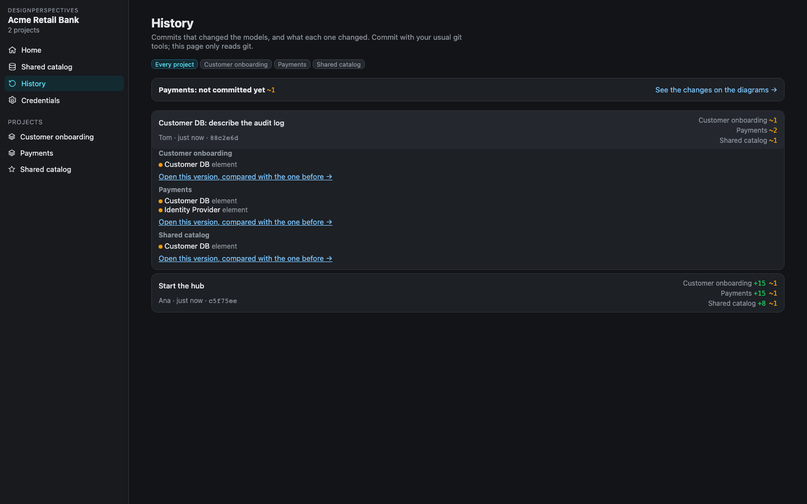
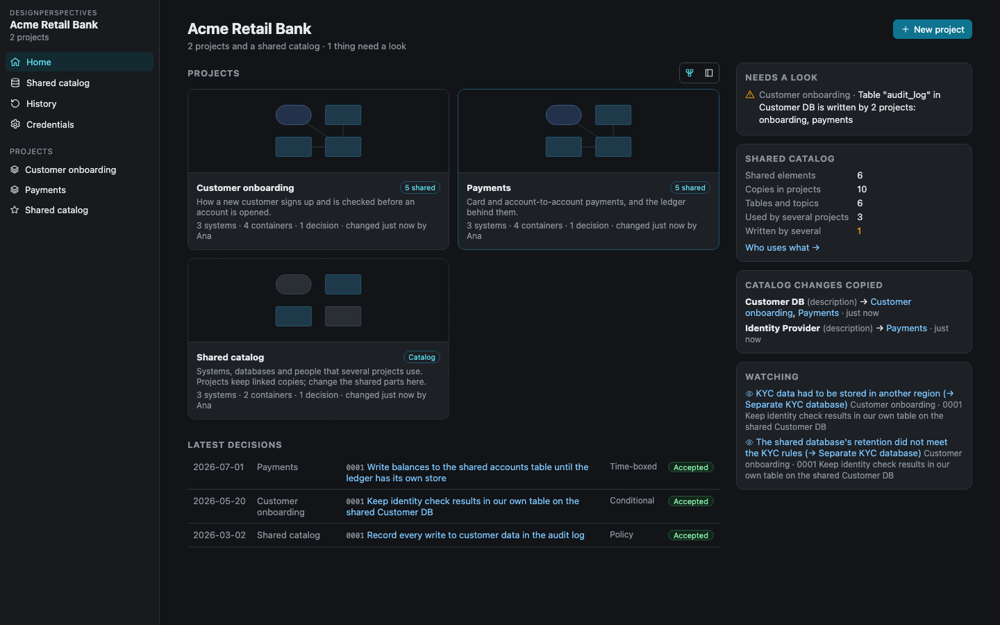

# Review: Stage H6 — roles per project, catalog copies that follow, history, GitHub status

Date: 2026-11-15. Branch: `feat/hub-roles-sync-history` (on `feat/home-hub`). Decisions: DEC-057, DEC-058, DEC-059.

This stage answers the owner's feedback on the H2–H5 questions:

| Question | Answer | What was built |
|---|---|---|
| 1. Roles per project in a hub? | Yes. | Roles per project (DEC-057). |
| 2. Update every copy from the catalog? | Yes, as soon as the change is saved to the catalog; plus "a Git for this project to understand changes", read-only. | Automatic copies (DEC-057); History page (DEC-058). |
| 3. Require `DP_SECRET_KEY`? | No, not for now. | No change. |
| 4. Which integration first? | "Keep it simple, go with whatever you think." | GitHub status for linked work (DEC-059). |
| 5. Tables as components? | No. | No change. |

## What was built

| # | Item | Where |
|---|---|---|
| H6-1 | **Roles per project.** `projects: {id: role}` in the users file. A project's app gives the request the user's role there. The role is read live, so there is no sign-out on change. `dp users role NAME ROLE [--project ID]`, and `dp users list` shows the project roles. `GET /api/hub` gives your role per project, shown on cards and in the rail. | `src/core/users.ts`, `Auth.projectRole` in `src/server/auth.ts`, `buildApp`, `src/cli.ts` |
| H6-2 | **Copies follow the catalog.** `Hub.syncCatalog` runs before each project request, after each catalog request, and on hub, home and usage. It is keyed by the catalog and project revisions, writes only when something differs, and is not an undo step. A copy whose new name clashes stays as drift. Off on a read-only server. | `src/server/hub.ts`, `syncCopies` in `src/core/catalog.ts` |
| H6-3 | **"Catalog changes copied"** on the home page: element, fields, and the projects with links to each copy. | `HomeSummary.catalogUpdates`, `HomePage.tsx` |
| H6-4 | **History.** Commits touching the model folders, per project or across the hub, each compared with its parent model: counts and up to 12 objects. It also shows what is not committed yet against HEAD, and links to each version compared with the one before. Cached per commit. | `src/core/history.ts`, `GET /api/history`, `ui/src/home/HistoryPage.tsx` |
| H6-5 | **GitHub status for linked work.** "Refresh status from GitHub" under Linked work. It reads issue and pull request states from api.github.com with the first `github` credential (or none, for public repositories). One undo step; it reports links it could not read and never returns the token. | `src/core/workStatus.ts`, `POST /api/work/refresh`, `ui/src/panels/WorkRefresh.tsx`, `CredentialStore.byProvider` |

## How it was checked

- **vitest**: 305 tests (up from 298), all pass.
  - `tests/hub.test.ts` (12):
    - the demo's drifted copy is brought up to date and listed
    - a catalog edit reaches both projects; undo of a project's own edit keeps the copy in step
    - a name clash stays as drift
    - a read-only hub writes nothing
    - roles per project: engineer here, architect there; a viewer who is an engineer in one project; changed live; bad roles refused; the last architect protected
  - `tests/history-work.test.ts` (5):
    - single-project history with model changes per commit and the uncommitted changes
    - hub history across projects and filtered to one
    - no git
    - GitHub refresh with a stubbed fetch: statuses changed, failures reported, the token sent but never returned, one undo step, the no-credential path, roles
- **Browser tests**: `e2e/hub.spec.ts` now has 6, adding "a catalog change reaches every project" and "history". The full browser run is in the commit's checks.
- Typecheck, lint and Prettier are clean on touched files. `npm run make-demo` is stable. `static/` was rebuilt.

## Limits

- **Writes during reads.** A project's files can change during a request that only reads: the first one after a catalog change. Git shows that change as uncommitted, and History lists it.
- **List of copies is not kept.** The "Catalog changes copied" list is in memory only (git history has the changes).
- **No "no access" role**: every signed-in user sees every project of the hub.
- **History load time.** History's first load runs one model diff per commit; the default is 20 commits, 100 at most.
- **GitHub only.** The status refresh covers github.com only, not GitHub Enterprise or other trackers, and only when asked.

## Questions for the owner

1. Should a role be able to hide a project entirely from someone (a "no access" role)?
2. Should catalog copies also be committed for you, or is "shown as uncommitted, then you commit" right (dp keeps git read-only today)?
3. Should the GitHub refresh also run on a schedule while the server is up, or stay a button?

## Owner feedback

- 2026-11-15, on the questions above:
  1. "Yes, a role should have no access to an entire project too." Built as role `none` per project (DEC-060): the project is hidden and every request to it is refused, on read-only servers too. Tested in `tests/hub.test.ts` ("no access…").
  2. "Do what you think is best." dp does not commit the catalog copies; they show as uncommitted and are committed with the team's own tools (recorded in DEC-057).
  3. "GitHub refresh is on demand only." Already so; recorded in DEC-059.
