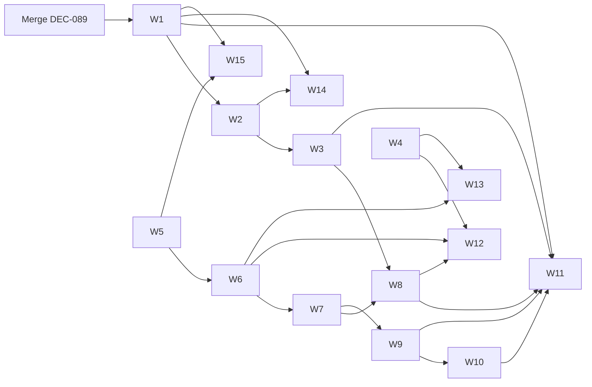

# Waves: the owner's list of 2026-11-17

Status: **planning**. Part 0 of [questions.md](questions.md) is answered and applied (2026-11-18); the rest is waiting for the owner's answers. Nothing in this folder is built yet.

This folder turns the owner's list of 2026-11-17 into **waves**. A wave is one branch of work that one agent runs from start to finish, handing parts to subagents. Each wave has its own file. This file is the index: the order, the rules every wave follows, who does what, and where each item of the list went.

"System design" and "system architecture" mean the same thing in these files.

## How to use this folder

1. **Answer.** Read [questions.md](questions.md) and type your thinking under each "Your thinking:" line. Questions marked ★ change what gets built. The others use their recommendation if left blank.
2. **Apply.** Tell Claude "apply my answers in docs/waves/questions.md". Claude then:
   - rewrites the Design section of each wave from your answers and fills in its "Owner answers" section;
   - records the cross-cutting answers in this file, and the ones that are project decisions as DEC entries in [../decisions.md](../decisions.md);
   - deletes `questions.md` once every answer lives in a wave file or a DEC (as commit 47b33a2 did with the earlier questions file);
   - commits `docs/waves/`, `docs/future_tasks.md` and `docs/README.md` by path on a branch `docs/wave-plans` from `main`.
3. **Run.** Open a new Claude Code session in the repository and paste the wave's start prompt (the last section of each wave file). Run one wave at a time, in the order below. Review and merge a wave's branch before you start the next.
4. **Close.** When a wave is merged, its section in [../reviews.md](../reviews.md) says what was built. The wave file is deleted in the same change (CLAUDE.md: no superseded plans) and its row below is marked done.

**Before Wave 1:** commit and merge the CI move that is waiting on the branch `ci-local-checks` (DEC-089: GitLab CI, `npm run ci`, the pre-push hook). Every wave runs `npm run ci`, and the next free decision number depends on DEC-089 being in `main`.

## The waves

Recommended order. You can change it in questions.md (★A3). Sizes compare the waves with each other; L may be split by the wave agent at the split point its file names.

| # | Wave | What it builds | Owner items | Depends on | Size | Status |
|---|---|---|---|---|---|---|
| 1 | [Grounded BMO answers](wave-01-grounded-bmo.md) | Fixed prompt templates per situation, fixed context packs, citations that dp checks, labels on everything BMO writes, an evaluation set, `docs/determinism.md` | 2, 9, 11, 12 | merge of DEC-089 | L | Waiting for answers |
| 2 | [Notes, context and help](wave-02-notes-context-help.md) | Diagram notes, a Notes page, safe Markdown, "include notes" in BMO's preview, `dp context` for coding agents, help about dp (search without an LLM, and a BMO help task) | 3, 17 | 1 | M | Waiting for answers |
| 3 | [Reference library and ADRs](wave-03-reference-and-adrs.md) | The owner's curated library of patterns and anti-patterns (project and hub), an opt-in starter set, decisions shown as ADRs with links (files only if ★Q3.5 says so) | 4, 13 | 2 | M | Waiting for answers |
| 4 | [Roles, data and variants](wave-04-roles-data-variants.md) | CRUD letters on data access, people as roles, a role × data matrix; conditions on lines and A/B variants as grouped flows | 20, 5 | — | M | Waiting for answers |
| 5 | [Code facts](wave-05-code-facts.md) | One module per language, Java (and Kotlin imports), Maven and Gradle, a role for every file (config, test, shared helper…), facts from config files, language mix per object | 14, 8 | — | L (split point: Java as 5b) | Waiting for answers |
| 6 | [Drift and findings](wave-06-drift-and-findings.md) | Model ↔ code drift in both directions (found / not found / not checkable), one Finding shape and acknowledgements for every later check, "update the model from code" through the import review, `dp drift` | 1 | 5 | M–L | Waiting for answers |
| 15 | [Guided import interview](wave-15-guided-import-interview.md) | Importing a codebase: the scan makes every deterministic call, then a "question x of y" interview asks the rest: first a few plain questions, then grouped approve/disapprove cards for what dp would label, then the draft. Many questions are fine. Number 15 is an id, not a place in the order | 11 (answer 0.3) | 5, 1 | L (split point: interview 15a, BMO-proposed cards 15b) | Answers applied; ready after Waves 5 and 1 || 7 | [Metrics](wave-07-metrics.md) | Ca, Ce, instability, cycles, abstractness, distance (computed); complexity and LCOM (approximate, labelled); computed off the request path with a cache | 6 | 5, 6 | M | Waiting for answers |
| 8 | [Rules and presets](wave-08-rules-and-presets.md) | One rule registry (the checklist's rules move into it), presets a team switches on, anti-pattern detectors dp runs itself; never blocks a save | 18, 21 (from the model and code) | 3, 6, 7 | L | Waiting for answers |
| 9 | [Characteristics table](wave-09-characteristics-table.md) | Needed vs current stars per system and container, compared across main, drafts, git versions and decisions | 7 | 7 | M | Waiting for answers |
| 10 | [Risk and risk storming](wave-10-risk-storming.md) | Risks per part and characteristic, the assessment grid, a computed risk overlay, sessions where people score privately before agreeing | 10 | 9 | M | Waiting for answers |
| 11 | [BMO reviews](wave-11-bmo-reviews.md) | The "check against anti-patterns" button, proposed ratings, suggested risks: cited, labelled, written only on request | 22 (and the BMO parts of 7 and 10) | 1, 3, 8, 9, 10 | M | Waiting for answers |
| — | *Deployment diagrams* | *Already decided (DEC-019, DEC-022). Goes here if ★A2 says interleave.* | — | — | L | — |
| 12 | [Runtime](wave-12-runtime-telemetry.md) | Traces and System Testing runs added up: busy, slow and failing lines, chatty and repeated calls, cycles, deep chains, calls the model lacks, A/B split from flag events | 21 (from telemetry) | 4, 6, 8 | M | Waiting for answers |
| 13 | [Contracts and consumer notifications](wave-13-contracts.md) | A contract on what a service sends, fingerprints, who consumes it, breaking changes by direction, "needs a look" for the consumer, `dp contracts` | 19 | 4, 6 | M–L | Waiting for answers |
| 14 | [Local runtimes and the word index](wave-14-retrieval-local-models.md) | Local runtimes first-class (OpenAI-compatible local servers, GPU share as Ollama reports it, bounded runtime settings, setup notes) and a BM25 word index for choosing context. No embeddings, no vector file, no native GPU code. Not gated (owner answers 0.4, 0.5). Depends only on Waves 1 and 2, so it can move earlier | 16, 15 | 1, 2 | M | Answers applied; ready after Waves 1 and 2 |

Wave 4 and Wave 5 depend on nothing in this list and can move earlier or later.

## Rules for every wave agent

**Code**
- Everything is TypeScript. Every model edit goes through `src/core/modelEdits.ts`. API shapes live in `src/shared/types.ts`.
- New per-object data is a `dp.*` property, unless a DEC in that wave adds an exception to CLAUDE.md's list.
- Text a person or the repository wrote reaches BMO only inside data blocks, never in system text (`tests/unit/bmo-core.test.ts:89` checks this).
- BMO output is labelled in the UI and in review files only, never stored as a label in the model (DEC-051, DEC-064).

**Required in every wave** (each wave file lists its own cases)
- Every new non-GET route gets a `ROUTE_RULES` entry in `src/server/auth.ts`. A route without one is architect-only, and a test fails (`tests/unit/auth.test.ts:733-734`).
- Works in a hub with per-project roles (DEC-057) and with `--read-only`.
- New model data is handled in `src/core/modelUnits.ts`, gets labels in `src/core/diff.ts`, merges in a three-way merge, and shows in the change list and `dp diff`.
- Output is byte-stable: the same input gives the same file, twice. Paths work on Windows.
- New UI can be reached with the keyboard.
- New routes and outbound calls are added to the security model in `docs/CONTRIBUTING.md`.
- The wave says what the planned static export would include (DEC-024).

**Git and checks**
- Branch `feat/wNN-<slug>` from `main` after the previous wave is merged. Commit by path. Never push. Never run `git stash`.
- Never run `prettier --write` on docs (they are in `config/prettierignore`). Use `npm run format` for code.
- While working: `npm run ci -- --quick`. After committing: the full `npm run ci`. Its checks that `static/`, `demo/` and `tests/TESTS.csv` are unchanged since the last commit only pass once the built files are committed.
- After UI changes: `cd ui && npm run build`, and commit `static/`. After model, ops or demo changes: `npm run make-demo`, and commit `demo/`. After adding or renaming tests: `npm run test:list`.

**Docs** (every wave)
- A new DEC at the bottom of `docs/decisions.md`, numbered with the next free number. Never reuse a number written in these plans.
- An "Unreleased" entry in `docs/CHANGELOG.md`.
- A section at the top of `docs/reviews.md` (what was built, how it was checked, limits, questions, an empty owner-feedback part).
- The code map in `.claude/CLAUDE.md`, the feature list in `README.md`, and `docs/future_tasks.md`.
- Rows for the wave's outputs in `docs/determinism.md` (from Wave 1 on).

**Writing in repository files**
- Name file formats and integration targets where needed. Do not name or compare competing products.
- Separate facts (with a source) from interpretation ([Proposal]), as the other docs do.

**Stop and ask** when a wave file's "Stop and ask if" condition is met, when an owner answer the wave needs is missing, or when a change would contradict a DEC that the wave does not amend.

## Agents and models

The owner asked (2026-11-14, 2026-11-16) to split work across models to save usage while keeping quality.

| Who | Agent type | Model | Used for |
|---|---|---|---|
| The wave agent | the main session | as started | Writes each subagent's brief (files and line ranges, "never run git stash", "never push"), reviews every diff, runs the checks, runs `/code-review` (high) and, where the wave says so, `/security-review` |
| Re-anchor | Explore | Haiku | At the start: confirm the `file:line` anchors in the wave file still match `main`, and report what moved |
| Design check | Plan | Opus | Only when the wave file says the design is still open after the owner's answers |
| Hard parts | general-purpose | Opus | Security, sign-in and roles, outbound calls, merge and data-loss logic, the first pass of an algorithm that is not settled |
| Building | general-purpose | Sonnet | Well-specified implementation, UI and tests. Fixture tests are written by a different subagent from the one that wrote the code |
| Paperwork | general-purpose | Haiku | CHANGELOG, README feature list, CLAUDE.md map, the reviews.md skeleton, the TESTS.csv check |

- Run **up to 3 agents at once** (owner, 2026-11-18, replacing the earlier one-at-a-time rule). Give parallel agents separate files. Keep an eye on usage when several are Opus.
- Only **one agent at a time builds the UI or runs browser tests**, because parallel builds overwrite `static/`. This is a technical limit, not a usage rule.
- When an agent is cut off, resume it with SendMessage rather than starting again. Give follow-up fixes, with precise briefs, to Sonnet.
- Fable is used only if the owner asks for it.

## Determinism classes

Proposed in questions.md (★A4). Every result dp shows carries one of these:

| Class | Meaning | Example |
|---|---|---|
| **computed** | From files, the model or traces by fixed rules. Same input, same output. | Import edges, instability, drift between manifests and the model |
| **approximate** | Computed by a rule known to miss cases, and shown with what it misses | Complexity counted from tokens, LCOM without a full parser |
| **heuristic** | A rule of thumb, shown as a hint, never as a fact | A component whose name ends in "Manager" (Entity Trap) |
| **proposed** | Written by BMO, labelled until a person accepts it. Once accepted it is that person's | Names and descriptions in an import, BMO's anti-pattern review |

Wave 1 writes `docs/determinism.md` with these classes and one row per feature. Every later wave adds its rows.

## Where each item went

The owner's list of things to build (2026-11-17):

| # | Item (shortened) | Where |
|---|---|---|
| 1 | Architecture drift detection | Wave 6 (model ↔ code). Also runtime drift in Wave 12 and contract changes in Wave 13 |
| 2 | LLM explanations grounded in actual code and docs | Wave 1 |
| 3 | A note for each object at each level, easy to see | Wave 2 (diagram notes, Notes page, `dp context`) · Q2.1–Q2.3 |
| 4 | A reference notes section curated by the owner (patterns, anti-patterns) | Wave 3 · Q3.1–Q3.3 |
| 5 | How A/B testing and conditional services work in C4 | Explained in questions 0.1. Modelled in Wave 4; the observed split in Wave 12 |
| 6 | Metrics such as LCOM and instability | Wave 7 · Q7.1 |
| 7 | Characteristics star table: current vs needed, by a person or an LLM, compared across planned changes | Wave 9 (table, comparisons). BMO proposals in Wave 11 |
| 8 | How config files and common functions such as `tools.py` show up | Explained in questions 0.2. Wave 5 (file roles, config facts) |
| 9 | Better fixed context prompts, never written by an LLM | Wave 1 · questions 0.6 |
| 10 | Risk analysis such as risk storming | Wave 10. BMO suggestions in Wave 11 |
| 11 | Where LLM false positives and negatives appear; which levels are guesses | Explained in questions 0.3. `docs/determinism.md` in Wave 1. The owner's answer to 0.3 (deterministic first, then ask the user) is Wave 15 |
| 12 | LLM use is fine where determinism is impossible, but called out | The determinism classes (★A4) and BMO's labels (Wave 1), followed by every wave |
| 13 | An ADR section where each decision can have files or info attached | Wave 3 · Q3.4–Q3.6 |
| 14 | More languages, such as Java | Wave 5 · Q5.1–Q5.4 |
| 15 | GPU acceleration (CUDA, MPS) where it applies | Explained in questions 0.4; owner chose local runtimes first-class. Wave 14 (no native GPU code) |
| 16 | A vector DB for faster LLM processing | Explained in questions 0.5; owner chose the word index only. Wave 14 (no vectors) |
| 17 | BMO answers questions about designPerspectives itself | Wave 2 (help corpus, search, help task) |
| 18 | Architecture validation and presets | Wave 8 |
| 19 | When A's output changes, tell B (which reads it), in the UI | Wave 13 |
| 20 | Roles and actions such as CRUD per role, and what each role sees | Wave 4 (roles in the modelled system, as the owner chose) |
| 21 | Anti-patterns tracked through telemetry or other ways | Wave 8 (from the model and code) and Wave 12 (from traces). Also future_tasks 2.7 |
| 22 | A button that asks BMO to test the codebase or design against the chosen anti-patterns | Wave 11 |

The owner's list of things to think about later, all in [../future_tasks.md](../future_tasks.md):

| Idea | Where in future_tasks.md |
|---|---|
| Importing draw.io and Lucidchart diagrams | 2.1 |
| A UI redesign, drawn by hand | 2.8 |
| Trade-offs that change over time | 2.3 |
| Extensibility, architecture vitality | 2.3 |
| How system design reviews are done | 2.4 |
| Code reviews and test coverage through the tool | 2.4 |
| Debugging through dp compared with an editor's debugger | 2.7 |
| Risk analysis | 2.3 (first cut: Wave 10) |
| Is creating C4 from a codebase an LLM-only job? | 2.0 (facts in questions 0.3). Owner's answer: make all deterministic calls, then ask the user (Wave 15) |
| A checklist for release 1.0.0 | 2.0 |
| Data drift | 2.2 |
| **Product vision (most important)** | 2.0, and questions ★A1 |
| Anti-patterns from telemetry | 2.7 (first cut: Wave 12) |
| Where to put people (language mix, compliance) | 2.4 (language mix per object: Wave 5) |
| TOGAF | 2.0 |
