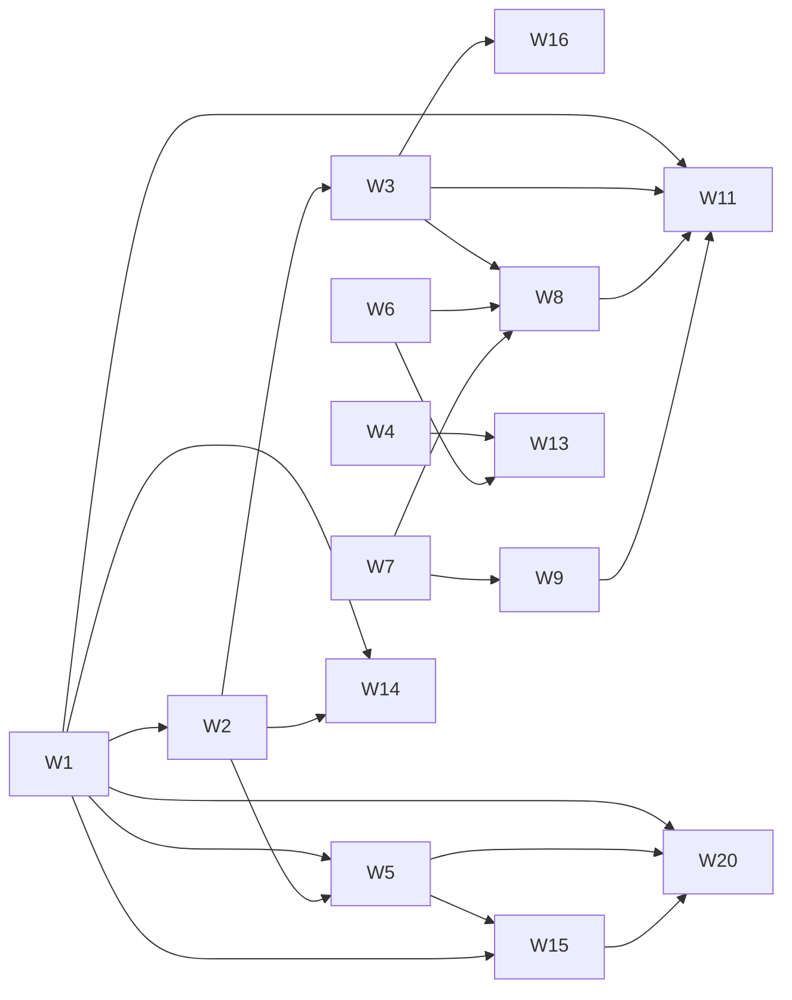

# Waves: the owner's list of 2026-11-17

Status: **planning**. All parts of [questions.md](questions.md) are answered and applied: Parts 0, A and C (2026-11-18 and 2026-11-19) and Part B (Waves 1 to 3 on 2026-11-19; Waves 4 to 15 on 2026-11-20). On 2026-11-20 the owner decided that dp reads code by search, pinned key code and one generic regex reader for the major languages, not per language, and moved architecture drift to the ideas list; Waves 5, 6 and 7 were rewritten and Waves 4, 8, 9, 11, 13, 14, 15 and 20 adjusted. Waves 1 to 9, 11 to 20 are planned; 10 and 12 are parked. Waves 17 to 20 were added from the product vision. The owner still has to fill the "Your decision" column of [v1-scope-review.md](v1-scope-review.md). Nothing in this folder is built yet.

**Read first:** [../product-vision.md](../product-vision.md) (what 1.0.0 is: software architecture only, twelve features, not an IDE) and [v1-scope-review.md](v1-scope-review.md) (what is built or planned outside that line, for the owner to decide).

This folder turns the owner's list of 2026-11-17 into **waves**. A wave is one branch of work that one agent runs from start to finish, handing parts to subagents. Each wave has its own file. This file is the index: the order, the rules every wave follows, who does what, and where each item of the list went.

"System design" and "system architecture" mean the same thing in these files.

## How to use this folder

1. **Answer.** Read [questions.md](questions.md) and type your thinking under each "Your thinking:" line. Questions marked ★ change what gets built. The others use their recommendation if left blank. Also fill the "Your decision" column of [v1-scope-review.md](v1-scope-review.md).
2. **Apply.** Tell Claude "apply my answers in docs/waves/questions.md" (and "apply my decisions in docs/waves/v1-scope-review.md"). Claude then:
   - rewrites the Design section of each wave from your answers and fills in its "Owner answers" section;
   - records the cross-cutting answers in this file, and the ones that are project decisions as DEC entries in [../decisions.md](../decisions.md);
   - **keeps `questions.md` and every wave file** (owner, 2026-11-19: the owner deletes planning files before 1.0.0);
   - commits `docs/` by path on a branch from `main`.
3. **Run.** Open a new Claude Code session in the repository and paste the wave's start prompt (the last section of each wave file). Run the waves in the order below. Review and merge a wave's branch before you start the next one that depends on it.
4. **Close.** When a wave is merged, its section in [../reviews.md](../reviews.md) says what was built and its row below is marked done. **The wave file stays** until the owner deletes it before 1.0.0.

The CI move (DEC-089) is merged, so the next free decision number is the one after the last entry in `decisions.md` (DEC-090 is taken by the product vision).

## The waves

The order below is the owner's accepted order (answer A3, 2026-11-19), grouped by release. Sizes compare the waves with each other; L may be split by the wave agent at the split point its file names.

| # | Wave | What it builds | Feature (vision) | Depends on | Size | Release | Status |
|---|---|---|---|---|---|---|---|
| 1 | [Grounded BMO answers](wave-01-grounded-bmo.md) | Fixed prompt templates per situation, fixed context packs, citations that dp checks, labels on everything BMO writes, `docs/determinism.md`. The evaluation set is deferred (ideas list I2.0) | L | none | M–L | 0.5.1 | Answers applied; ready |
| 2 | [Notes, context and help](wave-02-notes-context-help.md) | Sticky notes stored in the model (stuck to objects or diagrams), a Notes page, safe Markdown, BMO always reads notes and comments, BMO without an LLM (search and fixed commands, behind a setting), `dp context` for coding agents, help about dp | E, L | 1 | M–L | 0.5.1 | Answers applied; ready after Wave 1 |
| 3 | [Reference library and ADRs](wave-03-reference-and-adrs.md) | The owner's curated library of patterns and anti-patterns (project and hub), an opt-in starter set, decision links (web, repository, a file on your own computer) and a Compliance section; the page stays "Decisions" | G, K | 2 | M | 0.5.1 | Answers applied; ready after Wave 2 |
| 16 | [Images and files](wave-16-attachments.md) | A content-addressed attachment store; images and files on notes, comments, decisions and diagrams; type allowlist; BMO gets a list and redacted text files, never the contents of images, PDFs or Office files; or a reference to a file on your own computer (opens in the default app) instead of a copy | E | 2, 3 | M–L | 0.5.1 | Answers applied (C4, C5, Q3.5) |
| 4 | [Roles, data and variants](wave-04-roles-data-variants.md) | Conditions on lines and A/B variants as grouped flows (C4 modelling). **The data half** (CRUD letters, role × data matrix) is on the scope review as P4 | A (data half: outside the vision's line, kept by the owner's answers) | none | M | 0.5.1 | Answers applied (2026-11-20): CRUD letters (an old write becomes C, U and D), matrix, variants; ready |
| 5 | [Code search, key code and one generic reader](wave-05-code-search.md) | Find a function, class or file name in the code with no LLM (offline BMO `where`, `dp find --code`), with definitions marked; a component's **key code** (main files and functions) pinned by a person, checked by dp, or proposed by BMO and verified; **one generic regex reader** (a pattern table for the major languages) replaces the Python and JS/TS readers. No per-language code, no Maven or Gradle, no file roles | H, L | 1, 2 | M–L (split point: search and key code 5a, generic reader 5b) | 0.5.2 | Rewritten 2026-11-20 (revised the same day); ready after Waves 1 and 2 |
| 15 | [Guided import interview](wave-15-guided-import-interview.md) | Importing a codebase: the scan makes every deterministic call, then a "question x of y" interview asks the rest. The questions depend on the codebase, there are always at least 6 per level, and the person can add notes, context and file references. Includes the "main files and functions" card per component. Number 15 is an id, not a place in the order | H | 5, 1 | L (split point: interview 15a, BMO-proposed cards 15b) | 0.5.2 | Answers applied (2026-11-20); ready after Waves 5 and 1 |
| 6 | [Findings and acknowledgements](wave-06-findings.md) | One Finding shape, acknowledgements stored in the model, the warnings dp already makes as the first findings, a Findings page. **Drift is parked in the ideas list** | L, B | none | M | 0.5.2 | Rewritten 2026-11-20; ready |
| 7 | [Model metrics](wave-07-metrics.md) | Ca, Ce, instability and cycles computed from the model's own lines, per level, for main, a draft or a git version; a panel section, an overlay, `dp metrics`. No code is read; LCOM, complexity, abstractness and distance are not built | L | none | S–M | 0.5.2 | Rewritten 2026-11-20; ready |
| 8 | [Rules and presets](wave-08-rules-and-presets.md) | One rule registry (the checklist's rules move into it), presets a team switches on, anti-pattern detectors dp runs itself on the model; never blocks a save | L | 3, 6, 7 | L | 0.5.2 | Answers applied; ready after Waves 3, 6 and 7 |
| 9 | [Characteristics table](wave-09-characteristics-table.md) | Needed vs current stars per system and container, compared across main, drafts, git versions and decisions (the "-ilities") | L | 7 (hints only) | M | 0.5.3 | Answers applied; ready after Wave 7 |
| 11 | [BMO reviews](wave-11-bmo-reviews.md) | The "check against anti-patterns" button, a check of decisions ("ADR broken or violated"), proposed ratings: cited, labelled, written only on request. The risk parts wait for Wave 10 | L | 1, 3, 8, 9 | M | 0.5.3 | Answers applied; ready after Wave 9 |
| 13 | [Contracts and consumer notifications](wave-13-contracts.md) | A contract on what a service sends, fingerprints, who consumes it, breaking changes by direction, "needs a look" for the consumer, `dp contracts` | F | 4, 6 | M–L | 0.5.4 | Answers applied; ready after Waves 4 and 6 |
| 14 | [Local runtimes and the word index](wave-14-retrieval-local-models.md) | Local runtimes first-class (OpenAI-compatible local servers, GPU share as Ollama reports it, bounded runtime settings, setup notes) and a BM25 word index for choosing context, also used by offline BMO's free-text search, with language-neutral chunks. No embeddings, no vector file, no native GPU code. Depends only on Waves 1 and 2, so it can move earlier | L | 1, 2 | M | 0.5.4 | Answers applied; ready after Waves 1 and 2 |
| 17 | [Architecture commits](wave-17-architecture-commits.md) | Commit `architecture/` from dp, with a built message: a Commit button, `dp commit`, and an opt-in "commit when a draft is applied". Never pushes. Amends DEC-018 | I | none | M | 0.5.3 | Answers applied; ready |
| 18 | [Drafts that keep up with main](wave-18-drafts-keep-up.md) | Rebase a draft onto the current main, a merge editor for conflicts, undo of an apply that brings the draft back | C | none | M–L (split: 18a rebase and editor, 18b undo) | 0.5.3 | Answers applied; ready |
| 19 | [Lenses for the roles around an architect](wave-19-lenses-for-roles.md) | Built-in DevOps, Security and Business lenses next to Engineer, Architect and Overview | D | none (better after 9 and 13) | S–M | 0.5.3 | Answers applied; ready |
| 20 | [A real back-and-forth about an existing system](wave-20-system-conversation.md) | BMO and the person talk in rounds: dp plans rounds from the size and tangle of the model and code folders, each round is previewed and returns cited statements and questions, more questions as the code grows, the person's answers carry forward; plus a checklist item | H, L | 1, 5, 15 | L (split: 20a loop, 20b actions) | 0.5.4 | Answers applied; ready after Wave 15 |
| 10 | [Risk and risk storming](wave-10-risk-storming.md) | Risks per part and characteristic, the assessment grid, a computed risk overlay, private scoring sessions | none | 9 | M | — | **Parked** (owner, A7): moved to the ideas list |
| 12 | [Runtime](wave-12-runtime-telemetry.md) | Traces and System Testing runs added up: busy, slow and failing lines, chatty and repeated calls, cycles, deep chains, A/B split from flag events | none (runtime) | 4, 6, 8 | M | — | **Parked** (owner, A7): moved to the ideas list |
| — | *Architecture drift* | Model ↔ code comparison, found / not found / not checkable, "update the model from code", `dp drift`. **Moved to ideas list I2.2 for the owner to review later** (2026-11-20) | H | — | M–L | — | Parked (owner) |
| — | *Deployment diagrams* | *Decided earlier (DEC-019, DEC-022) but infrastructure: not scheduled before 1.0.0 unless the owner says so (scope review P1)* | none | — | L | — | Waiting for the owner |

"Feature" is the letter of the twelve features in [../product-vision.md](../product-vision.md). Waves 10 and 12 map to none of them.

Waves 10 and 12 are parked and left out of the graph. Wave 10 followed Wave 9; Wave 12 followed Waves 4, 6 and 8.

Waves 4, 6 and 7 depend on nothing in this list and can move earlier or later. Wave 5 now needs Waves 1 and 2 (its search is a command of offline BMO). Wave 7 reads the model only, so it no longer waits for Waves 5 and 6.

**Run order inside 0.5.2:** 5, 15, 6, 7, 8.

## Releases

Owner, 2026-11-19: every release before 1.0.0 stays inside 0.5.x. Grouped releases (answer A8):

| Release | After | What the owner gets |
|---|---|---|
| 0.5.1 | Waves 1, 2, 3, 16, 4 | Cited BMO answers, notes and help, the reference library, ADRs, images and files, conditions and variants |
| 0.5.2 | Waves 5, 15, 6, 7, 8 | Code search and key code, the guided import interview, findings and acknowledgements, model metrics, rules and presets |
| 0.5.3 | Waves 9, 11, 17, 18, 19 | The characteristics table, BMO reviews (anti-patterns, decisions), architecture commits, rebase and merge editor, DevOps, Security and Business lenses |
| 0.5.4 | Waves 13, 14, 20 | Contracts, local runtimes and the word index, the back-and-forth about an existing system |
| 1.0.0 | The 1.0 checklist (ideas list I2.0) | The twelve features |

- A wave agent does not bump the version. The release is its own small change after the last wave of its group: version in `package.json`, README, CHANGELOG heading.
- If the owner's review adds waves (the scope review), each joins the group it fits or adds the next 0.5.x number. There is no 0.6.

## Rules for every wave agent

**Code**
- Everything is TypeScript. Every model edit goes through `src/core/modelEdits.ts`. API shapes live in `src/shared/types.ts`.
- New per-object data is a `dp.*` property, unless a DEC in that wave adds an exception to CLAUDE.md's list.
- Text a person or the repository wrote reaches BMO only inside data blocks, never in system text (`tests/unit/bmo-core.test.ts:89` checks this).
- BMO output is labelled in the UI and in review files only, never stored as a label in the model (DEC-051, DEC-064).

**Required in every wave** (each wave file lists its own cases)
- Every new non-GET route gets a `ROUTE_RULES` entry in `src/server/auth.ts`. A route without one is architect-only, and a test fails (`tests/unit/auth.test.ts:733-734`).
- Works in a hub with per-project roles (DEC-057) and with `--read-only`.
- New model data is handled in `src/core/modelUnits.ts`, gets labels in `src/core/diff.ts`, merges in a three-way merge, and shows in the change list and `dp diff`.
- Output is byte-stable: the same input gives the same file, twice. Paths work on Windows.
- New UI can be reached with the keyboard.
- New routes and outbound calls are added to the security model in `docs/CONTRIBUTING.md`.
- The wave says what the planned static export would include (DEC-024).

**Git and checks**
- Branch `feat/wNN-<slug>` from `main` after the previous wave is merged. Commit by path. Never push. Never run `git stash`.
- Never run `prettier --write` on docs (they are in `config/prettierignore`). Use `npm run format` for code.
- While working: `npm run ci -- --quick`. After committing: the full `npm run ci`. Its checks that `static/`, `demo/` and `tests/TESTS.csv` are unchanged since the last commit only pass once the built files are committed.
- After UI changes: `cd ui && npm run build`, and commit `static/`. After model, ops or demo changes: `npm run make-demo`, and commit `demo/`. After adding or renaming tests: `npm run test:list`.

**Docs** (every wave)
- A new DEC at the bottom of `docs/decisions.md`, numbered with the next free number. Never reuse a number written in these plans.
- An "Unreleased" entry in `docs/CHANGELOG.md`.
- A section at the top of `docs/reviews.md` (what was built, how it was checked, limits, questions, an empty owner-feedback part).
- The code map in `.claude/CLAUDE.md`, the feature list in `README.md`, and `docs/planned_features.md` and the ideas list.
- Rows for the wave's outputs in `docs/determinism.md` (from Wave 1 on).
- Do not delete `questions.md`, a wave file or any other planning file (owner, 2026-11-19).

**Writing in repository files**
- Name file formats and integration targets where needed. Do not name or compare competing products.
- Separate facts (with a source) from interpretation ([Proposal]), as the other docs do.

**Stop and ask** when a wave file's "Stop and ask if" condition is met, when an owner answer the wave needs is missing, or when a change would contradict a DEC that the wave does not amend.

## Agents and models

The owner asked (2026-11-14, 2026-11-16) to split work across models to save usage while keeping quality.

| Who | Agent type | Model | Used for |
|---|---|---|---|
| The wave agent | the main session | as started | Writes each subagent's brief (files and line ranges, "never run git stash", "never push"), reviews every diff, runs the checks, runs `/code-review` (high) and, where the wave says so, `/security-review` |
| Re-anchor | Explore | Haiku | At the start: confirm the `file:line` anchors in the wave file still match `main`, and report what moved |
| Design check | Plan | Opus | Only when the wave file says the design is still open after the owner's answers |
| Hard parts | general-purpose | Opus | Security, sign-in and roles, outbound calls, merge and data-loss logic, the first pass of an algorithm that is not settled |
| Building | general-purpose | Sonnet | Well-specified implementation, UI and tests. Fixture tests are written by a different subagent from the one that wrote the code |
| Paperwork | general-purpose | Haiku | CHANGELOG, README feature list, CLAUDE.md map, the reviews.md skeleton, the TESTS.csv check |

- **No limit on the number of agents** (owner, 2026-11-19, replacing the earlier limit of 3). Use as many as the work needs, but not for a small task. Give parallel agents separate files. Several Opus agents at once use the usage limit fastest; the owner accepts that.
- Only **one agent at a time builds the UI or runs browser tests**, because parallel builds overwrite `static/`. This is a technical limit, not a usage rule.
- When an agent is cut off, resume it with SendMessage rather than starting again. Give follow-up fixes, with precise briefs, to Sonnet.
- **Fable is never used** (owner, 2026-11-19).
- **When in doubt, the larger model** (owner, 2026-11-19): if a step could go to either of two models, use the larger (Haiku → Sonnet, Sonnet → Opus). The models in the wave files are the starting point; this rule overrides them where a step is not clearly simple.

## Determinism classes

Accepted by the owner (answer A4, 2026-11-19). Every result dp shows carries one of these:

| Class | Meaning | Example |
|---|---|---|
| **computed** | From files, the model or traces by fixed rules. Same input, same output. | Search results, instability from the model's lines, a file named in key code that no longer exists |
| **approximate** | Computed by a rule known to miss cases, and shown with what it misses | Complexity counted from tokens, LCOM without a full parser |
| **heuristic** | A rule of thumb, shown as a hint, never as a fact | A component whose name ends in "Manager" (Entity Trap) |
| **proposed** | Written by BMO, labelled until a person accepts it. Once accepted it is that person's | Names and descriptions in an import, BMO's anti-pattern review |

Wave 1 writes `docs/determinism.md` with these classes and one row per feature. Every later wave adds its rows.

## Where each item went

The owner's list of things to build (2026-11-17):

| # | Item (shortened) | Where |
|---|---|---|
| 1 | Architecture drift detection | **Parked** (owner, 2026-11-20): ideas list I2.2. Wave 6 builds only the Finding shape and acknowledgements. Contract changes are Wave 13; runtime drift was Wave 12 (parked) |
| 2 | LLM explanations grounded in actual code and docs | Wave 1 |
| 3 | A note for each object at each level, easy to see | Wave 2 (sticky notes in the model, Notes page, `dp context`) · Q2.1–Q2.3; images and files in Wave 16 |
| 4 | A reference notes section curated by the owner (patterns, anti-patterns) | Wave 3 · Q3.1–Q3.3 |
| 5 | How A/B testing and conditional services work in C4 | Explained in questions 0.1. Modelled in Wave 4; the observed split would have been Wave 12 (parked) |
| 6 | Metrics such as LCOM and instability | Wave 7 · Q7.1: instability, coupling and cycles from the model. LCOM, complexity, abstractness need function bodies and field use that regexes read badly, so they are not built (report import is an idea, ideas list I2.5) |
| 7 | Characteristics star table: current vs needed, by a person or an LLM, compared across planned changes | Wave 9 (table, comparisons). BMO proposals in Wave 11 |
| 8 | How config files and common functions such as `tools.py` show up | Explained in questions 0.2. Owner, 2026-11-20: dp does not map `tools.py` and similar; a C3 component shows its **main files and functions** (Wave 5, key code) |
| 9 | Better fixed context prompts, never written by an LLM | Wave 1 · questions 0.6 |
| 10 | Risk analysis such as risk storming | Wave 10 (**parked**, answer A7; ideas list I2.3) |
| 11 | Where LLM false positives and negatives appear; which levels are guesses | Explained in questions 0.3. `docs/determinism.md` in Wave 1. The owner's answer to 0.3 (deterministic first, then ask the user) is Wave 15 |
| 12 | LLM use is fine where determinism is impossible, but called out | The determinism classes (★A4) and BMO's labels (Wave 1), followed by every wave |
| 13 | An ADR section where each decision can have files or info attached | Wave 3 (Decisions page keeps its name; links, Compliance) · Q3.4–Q3.6; files and local-file references in Wave 16 |
| 14 | More languages, such as Java | Answered by generality (2026-11-20): no code per language. Wave 5 finds a name in any language as plain text and reads imports and definitions with one regex pattern table for the major languages (Java included, approximately); no Maven or Gradle reading |
| 15 | GPU acceleration (CUDA, MPS) where it applies | Explained in questions 0.4; owner chose local runtimes first-class. Wave 14 (no native GPU code) |
| 16 | A vector DB for faster LLM processing | Explained in questions 0.5; owner chose the word index only. Wave 14 (no vectors) |
| 17 | BMO answers questions about designPerspectives itself | Wave 2 (help corpus, search, help task) |
| 18 | Architecture validation and presets | Wave 8 |
| 19 | When A's output changes, tell B (which reads it), in the UI | Wave 13 |
| 20 | Roles and actions such as CRUD per role, and what each role sees | Wave 4 (roles in the modelled system, as the owner chose) |
| 21 | Anti-patterns tracked through telemetry or other ways | Wave 8 (from the model; code-level checks are BMO, Wave 11). Telemetry: Wave 12 (**parked**, answer A7; ideas list I2.7) |
| 22 | A button that asks BMO to test the codebase or design against the chosen anti-patterns | Wave 11 |

The product vision of 2026-11-19 adds twelve features. Where each is built or planned:

| | Feature | Built / planned |
|---|---|---|
| A | C4 modelling | Built; Wave 4 (conditions, variants) |
| B | Single source of truth | Built; the `dp.*` rule in every wave |
| C | Change proposals | Built (drafts); Wave 18 (rebase, merge editor, undo restores the draft) |
| D | Lenses incl. DevOps | Mechanism built, three lenses; Wave 19 adds DevOps, Security, Business |
| E | Collaboration, notes, images, files | Comments built; Waves 2, 3, 16 |
| F | Contracts between services | Wave 13 |
| G | ADR page | Built as Decisions; Wave 3 |
| H | Codebase importing | Built; Waves 5 (code search, key code), 15, 20. Drift is parked |
| I | Git-style commits | History built (read-only); Wave 17 adds commits |
| J | GitHub, SonarQube, Jira | Built (DEC-085 to DEC-088) |
| K | Shared catalog | Built (DEC-054 to DEC-057); Wave 3 for the library |
| L | BMO | Built; Waves 1, 2, 5 (find code, key code), 6, 7, 8, 9, 11, 14, 20 |

The owner's list of things to think about later, all in the ideas list:

| Idea | Where in the ideas list |
|---|---|
| Importing draw.io and Lucidchart diagrams | I2.1 |
| A UI redesign, drawn by hand | I2.8 |
| Trade-offs that change over time | I2.3 |
| Extensibility, architecture vitality | I2.3 |
| How system design reviews are done | I2.4 |
| Code reviews and test coverage through the tool | I2.4 |
| Debugging through dp compared with an editor's debugger | I2.7 |
| Risk analysis | I2.3 (the first cut, Wave 10, is parked) |
| Is creating C4 from a codebase an LLM-only job? | I2.0 (facts in questions 0.3). Owner's answer: make all deterministic calls, then ask the user (Wave 15) |
| A checklist for release 1.0.0 | I2.0 |
| Data drift | I2.2 |
| **Product vision (most important)** | Answered 2026-11-19: [../product-vision.md](../product-vision.md), DEC-090 |
| Anti-patterns from telemetry | I2.7 (the first cut, Wave 12, is parked) |
| Where to put people (language mix, compliance) | I2.4 (language mix per object is no longer built) |
| TOGAF | I2.0 |
