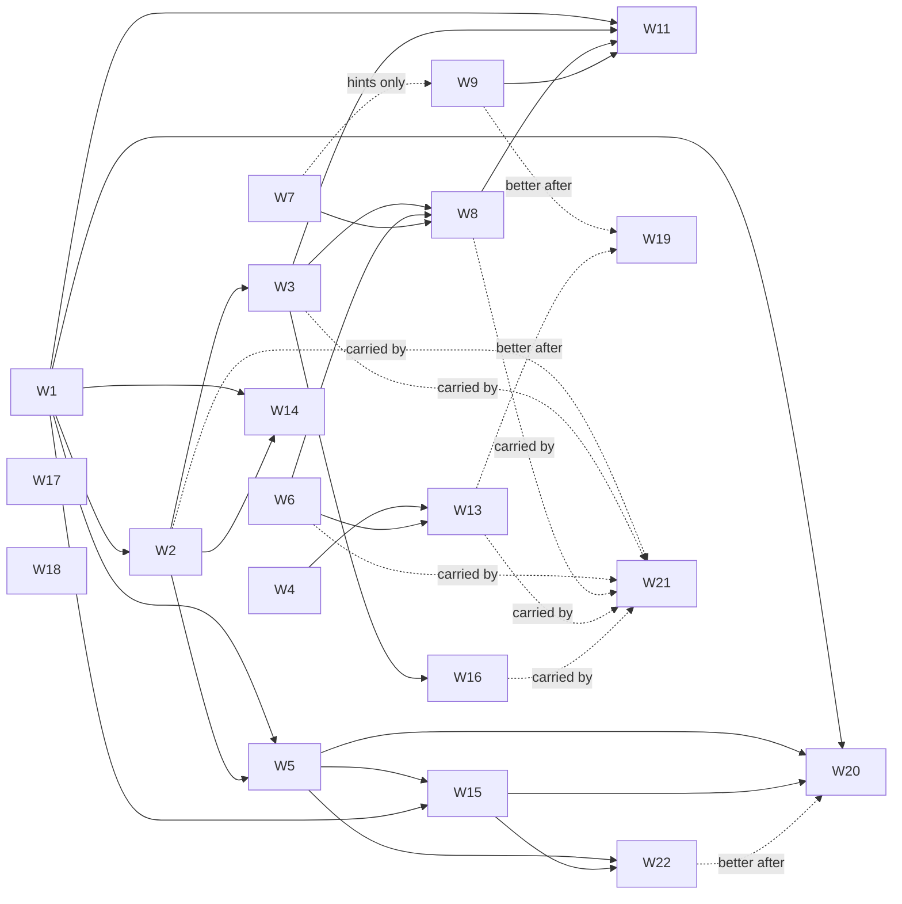

# Waves: the owner's list of 2026-11-17

Status: **planning**. All questions of the owner's question file (now deleted; its content is in the wave files and in "Cross-cutting questions and answers" below) are answered and applied: Parts 0, A and C (2026-11-18 and 2026-11-19) and Part B (Waves 1 to 3 on 2026-11-19; Waves 4 to 15 on 2026-11-20). On 2026-11-20 the owner decided that dp reads code by search, pinned key code and one generic regex reader for the major languages, not per language, and moved architecture drift to the ideas list; Waves 5, 6 and 7 were rewritten and Waves 4, 8, 9, 11, 13, 14, 15 and 20 adjusted. Waves 1 to 9, 11 to 22 are planned; 10 and 12 are parked. Waves 17 to 20 were added from the product vision. Wave 21 (the static export) was added on 2026-11-20 from the owner's answer D1 (DEC-100).

**Where things stand (2026-11-20).** **No wave is built.** The product itself is the work of the changelog up to 0.6.0 (the model, canvas, drafts, hub, System Testing, checklist, linked work, import and BMO); the 0.6.0 release change (version in `package.json` and the README, which still say 0.5.0, a tag) is not made yet (DEC-098). What the owner still owes before the waves can start cleanly: **nothing is open** (see ["Open questions" in decisions.md](../decisions.md#open-questions-and-the-ids-of-answered-ones)). The scope of 1.0.0 was decided item by item on 2026-11-20 (D4, [DEC-104](../decisions.md); the review file `v1-scope-review.md` was deleted and its content moved to DEC-104, [../product-vision.md](../product-vision.md) and [../planned_features.md](../planned_features.md) A8). The import and large-codebase questions N1 to N15 are recorded in DEC-103. Answered on 2026-11-20 and recorded in DEC-100 and DEC-101: D1 (the static export is in 1.0.0: Wave 21), D2 (local accounts now, hosted later), D5 (open a local file stays), D6 (credentials always encrypted), D7 (the release steps are in [../CONTRIBUTING.md](../CONTRIBUTING.md#making-a-release)), D9 (one branch per session) and D15 (build the "needs a look" alignment with the next code change).

**Read first:** [../product-vision.md](../product-vision.md) (what 1.0.0 is: software architecture only, twelve features, not an IDE) and DEC-104 in [../decisions.md](../decisions.md) (what is built or planned outside that line, and what was decided for each item). Then, for the import waves (5, 15, 20), [../import-design.md](../import-design.md): what the import is for, what matters to C4 at each level, and what the scan cannot see yet. For what exists today and what is only planned: [../planned_features.md](../planned_features.md); for how to check the built product by hand: [../manual-test-plan.md](../manual-test-plan.md).

This folder turns the owner's list of 2026-11-17 into **waves**. A wave is one branch of work that one agent runs from start to finish, handing parts to subagents. Each wave has its own file. This file is the index: the order, the rules every wave follows, who does what, and where each item of the list went.

"System design" and "system architecture" mean the same thing in these files.

## How to use this folder

1. **Answer.** The questions of each wave are in that wave's file ("Questions, options and answers"); all are answered and applied, and the owner's words are the record. What is left to answer, if anything, is in [decisions.md](../decisions.md#open-questions-and-the-ids-of-answered-ones). A question left blank uses its recommendation.
2. **Apply.** Tell Claude which answers to apply. Claude then:
   - rewrites the Design section of each wave from your answers and fills in its "Owner answers" section;
   - records the cross-cutting answers in this file, and the ones that are project decisions as DEC entries in [../decisions.md](../decisions.md);
   - **keeps every wave file until its wave is built**; then the wave file is replaced by a review file (step 4 and "Closing a wave" below; owner, 2026-11-20);
   - commits `docs/` by path on a branch from `main`.
3. **Run.** Open a new Claude Code session in the repository and paste the wave's start prompt (the last section of each wave file). Run the waves in the order below. Review and merge a wave's branch before you start the next one that depends on it.
4. **Close.** When a wave is built and its checks pass, the wave agent writes `wave-NN-review.md` and **deletes the wave file** (`wave-NN-<slug>.md`), as set out in "Closing a wave" below. The row in the table stays and links to the review file.

The next free decision number is the one after the highest DEC id in `decisions.md` (**DEC-106** on 2026-11-20; DEC-090 to DEC-105 are taken). Check the file when a wave starts: never reuse a number written in these plans, and expect parallel sessions to add entries.

`docs/determinism.md`, which every wave adds rows to, does not exist yet: Wave 1 writes it.

## The waves

The order below is the owner's accepted order (answer A3, 2026-11-19), grouped by release. Sizes compare the waves with each other; L may be split by the wave agent at the split point its file names.

| # | Wave | What it builds | Feature (vision) | Depends on | Size | Release | Status |
|---|---|---|---|---|---|---|---|
| 1 | [Grounded BMO answers](wave-01-grounded-bmo.md) | Fixed prompt templates per situation, fixed context packs, citations that dp checks, labels on everything BMO writes, `docs/determinism.md`. The evaluation set is deferred (ideas list I2.0) | L | none | M–L | 0.7.0 | Answers applied; ready |
| 2 | [Notes, context and help](wave-02-notes-context-help.md) | Sticky notes stored in the model (stuck to objects or diagrams), a Notes page, safe Markdown, BMO always reads notes and comments, BMO without an LLM (search and fixed commands, behind a setting), `dp context` for coding agents, help about dp | E, L | 1 | M–L | 0.7.0 | Answers applied; ready after Wave 1 |
| 3 | [Reference library and ADRs](wave-03-reference-and-adrs.md) | The owner's curated library of patterns and anti-patterns (project and hub), an opt-in starter set, decision links (web, repository, a file on your own computer) and a Compliance section; the page stays "Decisions" | G, K | 2 | M | 0.7.0 | Answers applied; ready after Wave 2 |
| 16 | [Images and files](wave-16-attachments.md) | A content-addressed attachment store; images and files on notes, comments, decisions and diagrams; type allowlist; BMO gets a list and redacted text files, never the contents of images, PDFs or Office files; or a reference to a file on your own computer (opens in the default app) instead of a copy | E | 2, 3 | M–L | 0.7.0 | Answers applied (C4, C5, Q3.5) |
| 4 | [Roles, data and variants](wave-04-roles-data-variants.md) | Conditions on lines and A/B variants as grouped flows (C4 modelling). **The data half** (CRUD letters, role × data matrix) is kept (DEC-104, P4) | A (data half: outside the vision's line, kept by the owner's answers) | none | M | 0.7.0 | Answers applied (2026-11-20): CRUD letters (an old write becomes C, U and D), matrix, variants; ready |
| 5 | [Code search, key code and one generic reader](wave-05-code-search.md) | Find a function, class or file name in the code with no LLM (offline BMO `where`, `dp find --code`), with definitions marked; a component's **key code** (main files and functions) pinned by a person, checked by dp, or proposed by BMO and verified; **one generic regex reader** (a pattern table for the major languages) replaces the Python and JS/TS readers. No per-language code, no Maven or Gradle, no file roles | H, L | 1, 2 | M–L (split point: search and key code 5a, generic reader 5b) | 0.8.0 | Rewritten 2026-11-20 (revised the same day); ready after Waves 1 and 2 |
| 15 | [Guided import interview](wave-15-guided-import-interview.md) | Importing a codebase: the scan makes every deterministic call, then a "question x of y" interview asks the rest. The questions depend on the codebase, there are always at least 6 per level, and the person can add notes, context and file references. Includes the "main files and functions" card per component. Number 15 is an id, not a place in the order | H | 5, 1 | L (split point: interview 15a, BMO-proposed cards 15b) | 0.8.0 | Answers applied (2026-11-20); ready after Waves 5 and 1 |
| 6 | [Findings and acknowledgements](wave-06-findings.md) | One Finding shape, acknowledgements stored in the model, the warnings dp already makes as the first findings, a Findings page. **Drift is parked in the ideas list** | L, B | none | M | 0.9.0 | Rewritten 2026-11-20; ready |
| 7 | [Model metrics](wave-07-metrics.md) | Ca, Ce, instability and cycles computed from the model's own lines, per level, for main, a draft or a git version; a panel section, an overlay, `dp metrics`. No code is read; LCOM, complexity, abstractness and distance are not built | L | none | S–M | 0.9.0 | Rewritten 2026-11-20; ready |
| 8 | [Rules and presets](wave-08-rules-and-presets.md) | One rule registry (the checklist's rules move into it), presets a team switches on, anti-pattern detectors dp runs itself on the model; never blocks a save | L | 3, 6, 7 | L | 0.9.0 | Answers applied; ready after Waves 3, 6 and 7 |
| 9 | [Characteristics table](wave-09-characteristics-table.md) | Needed vs current stars per system and container, compared across main, drafts, git versions and decisions (the "-ilities") | L | 7 (hints only) | M | 0.10.0 | Answers applied; ready after Wave 7 |
| 11 | [BMO reviews](wave-11-bmo-reviews.md) | The "check against anti-patterns" button, a check of decisions ("ADR broken or violated"), proposed ratings: cited, labelled, written only on request. The risk parts wait for Wave 10 | L | 1, 3, 8, 9 | M | 0.10.0 | Answers applied; ready after Wave 9 |
| 13 | [Contracts and consumer notifications](wave-13-contracts.md) | A contract on what a service sends, fingerprints, who consumes it, breaking changes by direction, "needs a look" for the consumer, `dp contracts` | F | 4, 6 | M–L | 0.11.0 | Answers applied; ready after Waves 4 and 6 |
| 14 | [Local runtimes and the word index](wave-14-retrieval-local-models.md) | Local runtimes first-class (OpenAI-compatible local servers, GPU share as Ollama reports it, bounded runtime settings, setup notes) and a BM25 word index for choosing context, also used by offline BMO's free-text search, with language-neutral chunks. No embeddings, no vector file, no native GPU code. Depends only on Waves 1 and 2, so it can move earlier | L | 1, 2 | M | 0.11.0 | Answers applied; ready after Waves 1 and 2 |
| 17 | [Architecture commits](wave-17-architecture-commits.md) | Commit `architecture/` from dp, with a built message: a Commit button, `dp commit`, and an opt-in "commit when a draft is applied". Never pushes. Amends DEC-018 | I | none | M | 0.10.0 | Answers applied; ready |
| 18 | [Drafts that keep up with main](wave-18-drafts-keep-up.md) | Rebase a draft onto the current main, a merge editor for conflicts, undo of an apply that brings the draft back | C | none | M–L (split: 18a rebase and editor, 18b undo) | 0.10.0 | Answers applied; ready |
| 19 | [Lenses for the roles around an architect](wave-19-lenses-for-roles.md) | Built-in DevOps, Security and Business lenses next to Engineer, Architect and Overview | D | none (better after 9 and 13) | S–M | 0.10.0 | Answers applied; ready |
| 20 | [A real back-and-forth about an existing system](wave-20-system-conversation.md) | BMO and the person talk in rounds: dp plans rounds from the size and tangle of the model and code folders, each round is previewed and returns cited statements and questions, more questions as the code grows, the person's answers carry forward; plus a checklist item | H, L | 1, 5, 15 | L (split: 20a loop, 20b actions) | 0.11.0 | Answers applied; ready after Wave 15 |
| 21 | [Static HTML export](wave-21-static-export.md) | `dp export html`: a read-only snapshot of one project that opens with no server (a folder for a web host or for opening from disk, and a single file for an email attachment, from one second UI build target), a review report that lists what will leave the machine and refuses secret-looking values, byte-stable output, CI examples. Added from the owner's answer D1 | — (sharing; supports B, E) | none hard; run last, so it carries what Waves 2, 3, 6, 8, 9, 13, 16 add | M–L (split: 21a folder and review, 21b single file and CI examples) | 0.12.0 (DEC-102, DEC-103) | Planned 2026-11-20 (D1, DEC-100; D16 to D19, DEC-102); ready after Wave 20 |
| 22 | [Digests for large codebases](wave-22-digests.md) | Cached per-container and per-component digests in `architecture/import/digests/`: a computed part with a hash of the files it was built from, a labelled BMO summary on top, stale digests listed and never rebuilt silently, use in runs instead of re-reading the code, and `dp context --write` for an agent instructions file (only on request, never over a file dp did not write). Added from N13 (DEC-103) | L | 5, 15 (Wave 2 for step 6) | M–L (split: 22a computed, 22b summary, UI, context file) | 0.11.0 | Written 2026-11-20; ready after Waves 5 and 15 |
| 10 | [Risk and risk storming](wave-10-risk-storming.md) | Risks per part and characteristic, the assessment grid, a computed risk overlay, private scoring sessions | none | 9 | M | — | **Parked** (owner, A7): moved to the ideas list |
| 12 | [Runtime](wave-12-runtime-telemetry.md) | Traces and System Testing runs added up: busy, slow and failing lines, chatty and repeated calls, cycles, deep chains, A/B split from flag events | none (runtime) | 4, 6, 8 | M | — | **Parked** (owner, A7): moved to the ideas list |
| — | *Architecture drift* | Model ↔ code comparison, found / not found / not checkable, "update the model from code", `dp drift`. **Moved to ideas list I2.2 for the owner to review later** (2026-11-20) | H | — | M–L | — | Parked (owner) |
| — | *Deployment diagrams* | *Decided earlier (DEC-019, DEC-022) but infrastructure: after 1.0.0 (owner, 2026-11-20, DEC-104, P1)* | none | — | L | — | Later (ideas list I1) |
| — | *System Testing, traces and the demo system off by default* | Not a wave: one switch (`dp serve --testing`) and `dp serve --demo --with-system`, docs and tests ([planned_features.md](../planned_features.md) A8). Added from the scope decision B3, B4, B7 (DEC-104) | none (non-goal) | none | S–M | 0.7.0 group | Accepted 2026-11-20; not built |

"Feature" is the letter of the twelve features in [../product-vision.md](../product-vision.md). Waves 10 and 12 map to none of them.

Solid arrows are hard dependencies, dashed arrows are "better after". Waves 17 and 18 stand alone. Wave 21 has no hard dependency; it is run last so that it is built once against the final shape of the data it carries. Waves 10 and 12 are parked and left out of the graph. Wave 10 followed Wave 9; Wave 12 followed Waves 4, 6 and 8.

**Built:** none of these waves. Every row above is planned, parked or waiting for the owner; the Status column says whether its owner answers are applied.

Waves 4, 6 and 7 depend on nothing in this list and can move earlier or later. Wave 5 now needs Waves 1 and 2 (its search is a command of offline BMO). Wave 7 reads the model only, so it no longer waits for Waves 5 and 6.

**Run order:** 5, 15 (0.8.0), then 6, 7, 8 (0.9.0). In 0.11.0, Wave 22 runs before Wave 20, which uses its digests. **Wave 21 runs last**, after the waves of 0.11.0.

## Releases

Owner, 2026-11-20: every release before 1.0.0 is a `0.X.Y` version with no ceiling on X (DEC-098; this replaces the earlier rule that kept all releases inside 0.5.x). A group of waves that adds features raises X (SemVer minor); a group that only fixes raises Y. `0.6.0` is the work already built and tested (the model, canvas, System Testing, checklist and linked work of the changelog). Grouped releases (answer A8):

| Release | After | What the owner gets |
|---|---|---|
| 0.7.0 | Waves 1, 2, 3, 16, 4 (and A8) | Cited BMO answers, notes and help, the reference library, ADRs, images and files, conditions and variants; System Testing off by default |
| 0.8.0 | Waves 5, 15 | Code search and key code, the guided import interview (the import release, DEC-103) |
| 0.9.0 | Waves 6, 7, 8 | Findings and acknowledgements, model metrics, rules and presets |
| 0.10.0 | Waves 9, 11, 17, 18, 19 | The characteristics table, BMO reviews (anti-patterns, decisions), architecture commits, rebase and merge editor, DevOps, Security and Business lenses |
| 0.11.0 | Waves 13, 14, 22, 20 | Contracts, local runtimes and the word index, digests for large codebases, the back-and-forth about an existing system |
| 0.12.0 | Wave 21 | The static HTML export (its own release: it is a publishing feature with its own review step; DEC-102) |
| 1.0.0 | The 1.0 checklist (ideas list I2.0) | The twelve features |

- A wave agent does not bump the version and does not write to `docs/CHANGELOG.md`. The release is its own small change after the last wave of its group, once the group is built and tested: version in `package.json`, README, and a new `## [x.y.z] - Month - DD - YYYY` section in the CHANGELOG written from what shipped. The CHANGELOG never lists planned or unreleased work. The full procedure (branch, checks, merge, tag, GitHub release) is [Making a release](../CONTRIBUTING.md#making-a-release) in CONTRIBUTING.md (DEC-100).
- If a later review adds waves, each joins the group it fits or adds the next `0.X.0` number. The one piece of work outside the waves, A8 (System Testing off by default), is done in the 0.7.0 group before its release change.

## Rules for every wave agent

**Code**
- Everything is TypeScript. Every model edit goes through `src/core/modelEdits.ts`. API shapes live in `src/shared/types.ts`.
- New per-object data is a `dp.*` property, unless a DEC in that wave adds an exception to CLAUDE.md's list.
- Text a person or the repository wrote reaches BMO only inside data blocks, never in system text (`tests/unit/bmo-core.test.ts:89` checks this).
- BMO output is labelled in the UI and in review files only, never stored as a label in the model (DEC-051, DEC-064).

**Required in every wave** (each wave file lists its own cases)
- Every new non-GET route gets a `ROUTE_RULES` entry in `src/server/auth.ts`. A route without one is architect-only, and a test fails (`tests/unit/auth.test.ts:733-734`).
- Works in a hub with per-project roles (DEC-057) and with `--read-only`.
- New model data is handled in `src/core/modelUnits.ts`, gets labels in `src/core/diff.ts`, merges in a three-way merge, and shows in the change list and `dp diff`.
- Output is byte-stable: the same input gives the same file, twice. Paths work on Windows.
- New UI can be reached with the keyboard.
- New routes and outbound calls are added to the security model in `docs/CONTRIBUTING.md`.
- The wave says what the static export includes (DEC-024, [Wave 21](wave-21-static-export.md)); Wave 21 collects these lines in one table, so update its table when a wave's line changes.

**Git and checks**
- Branch `feat/wNN-<slug>` from `main` after the previous wave is merged. Commit by path. Never push. Never run `git stash`.
- Never run `prettier --write` on docs (they are in `config/prettierignore`). Use `npm run format` for code.
- While working: `npm run ci -- --quick`. After committing: the full `npm run ci`. Its checks that `static/`, `demo/` and `tests/TESTS.csv` are unchanged since the last commit only pass once the built files are committed.
- After UI changes: `cd ui && npm run build`, and commit `static/`. After model, ops or demo changes: `npm run make-demo`, and commit `demo/`. After adding or renaming tests: `npm run test:list`.

**Docs** (every wave)
- A new DEC at the end of its topic in `docs/decisions.md`, numbered with the next free number. Never reuse a number written in these plans.
- Nothing in `docs/CHANGELOG.md` (it lists released versions only). Keep the notes for the release entry in the wave's review file ("Notes for the release entry"); the release change turns them into the changelog section. Where a wave file's Docs step still says "CHANGELOG", read it this way.
- The wave's review file, written when the wave is complete, and the deletion of the wave file ("Closing a wave" below). Where a wave file says "a section at the top of `docs/reviews.md`", read: the review file.
- The code map in `.claude/CLAUDE.md`, the feature list in `README.md`, and `docs/planned_features.md` and the ideas list.
- Rows for the wave's outputs in `docs/determinism.md` (from Wave 1 on).
- Delete a wave file only as part of closing its wave, after its review file exists (owner, 2026-11-20, replacing the rule of 2026-11-19 that no planning file is deleted). Never delete a file of a wave that is not built, a parked wave (10, 12), this README, or any other planning file. `questions.md` and `v1-scope-review.md` were deleted at the owner's request on 2026-11-20, after their content was moved.

**Writing in repository files**
- Name file formats and integration targets where needed. Do not name or compare competing products.
- Separate facts (with a source) from interpretation ([Proposal]), as the other docs do.

**Stop and ask** when a wave file's "Stop and ask if" condition is met, when an owner answer the wave needs is missing, or when a change would contradict a DEC that the wave does not amend.

## Closing a wave

Do this **only when the wave is complete**: everything its file lists is built, `npm run ci` passes, `/code-review` (and `/security-review` where the wave says so) is done and its findings are fixed or named. If a wave has a split point (for example 5a and 5b), it is complete only when both parts are built; until then keep the wave file and write "5a built" in the Status column of the table. If anything is unfinished, say so and stop: do not write the review file.

Then, on the wave's branch, in this order:

1. **Write `docs/waves/wave-NN-review.md`** with the same number as the wave file (`wave-01-review.md` for `wave-01-grounded-bmo.md`). Facts carry a source (a file, a test, a command, a DEC); [Proposal] marks interpretation. Sections:
   - **Header table:** wave number and name, release, branch, merge commit and date (or "not merged yet"), size as built against the size planned.
   - **What was built:** by feature, with the files and routes added, and the DEC ids written for it.
   - **How it was checked:** the commands run and their results, the test files and counts added, what `/code-review` and `/security-review` found and what was done with each finding, and what was checked by hand in the browser or demo.
   - **Differences from the wave file:** what was dropped, changed or added, and why. Any "Stop and ask" that fired and its answer.
   - **Limits and not verified:** what the wave does not do, what was written but never run (for example a Windows path), and which rows to add to `docs/manual-test-plan.md`.
   - **Notes for the release entry:** the lines the release change turns into the CHANGELOG section (built, tested and working only).
   - **Questions for the owner** and an empty **Owner feedback** part.
   - **Questions, options and answers:** the whole section of that name from the wave file, copied word for word. It is the only place where the options considered, their trade-offs and the owner's words survive once the wave file is gone.
2. **Update the other docs the wave changes**, as the "Docs" rules above say. In this README, set the wave's row to "Built" with a link to the review file, and update the "Built:" line. In `docs/manual-test-plan.md`, move the wave's features out of section 27 ("Not built yet") and add their rows. Update `docs/determinism.md` rows and `docs/planned_features.md`.
3. **Delete the wave file** with `git rm docs/waves/wave-NN-<slug>.md`. Never delete anything else here.
4. **Fix every link to the deleted file.** Run `grep -rn "wave-NN-<slug>" --exclude-dir=node_modules --exclude-dir=.git .` and change each match: a link to the wave's design becomes a link to the review file, or to the DEC that now records the decision. Other wave files that name this wave in "Depends on" keep the wave number and link to the review file. Then check that no markdown link in `docs/` is broken. A DEC or document that quoted the wave file's text keeps the quote and links the review file.
5. **Commit by path** (the review file, the deletion, the link fixes and the doc changes), never with `git add -A` or `.`. Do not push, merge or tag.

What is never done: the wave agent does not write the CHANGELOG or change the version (the release change does, after the last wave of its group), does not delete a wave that is only partly built, and does not rewrite the owner's answers when copying them.

## Agents and models

The owner asked (2026-11-14, 2026-11-16) to split work across models to save usage while keeping quality.

| Who | Agent type | Model | Used for |
|---|---|---|---|
| The wave agent | the main session | as started | Writes each subagent's brief (files and line ranges, "never run git stash", "never push"), reviews every diff, runs the checks, runs `/code-review` (high) and, where the wave says so, `/security-review` |
| Re-anchor | Explore | Haiku | At the start: confirm the `file:line` anchors in the wave file still match `main`, and report what moved |
| Design check | Plan | Opus | Only when the wave file says the design is still open after the owner's answers |
| Hard parts | general-purpose | Opus | Security, sign-in and roles, outbound calls, merge and data-loss logic, the first pass of an algorithm that is not settled |
| Building | general-purpose | Sonnet | Well-specified implementation, UI and tests. Fixture tests are written by a different subagent from the one that wrote the code |
| Paperwork | general-purpose | Haiku | README feature list, CLAUDE.md map, the review-file skeleton, the TESTS.csv check (the CHANGELOG is written by the release change, not by a wave) |

- **No limit on the number of agents** (owner, 2026-11-19, replacing the earlier limit of 3). Use as many as the work needs, but not for a small task. Give parallel agents separate files. Several Opus agents at once use the usage limit fastest; the owner accepts that.
- Only **one agent at a time builds the UI or runs browser tests**, because parallel builds overwrite `static/`. This is a technical limit, not a usage rule.
- When an agent is cut off, resume it with SendMessage rather than starting again. Give follow-up fixes, with precise briefs, to Sonnet.
- **Fable is never used** (owner, 2026-11-19).
- **When in doubt, the larger model** (owner, 2026-11-19): if a step could go to either of two models, use the larger (Haiku → Sonnet, Sonnet → Opus). The models in the wave files are the starting point; this rule overrides them where a step is not clearly simple.

## Determinism classes

Accepted by the owner (answer A4, 2026-11-19). Every result dp shows carries one of these:

| Class | Meaning | Example |
|---|---|---|
| **computed** | From files, the model or traces by fixed rules. Same input, same output. | Search results, instability from the model's lines, a file named in key code that no longer exists |
| **approximate** | Computed by a rule known to miss cases, and shown with what it misses | Complexity counted from tokens, LCOM without a full parser |
| **heuristic** | A rule of thumb, shown as a hint, never as a fact | A component whose name ends in "Manager" (Entity Trap) |
| **proposed** | Written by BMO, labelled until a person accepts it. Once accepted it is that person's | Names and descriptions in an import, BMO's anti-pattern review |

Wave 1 writes `docs/determinism.md` with these classes and one row per feature. Every later wave adds its rows.

## Where each item went

The owner's list of things to build (2026-11-17):

| # | Item (shortened) | Where |
|---|---|---|
| 1 | Architecture drift detection | **Parked** (owner, 2026-11-20): ideas list I2.2. Wave 6 builds only the Finding shape and acknowledgements. Contract changes are Wave 13; runtime drift was Wave 12 (parked) |
| 2 | LLM explanations grounded in actual code and docs | Wave 1 |
| 3 | A note for each object at each level, easy to see | Wave 2 (sticky notes in the model, Notes page, `dp context`) · Q2.1–Q2.3; images and files in Wave 16 |
| 4 | A reference notes section curated by the owner (patterns, anti-patterns) | Wave 3 · Q3.1–Q3.3 |
| 5 | How A/B testing and conditional services work in C4 | Explained in [Wave 4](wave-04-roles-data-variants.md#questions-options-and-answers-moved-from-questionsmd) (0.1). Modelled in Wave 4; the observed split would have been Wave 12 (parked) |
| 6 | Metrics such as LCOM and instability | Wave 7 · Q7.1: instability, coupling and cycles from the model. LCOM, complexity, abstractness need function bodies and field use that regexes read badly, so they are not built (report import is an idea, ideas list I2.5) |
| 7 | Characteristics star table: current vs needed, by a person or an LLM, compared across planned changes | Wave 9 (table, comparisons). BMO proposals in Wave 11 |
| 8 | How config files and common functions such as `tools.py` show up | Explained in [import-design.md](../import-design.md) section 9 (0.2). Owner, 2026-11-20: dp does not map `tools.py` and similar; a C3 component shows its **main files and functions** (Wave 5, key code) |
| 9 | Better fixed context prompts, never written by an LLM | Wave 1 · [questions 0.6](wave-01-grounded-bmo.md#questions-options-and-answers-moved-from-questionsmd) |
| 10 | Risk analysis such as risk storming | Wave 10 (**parked**, answer A7; ideas list I2.3) |
| 11 | Where LLM false positives and negatives appear; which levels are guesses | Explained in [import-design.md](../import-design.md) section 8 (0.3). `docs/determinism.md` in Wave 1. The owner's answer to 0.3 (deterministic first, then ask the user) is Wave 15 |
| 12 | LLM use is fine where determinism is impossible, but called out | The determinism classes (★A4) and BMO's labels (Wave 1), followed by every wave |
| 13 | An ADR section where each decision can have files or info attached | Wave 3 (Decisions page keeps its name; links, Compliance) · Q3.4–Q3.6; files and local-file references in Wave 16 |
| 14 | More languages, such as Java | Answered by generality (2026-11-20): no code per language. Wave 5 finds a name in any language as plain text and reads imports and definitions with one regex pattern table for the major languages (Java included, approximately); no Maven or Gradle reading |
| 15 | GPU acceleration (CUDA, MPS) where it applies | Explained in [Wave 14](wave-14-retrieval-local-models.md#questions-options-and-answers-moved-from-questionsmd) (0.4); owner chose local runtimes first-class. Wave 14 (no native GPU code) |
| 16 | A vector DB for faster LLM processing | Explained in [Wave 14](wave-14-retrieval-local-models.md#questions-options-and-answers-moved-from-questionsmd) (0.5); owner chose the word index only. Wave 14 (no vectors) |
| 17 | BMO answers questions about designPerspectives itself | Wave 2 (help corpus, search, help task) |
| 18 | Architecture validation and presets | Wave 8 |
| 19 | When A's output changes, tell B (which reads it), in the UI | Wave 13 |
| 20 | Roles and actions such as CRUD per role, and what each role sees | Wave 4 (roles in the modelled system, as the owner chose) |
| 21 | Anti-patterns tracked through telemetry or other ways | Wave 8 (from the model; code-level checks are BMO, Wave 11). Telemetry: Wave 12 (**parked**, answer A7; ideas list I2.7) |
| 22 | A button that asks BMO to test the codebase or design against the chosen anti-patterns | Wave 11 |

The product vision of 2026-11-19 adds twelve features. Where each is built or planned:

| | Feature | Built / planned |
|---|---|---|
| A | C4 modelling | Built; Wave 4 (conditions, variants) |
| B | Single source of truth | Built; the `dp.*` rule in every wave |
| C | Change proposals | Built (drafts); Wave 18 (rebase, merge editor, undo restores the draft) |
| D | Lenses incl. DevOps | Mechanism built, three lenses; Wave 19 adds DevOps, Security, Business |
| E | Collaboration, notes, images, files | Comments built; Waves 2, 3, 16 |
| F | Contracts between services | Wave 13 |
| G | ADR page | Built as Decisions; Wave 3 |
| H | Codebase importing | Built; Waves 5 (code search, key code), 15, 20. Drift is parked |
| I | Git-style commits | History built (read-only); Wave 17 adds commits |
| J | GitHub, SonarQube, Jira | Built (DEC-085 to DEC-088) |
| K | Shared catalog | Built (DEC-054 to DEC-057); Wave 3 for the library |
| L | BMO | Built; Waves 1, 2, 5 (find code, key code), 6, 7, 8, 9, 11, 14, 20 |

The owner's list of things to think about later, all in the ideas list:

| Idea | Where in the ideas list |
|---|---|
| Importing draw.io and Lucidchart diagrams | I2.1 |
| A UI redesign, drawn by hand | I2.8 |
| Trade-offs that change over time | I2.3 |
| Extensibility, architecture vitality | I2.3 |
| How system design reviews are done | I2.4 |
| Code reviews and test coverage through the tool | I2.4 |
| Debugging through dp compared with an editor's debugger | I2.7 |
| Risk analysis | I2.3 (the first cut, Wave 10, is parked) |
| Is creating C4 from a codebase an LLM-only job? | I2.0 (facts in [import-design.md](../import-design.md) section 8). Owner's answer: make all deterministic calls, then ask the user (Wave 15) |
| A checklist for release 1.0.0 | I2.0 |
| Data drift | I2.2 |
| **Product vision (most important)** | Answered 2026-11-19: [../product-vision.md](../product-vision.md), DEC-090 |
| Anti-patterns from telemetry | I2.7 (the first cut, Wave 12, is parked) |
| Where to put people (language mix, compliance) | I2.4 (language mix per object is no longer built) |
| TOGAF | I2.0 |

## Cross-cutting questions and answers (moved from questions.md)

*Moved from the deleted `questions.md` on 2026-11-20, with the owner's words as written. In the quotes, `future_tasks.md` and `backlog.md` mean the old backlog, now [planned_features.md](../planned_features.md) and the owner's private ideas list. The questions of each wave, with their options and answers, are in the wave files (the section "Questions, options and answers"); the explanations of questions 0.2 and 0.3 are in [import-design.md](../import-design.md); A1 is in [product-vision.md](../product-vision.md); A5 and A6 are in Waves 6 and 1.*

### How the answers were given and applied

The owner answered in four rounds: Parts 0, A and C (2026-11-18 and 2026-11-19), Waves 1 to 3 of Part B (2026-11-19), then Waves 4 to 15 (2026-11-20, Q5.8 later the same day). A question left blank used its recommendation. Facts carry a source (a `file:line`, a DEC, a line of the book notes in [../notes/](../notes/), or a web page checked on 2026-11-17); [Proposal] marks an interpretation or recommendation; [Training] marks model knowledge that was not re-checked.

**What changed the plan, Waves 1 to 3 (2026-11-19):**

- **Q1.3:** the evaluation set leaves Wave 1 for the ideas list.
- **Q2.1:** sticky notes become architecture data that BMO reads.
- **Q2.2:** BMO always sees notes.
- **Q2.5:** BMO works without an LLM, behind a setting.
- **Q3.4:** the page stays "Decisions".
- **Q3.5:** links in Wave 3; files in [Wave 16](wave-16-attachments.md); and a reference to a file on your own computer instead of a copy.

**Exceptions that held while the other questions were blank (2026-11-19):**

- **Q4.1 to Q4.3:** the data half of Wave 4 (CRUD letters, the role × data matrix) is on the review list (P4). Their recommendations hold if you keep it. **Answered 2026-11-20: kept.**
- **Q10.x and Q12.x:** the waves are parked (A7); their recommendations are kept for when they return.
- **Q11.2:** "add as a risk" is dropped while Wave 10 is parked. Q11.1 gains a decisions review (feature L, "ADR violated").
- **Q13.1:** still asks you before a YAML dependency is added.
- **Q5.4:** option 1 (Java as test fixtures only), as recommended. **Superseded 2026-11-20:** no Java at all (Q5.1, Q5.2).

**What changed the plan, Waves 4 to 15 (2026-11-20):**

- **Q4.1:** an old `write` becomes C, U and D at once; no `W`.
- **Q4.1 to Q4.3 answered:** the data half of Wave 4 is kept.
- **Q5.1, Q5.2, Q5.5, Q5.8:** code is searched, and read by one generic regex reader for the major languages; key code instead of file roles. Q5.3, Q5.4, Q5.6, Q5.7 follow (no Maven or Gradle, no Java samples, no config facts, no hash cache).
- **Wave 6:** drift parked (ideas list I2.2); Findings and acknowledgements stay.
- **Wave 7:** model coupling only (Q7.1 to Q7.4).
- **Q8.x, Q9.x, Q11.x, Q13.x, Q14.x:** your best-thinking answers hold the recommendations, with the follow-on changes noted per question. **Q13.1:** JSON only, no YAML dependency.
- **Q10.x, Q12.x:** the waves are parked.
- **Q15.1 to Q15.5:** the interview depends on the codebase, has a floor of 6 questions per level, adds notes, context and file references, and saves locally.

**Three answers that reached beyond their own wave (2026-11-20):**

- **dp reads code by search and by one generic regex reader, not per language** (Q5.1, Q5.2, Q5.5, then Q5.8). [Wave 5](wave-05-code-search.md) becomes "Code search, key code and one generic code reader": offline name search that marks definitions, a component's main files and functions, and a table of patterns for the major languages that replaces the Python and JS/TS readers. File roles, config facts, Maven and Gradle reading are not built, and [Wave 7](wave-07-metrics.md) measures the model. Recorded as DEC-096.
- **Architecture drift moved to ideas list I2.2.** [Wave 6](wave-06-findings.md) keeps only the Finding shape and acknowledgements that Waves 8, 11 and 13 need. Recorded as DEC-097.
- **Wave 4's data half is kept**: you answered Q4.1 to Q4.3, and that was read as overruling the scope review's "later" for P4, and the owner then kept it (DEC-104). An old `write` now becomes C, U and D at once.

### ★A2. Where do the waves go relative to the order you decided earlier?

**Why it matters.** planned_features B2 holds an order you decided: deployment diagrams, then the small batch, then the static HTML export (DEC-019, DEC-022, DEC-024, DEC-028).

**Analysis**
- Canary and blue/green releases (Waves 4 and 12) need deployment diagrams, and so does drift per environment.
- The static export must decide what it includes (notes, risks, attachments). That is easier after Waves 2, 3 and 10.

**Options**
1. The waves after the earlier order.
2. The waves first, then the earlier order.
3. Interleave: Waves 1 to 11, then deployment diagrams, then Waves 12 to 14, then the small batch and the static export.

**Recommended.** Option 3, recorded in a new DEC that amends DEC-028's order.

**Owner's thinking:** Go with whatever you think is best.

**Applied [2026-11-19].** Option 3 (interleave), adjusted by the vision. Deployment diagrams are infrastructure, so they leave the order for now and wait for your decision on item P1 of the scope review (decided 2026-11-20: after 1.0.0, DEC-104). The small batch (P2) no longer waits behind them (kept). The static export (P3) was recommended for after 1.0.0 too; the owner put it before 1.0.0 (D1, Wave 21). This amends the order in DEC-028; DEC-090 records it.

### ★A3. Is this wave order right?

**Analysis** [Proposal]
- **Wave 1 first.** It changes no file format, it hardens the 8 BMO tasks that exist, and every later BMO feature needs its citation check and labels.
- **Waves 2 and 3 next.** They are cheap and visible, and Wave 11 needs the reference library.
- **Wave 4 is independent.**
- **Two chains:** 5 → 6 → 7 → 8, and 9 → 10 → 11.
- **The last three:** 12 and 13 come after drift's Finding shape; 14 is gated.

**Alternatives**
- Visible features first: Waves 2, 3, 4 and 9, then Wave 1.
- Drift first: Waves 5 and 6, then the rest.

The cost of building BMO features before Wave 1 is redoing their prompts later.

**Recommended.** The order in [README.md](README.md).

**Owner's thinking:** Go with whatever you think is best.

**Applied [2026-11-19].** The order in [README.md](README.md), with three changes from your other answers: Wave 16 (images and files) goes after Wave 3; Waves 10 and 12 are parked (A7); and Wave 15 sits with Waves 5 to 8, after 5. The README has the release each wave belongs to.

### ★A4. Determinism classes on every result?

**Analysis.** You asked for as much determinism as possible, and for LLM use to be called out. One small vocabulary, used everywhere, does both:

| Class | Meaning |
|---|---|
| **computed** | Same input, same output |
| **approximate** | Computed, with known misses shown |
| **heuristic** | A hint |
| **proposed** | BMO's, labelled until accepted |

`docs/determinism.md` (Wave 1) lists every feature and its class. Every wave adds rows. The cost is one more label in the UI.

**Recommended.** Yes, recorded in a DEC.

**Owner's thinking:** Go with whatever you think is best.

**Applied [2026-11-19].** Yes. The four classes are in [README.md](README.md#determinism-classes). Wave 1 writes `docs/determinism.md` and the DEC that records them, as its file says.

### A7. Items that are in both of your lists

**Analysis.** "Risk analysis" and "anti-patterns through telemetry" appear in both the build list and the think-later list.

**Recommended**
- The waves build a first cut: risk storming in Wave 10, telemetry rules in Wave 12.
- the ideas list keeps the wider questions: continuous risk tracking; logs and metrics as well as traces.

**Owner's thinking:** Push these to future_tasks.md.

**Applied [2026-11-19].** Read as: risk analysis and anti-patterns through telemetry are not built in this plan. So **[Wave 10 (risk storming)](wave-10-risk-storming.md) and [Wave 12 (runtime)](wave-12-runtime-telemetry.md) are parked**: their files stay in this folder, marked "Parked", and their ideas are in ideas list (I2.3 and 2.7, and section 1.0). Knock-on changes: Wave 11 loses "add as a risk" and the `suggest-risks` task; Wave 4's note about the observed A/B split goes to the ideas list; the Risk tag group and trade-off risks stay as they are. The owner confirmed this reading on 2026-11-19 (C6b: do not build either for 1.0).

### A8. Releases

**Options**
1. A release after every wave.
2. Grouped releases:

   | Release | After |
   |---|---|
   | 0.6.0 | Waves 1–4 |
   | 0.7.0 | Waves 5–8 |
   | 0.8.0 | Waves 9–11 |
   | 0.9.0 | Waves 12–14 |
   | 1.0.0 | The 1.0 checklist (ideas list I2.0) |

Fewer releases mean fewer release chores, but longer waits for an installable version.

**Recommended.** Option 2.

**Owner's thinking:** Releases should all be within 0.5.x.

**Applied [2026-11-19].** Grouped releases, numbered inside 0.5.x until 1.0.0: **0.5.1** (Waves 1, 2, 3, 16, 4), **0.5.2** (Waves 5, 6, 15, 7, 8), **0.5.3** (Waves 9, 11), **0.5.4** (Waves 13, 14), then **1.0.0** when the 1.0 checklist (ideas list I2.0) is met. If more waves join after your review (Part C, the scope review), they add a 0.5.x number, not a 0.6. The table is in [README.md](README.md#releases).

**Applied again [2026-11-20].** The owner lifted the 0.5.x limit: releases are `0.X.Y` with no ceiling on X (DEC-098). The groups are now **0.7.0** (Waves 1, 2, 3, 16, 4), **0.8.0** (5, 15, 6, 7, 8), **0.9.0** (9, 11, 17, 18, 19) and **0.10.0** (13, 14, 20), then 1.0.0; 0.6.0 is the work already built. The older lines above are kept as the record of 2026-11-19.

### A9. Agent models

**Recommended.** As you asked on 2026-11-14:
- Opus for unsettled design, security and merge logic;
- Sonnet for well-specified building;
- Haiku for docs.

Each wave file names the model for each step. Fable is used only if you ask.

**Owner's thinking:** Fable will not be used; the rest is fine. Choose the bigger model rather than the smaller if on the fence.

**Applied [2026-11-19].** Fable is never used (it was "only if asked"; now not at all). When a step could go to either of two models, it goes to the larger: Sonnet becomes Opus, Haiku becomes Sonnet. Steps in the wave files keep their listed model; the rule in [README.md](README.md#agents-and-models) applies when a step is in doubt.

### A10. Deleting these planning files

**Recommended**
- `questions.md` is deleted once its answers live in the wave files or DECs.
- Each wave file is deleted when its reviews.md section lands. CLAUDE.md says not to commit superseded plans, and commit 47b33a2 did the same with the earlier questions file.
- The alternative is to keep these files in the git-ignored `local/`.

**Owner's thinking:** Keep questions.md for now, and the relevant .md files in docs/. I will choose what to delete before the 1.0 release.

**Applied [2026-11-19].** Nothing is deleted when a wave ships or when answers are applied. [README.md](README.md) no longer says to delete `questions.md` or each wave file. The owner deletes planning files before 1.0.0. (CLAUDE.md's "do not commit superseded plans" is left as it is; this is a standing owner exception for `docs/waves/` until then.)

**Applied [2026-11-20] (second change).** The owner then changed the rule for built waves: when a wave is complete, the agent writes `wave-NN-review.md` and deletes the wave file ("Closing a wave"). DEC-105.

**Applied [2026-11-20].** The owner asked for `questions.md` to be deleted. Before that, everything relevant in it was moved: the questions of each wave, with options, trade-offs and answers, into that wave's file (section "Questions, options and answers"); questions 0.2 and 0.3 into [import-design.md](../import-design.md); A1 into [product-vision.md](../product-vision.md); the cross-cutting answers here. The wave files still stay until the owner deletes them before 1.0.0.
